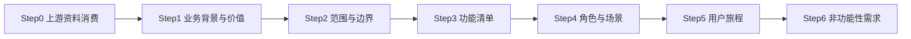

# AICoding 架构设计 · UserStory

> 本文档为《AICoding 架构设计》核心产物之一，定位为**产品需求与用户故事（UserStory）模版**。
> 上游输入：《高层架构设计》中的需求概要、行业调研、业务架构、产品原型；
> 下游输出：驱动《系统设计》《部署设计》《安全设计》的具体功能实现。

> **工具说明**：复用《高层架构设计》的部分结果产物（需求边界、产品模块全景图、功能清单、产品原型）。
> **重构语境说明**：本期为既有代码（LearningViewModel.kt 2443 行）的模块化瘦身与架构解耦重构，模板章节按重构语境适配——"产品原型"适配为 delegate 组件代码结构原型，"用户旅程"适配为 delegate 迁移故事与验收标准。

---

## 0. 元信息：修订记录

```yaml
标题: Nemo - LearningViewModel 模块化瘦身重构 - UserStory v0.1
版本: v0.1
状态: Draft   # Draft | Reviewing | Approved | Deprecated
创建日期: 2026-10-29
最后更新: 2026-10-29
作者: product-story-designer（顾全景）
评审人:
  - team-lead（主理人）
  - 用户（G4 UserStory 审核门审核人）

关联文档:
  上游输入:
    - 高层架构设计: .workbuddy/output/高层架构设计.md（G3 已通过，用户方案获批）
    - 资料摘要: .workbuddy/output/material_digest.md（G1 已通过，D1~D10 + X1~X10）
    - 行业调研报告: .workbuddy/output/research_report.md（G2 已通过）
  下游产出:
    - 系统设计: 由 system-architect（高见远）并行产出
    - 部署设计: N/A（纯代码变更，无部署拓扑变化）
    - 安全设计: N/A（纯代码变更，无安全边界变化）
```

| 版本 | 日期 | 作者 | 变更内容 | 评审状态 |
| --- | --- | --- | --- | --- |
| v0.1 | 2026-10-29 | product-story-designer（顾全景） | 初稿，覆盖 §1~§6 全部章节，16 条 UserStory（US1~US12 MVP + US13~US16 第二阶段），每条按七段式展开 | Draft |

> **版本管理纪律**：破坏性变更（章节结构调整 / 关键决策反转）升 MAJOR；新增章节、扩充内容升 MINOR。

---

## 1. 业务背景与价值

### 1.1 业务背景

- **当前业务现状（产品 / 用户规模）**：Nemo 是一款专为日语学习者设计的灵动词汇学习 App，技术栈为 Kotlin + Jetpack Compose + MVI + Hilt + Coroutines/Flow + Room + Supabase，采用模块化分层架构（`:app` + `:core(common/domain/data/designsystem/ui)` + `:feature(collection/learning/library/statistics/test/user/settings)`）。学习模块（`feature/learning`）是 Nemo 的核心业务模块，承担评分、队列调度、撤销、计时、TTS、设置监听等全部学习交互逻辑。终端学习者通过 Compose UI 页面消费 `LearningUiState` StateFlow 并通过 `onEvent(LearningEvent)` 发送交互事件。
- **触发本次需求的事件（痛点修复）**：学习模块核心文件 `LearningViewModel.kt` 已膨胀至 2443 行，承担 12 类职责（事件分发、设置监听、会话编排、评分管线、队列调度、撤销管理、卡片操作、计时结算、TTS、反馈、模式切换、导航），构造参数达 21 个，init 块含 18+ 个 Flow collector，是典型的 God ViewModel。任何功能修改需通读全文定位逻辑，评分管线 530 行跨越 6 个方法且无独立测试，Word/Grammar 双模式存在大量同构重复代码。该痛点已严重制约维护效率与测试覆盖可行性。
- **本系统在产品矩阵中的位置**：本次重构是 Nemo App `feature/learning` 模块内部的代码级重构，不涉及产品功能变更。重构后 `LearningViewModel` 对外接口（`StateFlow<LearningUiState>` + `onEvent(LearningEvent)`）保持完全不变，与 `feature/library`、`feature/statistics`、`feature/settings` 等上下游模块的交互接口零改动。

### 1.2 行业方案

> 同类功能、痛点的行业标杆系统及解决方案。以下整合自《高层架构设计》§3 行业调研结论（G2 已通过）。

| 标杆系统 | 厂商 / 来源 | 场景覆盖 | 借鉴点 | 适用度 |
| --- | --- | --- | --- | --- |
| B1 Android Architecture Blueprints | Google（官方） | Android App 架构模式展示（TODO App） | Compose + ViewModel per screen + Flow + Hilt + 单 Activity 标准范式 | 高 |
| B2 Now in Android（NiA） | Google（官方） | 生产级 Android App（新闻聚合）完整架构示例 | 三层架构（data/domain/UI）+ UDF + StateFlow sealed interface + Hilt + 模块化（Nemo 重构目标范式） | 高 |
| B3 Orbit MVI | Orbit MVI 社区 | MVI 状态管理框架（Android/iOS/桌面） | ContainerHost 委托模式思想（状态管理委托给独立容器，解决 ViewModel 职责拆分）+ intent/reduce/sideEffect 三分离 + 内外部状态分离 | 高 |

**方案组合**（来自高层架构 §3.2 加权打分结论）：B2 三层架构基线 + B3 ContainerHost 委托模式（不引入 Orbit 框架，借鉴委托思想自研 delegate 组件），覆盖目标架构基线 + domain use cases 方向验证 + ViewModel 内部职责委托拆分模式。否决 B4 Mavericks（3.30）与 B5 MVIKotlin（3.15），因两者违背"零破坏性重构"核心约束。

### 1.3 方案收益与价值

| 项 | 说明 |
| --- | --- |
| 功能模块 | LearningViewModel 拆分为薄编排层 + 7 个 delegate 组件（SettingsDelegate / SessionLifecycleDelegate / RatingDelegate / QueueNavigationDelegate / UndoDelegate / CardOpsDelegate / StatsTimerDelegate）+ StateUpdater 统一状态更新接口 |
| 预期价值收益 | **效率（可维护性）**：单文件行数 2443→≤400，单类职责数 12→1（编排调度），构造参数 21→≤8；**成本（可测试性）**：delegate 组件可独立单元测试，RatingDelegate 单测覆盖率 ≥ 80%；**体验（行为不变）**：重构后行为 100% 一致，行为契约测试 100% 通过 |
| 量化标准 | LearningViewModel.kt 行数 ≤ 400 行；职责数 = 1（编排调度）；构造参数 ≤ 8 个；RatingDelegate 单测覆盖率 ≥ 80%；行为契约测试通过率 100%（覆盖评分防抖 100ms / 导航防抖 400ms / 跨天重置 / Learn Ahead Limit / 撤销恢复全部关键时序场景） |

### 1.4 术语清单

> 统一文档中专有名词的中英文对照与含义，与 `system-architect` 术语表对齐。

| 术语 | 英文 / 代码标识 | 含义 |
| --- | --- | --- |
| 委托组件 | delegate | 承担单一职责域的独立类，通过 Hilt @Inject 注入，通过 StateUpdater 接口更新 _uiState。本期新建 7 个 delegate |
| 统一状态更新接口 | StateUpdater | delegate 通过此接口更新 _uiState（而非直接持有 MutableStateFlow 引用），解决多 delegate 并发写入问题。LearningViewModel 实现 |
| 事件路由表 | onEvent routing | 保持 onEvent(LearningEvent) 签名不变，内部改为 when 分发到对应 delegate 方法 |
| 薄编排层 | thin orchestration layer | LearningViewModel 重构后的形态，仅持有 _uiState + delegate 调度 + onEvent 路由，≤ 400 行 |
| 评分防抖 | rating debounce | RATING_DEBOUNCE_MS=100L，用户快速连续评分时 100ms 内的第二次评分被忽略（material_digest D1 §2） |
| 导航防抖 | navigation debounce | NAVIGATION_DEBOUNCE_MS=400L，用户快速滑动时 400ms 内的第二次导航被忽略（material_digest D1 §2） |
| 显示答案边界容差 | show answer grace | SHOW_ANSWER_GRACE_MS=150L，倒计时到点仍允许显示答案的容差窗口（material_digest D1 §2） |
| Learn Ahead Limit | learn ahead limit | 队列全部冷却时，允许在提前复习容差（默认 20 分钟）内继续学习（material_digest D9 §5） |
| Leech 钉子户 | leech | 失败次数达到阈值（默认 5 次）的卡片，按 _leechAction 处置：skip（暂停）或 bury_today（埋到次日）（material_digest D9 §5） |
| 行为契约测试 | behavior contract test | 验证重构后行为与重构前 100% 一致的测试，覆盖评分防抖/导航防抖/跨天重置/Learn Ahead/撤销恢复等关键时序场景 |
| God ViewModel | god viewmodel | 承担过多职责的单个 ViewModel 类，本期重构目标 LearningViewModel.kt（2443 行/12 职责/21 参数）即典型 |
| FSRS 算法 | fsrs algorithm | Free Spaced Repetition Scheduler，Nemo 使用的间隔重复算法，由 SrsCalculator 服务提供 |
| MVI | mvi | Model-View-Intent，Nemo 采用的状态管理范式：单一不可变状态源（LearningUiState）+ 单一事件入口（onEvent） |
| UDF | udf | Unidirectional Data Flow，单向数据流，Nemo 采用的状态流转范式 |

---

## 2. 范围与边界

### 2.1 系统内模块及功能

> 一级功能清单。本期系统内模块及功能完整继承自《高层架构设计》§6.1 In-Scope（F1~F12 + N1~N2）与 §6.3 功能清单（F1~F18）。

**MVP 范围（第一阶段，P0）**：

| 编号 | 模块 | 功能项 |
| --- | --- | --- |
| F1 | SettingsDelegate | 设置监听与写入——init 块 18+ Flow collector + toggle/cycle/set 系列方法迁移 |
| F2 | SessionLifecycleDelegate | 会话生命周期编排——startLearning/startBonusLearning/loadWord/GrammarSession/handleSessionLoadResult 迁移 |
| F3 | RatingDelegate | 评分核心管线——rate/applyLapsePenalty/handleScheduleResult/processSrsUpdate/processRelearningGraduation/persistRatingItemAsync 迁移 |
| F4 | QueueNavigationDelegate | 队列调度与导航——reQueue/resumeFromWaiting/removeCurrentAndMoveNext/handleSelectionResult/navigateNext/Prev/To 迁移 |
| F5 | UndoDelegate | 撤销管理——saveUndoSnapshot/undo/syncUndoAvailability 迁移 |
| F6 | CardOpsDelegate | 卡片管理操作——handleLeech/suspendCurrentItem/buryCurrentItem/suspendItem 迁移 |
| F7 | StatsTimerDelegate | 计时与会话结算——completeSession/syncTodayCounts/pauseTimer/resumeTimer 迁移 |
| F8 | StateUpdater 接口 | 统一状态更新——delegate 通过此接口更新 _uiState，解决并发写入 |
| F9 | onEvent 事件路由表 | 事件路由重构——保持 onEvent 签名不变，内部改为 when 分发到 delegate |
| F10 | LearningViewModel 薄编排层 | 编排层瘦身——持有 _uiState + delegate 调度，≤ 400 行 |
| F11 | 接口兼容保障 | StateFlow + onEvent 签名不变，Compose UI 零改动 |
| F12 | 行为契约测试 | 覆盖评分防抖/导航防抖/跨天重置/Learn Ahead/撤销恢复 |
| N1 | 行为契约测试覆盖率 | 评分防抖/导航防抖/跨天重置/Learn Ahead Limit/撤销恢复全部覆盖，100% 通过 |
| N2 | delegate 组件可独立单元测试 | 每个 delegate 可脱离 ViewModel 独立测试，≥ 80% 覆盖率（第二阶段目标） |

**第二阶段范围（P1）**：

| 编号 | 模块 | 功能项 |
| --- | --- | --- |
| F13 | loadWordSession/loadGrammarSession 泛型合并 | Word/Grammar 会话加载统一（X6） |
| F14 | processSrsUpdate/processRelearningGraduation 合并 | SRS 更新与重学毕业统一（X4） |
| F15 | buryCurrentItem/handleLeech 合并 | 卡片埋藏统一（X5） |
| F16 | StatsManager 改 DI | DI 一致性改造——@Inject constructor + @ApplicationContext（X2） |

**完整版范围（P2，推迟）**：

| 编号 | 模块 | 功能项 |
| --- | --- | --- |
| F17 | 自动翻面配置统一 | Word/Grammar 自动翻面参数化（X3） |
| F18 | 遗留字段清理 | selectedLevel/NoMoreWords/sessionQueue/sessionCorrectCount（X7~X10） |

### 2.2 系统外模块及功能

> 当前系统**不覆盖**的功能，及其原因。完整继承自《高层架构设计》§6.1 Out-of-Scope（O1~O9）。

| 编号 | 不做的事 | 原因 | 后续计划 |
| --- | --- | --- | --- |
| O1 | 不改业务逻辑/状态流转/边界条件/异常处理 | 用户诉求核心约束 1："100% 保持既有业务逻辑、状态流转、边界条件及异常处理行为，严禁增删改功能分支" | 永不做（约束基线） |
| O2 | 不改 LearningEvent sealed interface（含 30+ 事件定义） | 改事件模型会影响 UI 层调用方，违背核心约束 2"对外接口与调用方兼容"；R7 自动翻面统一涉及事件改造推迟至完整版 | 完整版 R7 评估 |
| O3 | 不改 LearningUiState data class 字段定义（含 40+ 字段） | 改状态字段会影响 Compose UI 层消费方，违背核心约束 2；R8 遗留字段清理推迟至完整版 | 完整版 R8 评估 |
| O4 | 不改 UI 层（Compose 页面与导航） | 用户诉求核心约束 2："保证外部 UI 层依赖的公开状态和交互方法签名保持平滑兼容" | 永不做（约束基线） |
| O5 | 不改数据层（Repository/UseCase/Room/Supabase） | 重构范围限定在 ViewModel 内部职责拆分，数据层不在本次范围 | 不做（超出范围） |
| O6 | 不引入第三方 MVI 框架（Orbit/MVIKotlin/Mavericks） | research_report.md 否决结论：B4（3.30）+ B5（3.15）违背零破坏性约束；B3 借鉴委托思想但不引入框架本身 | 永不做（范式迁移成本过高） |
| O7 | 不决定数据库表结构 | 归 system-architect 职责（product-story-designer 不越权） | Phase 4 system-architect |
| O8 | 不处理遗留字段（X7 selectedLevel / X8 NoMoreWords / X9 sessionQueue / X10 sessionCorrectCount） | 遗留字段清理涉及 UI 层和数据层验证，建议在委托化拆分完成、测试覆盖充分后单独处理 | 完整版 R8 |
| O9 | 不统一 Word/Grammar 自动翻面配置（X3） | 涉及 LearningEvent sealed interface 改造 + settings Flow 合并，影响面较大 | 完整版 R7 |

### 2.3 外部依赖

> 完整继承自《高层架构设计》§5.2 系统依赖架构。本期重构不新增外部系统依赖，所有依赖均为现有 Nemo 项目内部模块。

| 依赖系统 | 提供方 | 依赖能力 | 接入方式 | 接口人 |
| --- | --- | --- | --- | --- |
| LearningQueueManager | feature/learning/domain（D8 §1） | 队列调度（sortAnkiStyle/reorderQueueAnkiStyle/selectNextItem/removeCurrent） | @Inject constructor | 维护开发者 |
| LearningScheduler | feature/learning/domain（D8 §2） | 评分调度（scheduleFailure/schedulePass） | @Inject constructor | 维护开发者 |
| SessionLoader | feature/learning/domain（D8 §3） | 泛型会话加载（loadSession 泛型约束 SrsItem） | @Inject constructor | 维护开发者 |
| LearningSessionPolicy | feature/learning/domain（D8 §4） | FSRS 策略（partitionOverdueItems/mixSessionItems） | @Inject constructor（被 SessionLoader 间接调用） | 维护开发者 |
| LearningSessionStatsManager | feature/learning/domain（D8 §5） | 统计计时（checkAndRestoreOrReset/resumeTimer/pauseTimer/onItemRated/completeSession） | 直接 new（X2，第二阶段改 @Inject + @ApplicationContext） | 维护开发者 |
| LearningTtsManager | feature/learning/domain（D8 §6） | TTS 朗读（speakWord/speakExample/observeTtsEvents/stop） | @Inject constructor | 维护开发者 |
| LearningUndoHelper | feature/learning/domain（D8 §7） | 撤销快照（saveSnapshot/popSnapshot/canUndo/clear） | @Inject constructor | 维护开发者 |
| SrsIntervalPreview | feature/learning/domain（D8 §8） | SRS 间隔预览（calculate 返回 Map 映射 quality 到间隔文本） | @Inject constructor | 维护开发者 |
| SettingsRepository | core/data | 设置读写（Flow 读取 + suspend 写入） | @Inject constructor | 维护开发者 |
| WordRepository / GrammarRepository | core/data | 词库/语法库 CRUD | @Inject constructor | 维护开发者 |
| StudyRecordRepository | core/data | 学习记录（今日新学/复习/重学计数） | @Inject constructor | 维护开发者 |
| SrsCalculator（Service） | core/domain | FSRS 算法计算 | @Inject constructor | 维护开发者 |
| 5 个 Word UseCase + 5 个 Grammar UseCase | core/domain | 单词/语法查询 | @Inject constructor | 维护开发者 |
| ContentReportRepository | core/data | 内容错误反馈 | @Inject constructor | 维护开发者 |
| CloudBackupManager | core/data | 云端备份 | @Inject constructor | 维护开发者 |
| ReviewLogRepository | core/data | 复习日志记录 | @Inject constructor | 维护开发者 |
| Compose UI 页面（LearningScreen 等） | feature/learning/presentation | 消费 uiState StateFlow + 调用 onEvent | StateFlow collect + 方法调用 | 维护开发者 |
| Compose 导航（Navigation Compose） | feature/learning/presentation | 导航事件消费 | 方法调用 | 维护开发者 |
| Hilt DI 基础设施 | feature/learning/di（D7） | delegate 组件通过 @Inject 注入 | @Inject constructor + LearningModule | 维护开发者 |

---

## 3. 功能清单

> **定位**：全景骨架表，进入"角色 / 场景 / US"之前先看到完整功能版图。与《高层架构设计》§6.3 功能清单互查一致。

### 3.1 功能清单结构

| 编号 | 一级模块 | 二级模块 | 功能项 | 优先级（P0/P1/P2） | MVP 范围 | 完整版范围 | 对齐目标 | 备注 |
| --- | --- | --- | --- | --- | --- | --- | --- | --- |
| F1 | SettingsDelegate | 设置监听 | init 块 18+ Flow collector 迁移 | P0 | ✅ | ✅ | V1 | 监听深色模式/图标风格/Streak/Leech/每日目标/步进/提前学习/自动朗读/显示答案等待/自动翻面等 |
| F1 | SettingsDelegate | 设置写入 | toggle/cycle/set 系列方法迁移 | P0 | ✅ | ✅ | V1 | 8 个 toggle/cycle/set 方法，Word/Grammar 通过 isGrammar 参数或完全分离 |
| F1 | SettingsDelegate | 显示答案延迟装填 | armShowAnswerDelay 迁移 | P0 | ✅ | ✅ | V1 | 计算冷却锁定期与延迟期取最大值 |
| F2 | SessionLifecycleDelegate | 会话启动 | startLearning 迁移 | P0 | ✅ | ✅ | V1 | 清撤销→设 Loading→获取 dailyGoal/completedToday→loadSavedSession→loadSession→handleSessionLoadResult |
| F2 | SessionLifecycleDelegate | 加餐学习 | startBonusLearning 迁移 | P0 | ✅ | ✅ | V1 | ReviewBacklog/NewItems 双模式 |
| F2 | SessionLifecycleDelegate | 会话加载 | loadWordSession/loadGrammarSession 迁移 | P0 | ✅ | ✅ | V1 | MVP 暂保留双份，第二阶段 F13 合并 |
| F2 | SessionLifecycleDelegate | 加载结果处理 | handleSessionLoadResult 迁移 | P0 | ✅ | ✅ | V1 | Restored/NewSession/Completed 三分支 |
| F2 | SessionLifecycleDelegate | 模式切换 | changeLearningMode 迁移 | P0 | ✅ | ✅ | V1 | 切换后立即触发新模式会话加载 |
| F2 | SessionLifecycleDelegate | 退出学习 | exitLearning 迁移 | P0 | ✅ | ✅ | V1 | 重置全部状态 |
| F3 | RatingDelegate | 评分入口 | rate 迁移 | P0 | ✅ | ✅ | V1 + V2 | 防抖+按 quality 分支调度 |
| F3 | RatingDelegate | 失败惩罚 | applyLapsePenalty 迁移 | P0 | ✅ | ✅ | V1 + V2 | 纯内存计算不写库 |
| F3 | RatingDelegate | 调度结果处理 | handleScheduleResult 迁移 | P0 | ✅ | ✅ | V1 + V2 | Leech/Graduate/Requeue 三分支 |
| F3 | RatingDelegate | SRS 更新 | processSrsUpdate 迁移 | P0 | ✅ | ✅ | V1 + V2 | MVP 暂保留，第二阶段 F14 合并 |
| F3 | RatingDelegate | 重学毕业 | processRelearningGraduation 迁移 | P0 | ✅ | ✅ | V1 + V2 | MVP 暂保留，第二阶段 F14 合并 |
| F3 | RatingDelegate | 异步持久化 | persistRatingItemAsync 迁移 | P0 | ✅ | ✅ | V1 + V2 | Dispatchers.IO 后台写库+计数+日志 |
| F3 | RatingDelegate | 间隔预览 | calculateRatingIntervals 迁移 | P0 | ✅ | ✅ | V1 + V2 | 委托 SrsIntervalPreview |
| F3 | RatingDelegate | 当前项获取 | getCurrentItem 迁移 | P0 | ✅ | ✅ | V1 + V2 | 按模式构建 LearningItem |
| F4 | QueueNavigationDelegate | Anki 重入队 | reQueueAtRelativeOffset 迁移 | P0 | ✅ | ✅ | V1 | 对齐 Anki 卡片重入队 |
| F4 | QueueNavigationDelegate | 等待恢复 | resumeFromWaiting 迁移 | P0 | ✅ | ✅ | V1 | 强制全部到期后重选 |
| F4 | QueueNavigationDelegate | 移出当前 | removeCurrentAndMoveNext 迁移 | P0 | ✅ | ✅ | V1 | 移出已毕业卡片 |
| F4 | QueueNavigationDelegate | 选择结果处理 | handleSelectionResult 迁移 | P0 | ✅ | ✅ | V1 | Empty/Wait/Next 三分支+Learn Ahead 检测 |
| F4 | QueueNavigationDelegate | 导航 | navigateNext/navigatePrev/navigateTo 迁移 | P0 | ✅ | ✅ | V1 | 导航防抖 400ms |
| F4 | QueueNavigationDelegate | 队列徽章 | updateQueueBadgeCounts 迁移 | P0 | ✅ | ✅ | V1 | 统计 NEW/LEARNING/REVIEW/RELEARN 数量 |
| F4 | QueueNavigationDelegate | 会话持久化 | saveSessionState/saveCurrentSessionState/clearSession 迁移 | P0 | ✅ | ✅ | V1 | 按模式调 SettingsRepository |
| F5 | UndoDelegate | 快照保存 | saveUndoSnapshot 迁移 | P0 | ✅ | ✅ | V1 | 构建 UndoSnapshot 委托 LearningUndoHelper |
| F5 | UndoDelegate | 撤销执行 | undo 迁移 | P0 | ✅ | ✅ | V1 | 恢复数据库+内存 Map+UI 状态 |
| F5 | UndoDelegate | 可用性同步 | syncUndoAvailability 迁移 | P0 | ✅ | ✅ | V1 | 读取 canUndo 更新 uiState |
| F6 | CardOpsDelegate | 钉子户处理 | handleLeech 迁移 | P0 | ✅ | ✅ | V1 | bury_today/skip 二分支，MVP 暂保留，第二阶段 F15 合并 |
| F6 | CardOpsDelegate | 手动暂停 | suspendCurrentItem/suspendItem 迁移 | P0 | ✅ | ✅ | V1 | 持久化 isSkipped=true |
| F6 | CardOpsDelegate | 今日暂缓 | buryCurrentItem 迁移 | P0 | ✅ | ✅ | V1 | MVP 暂保留，第二阶段 F15 合并 |
| F7 | StatsTimerDelegate | 会话完成 | completeSession 迁移 | P0 | ✅ | ✅ | V1 | 设 SessionCompleted+clearSession+云端备份 |
| F7 | StatsTimerDelegate | 今日计数同步 | syncTodayCounts 迁移 | P0 | ✅ | ✅ | V1 | 从数据库安全同步今日新学/复习/重学数 |
| F7 | StatsTimerDelegate | 计时器 | pauseTimer/resumeTimer 迁移 | P0 | ✅ | ✅ | V1 | 委托 sessionStatsManager |
| F7 | StatsTimerDelegate | 跨天检查 | checkAndRestoreOrReset 迁移 | P0 | ✅ | ✅ | V1 | 委托 sessionStatsManager |
| F7 | StatsTimerDelegate | 显示答案 | showAnswer 迁移 | P0 | ✅ | ✅ | V1 | 前置检查+设状态+自动朗读+持久化 |
| F7 | StatsTimerDelegate | 语法详情 | toggleGrammarDetail 迁移 | P0 | ✅ | ✅ | V1 | 非 Learning 状态拒绝 |
| F7 | StatsTimerDelegate | 错误反馈 | handleReportError 迁移 | P0 | ✅ | ✅ | V1 | 关闭对话框+分类友好提示 |
| F8 | StateUpdater 接口 | 统一状态更新 | update { copy(...) } + currentState | P0 | ✅ | ✅ | V1 + V5 | delegate 通过此接口更新 _uiState |
| F9 | onEvent 事件路由表 | 事件路由 | when 分发到对应 delegate | P0 | ✅ | ✅ | V1 + V5 | 30+ 事件路由，签名不变 |
| F10 | LearningViewModel 薄编排层 | 编排层瘦身 | 持有 _uiState + delegate 调度 | P0 | ✅ | ✅ | V1 | ≤ 400 行 |
| F11 | 接口兼容保障 | StateFlow 不变 | uiState StateFlow 签名不变 | P0 | ✅ | ✅ | V5 | Compose UI 零改动 |
| F11 | 接口兼容保障 | onEvent 不变 | onEvent(LearningEvent) 签名不变 | P0 | ✅ | ✅ | V5 | Compose UI 与导航零改动 |
| F12 | 行为契约测试 | 重构安全验证 | 评分防抖/导航防抖/跨天重置/Learn Ahead/撤销恢复 | P0 | ✅ | ✅ | V5 | 100% 通过 |
| F13 | 会话加载泛型合并 | Word/Grammar 统一 | 合并为 1 个泛型方法（X6） | P1 | ❌ | ✅ | V3 | 第二阶段 |
| F14 | SRS 更新合并 | 重学毕业统一 | 抽取公共方法 + 差异化参数（X4） | P1 | ❌ | ✅ | V3 | 第二阶段 |
| F15 | 卡片埋藏合并 | 埋藏统一 | 抽取公共方法（X5） | P1 | ❌ | ✅ | V3 | 第二阶段 |
| F16 | StatsManager 改 DI | DI 一致性 | @Inject constructor + @ApplicationContext（X2） | P1 | ❌ | ✅ | V4 | 第二阶段 |
| F17 | 自动翻面配置统一 | Word/Grammar 参数化 | LearningEvent 改造 + settings Flow 合并（X3） | P2 | ❌ | ✅ | — | 完整版 |
| F18 | 遗留字段清理 | 废弃字段移除 | selectedLevel/NoMoreWords/sessionQueue/sessionCorrectCount（X7~X10） | P2 | ❌ | ✅ | — | 完整版 |

**硬指标自检**：
- 每个 P0 功能必须在 MVP 范围内为 ✅。✅ F1~F12 共 12 个 P0 功能全部 ✅ MVP。
- 每个功能必须能反向映射到《高层架构设计》§2.3 期待目标 + §2.5 功能缺口。✅ F1~F12（MVP 缺口，V1/V2/V5）、F13~F16（第二阶段缺口，V3/V4）、F17~F18（完整版，无 V 对齐标注"—"）。
- §3 功能清单与《高层架构设计》§6.3 功能清单互查一致。✅ 编号、优先级、MVP/完整版范围、对齐目标完全一致。

> **自检节点 1（§3 完成后）**：见附录 C §C.1 自检报告。

---

## 4. 角色与场景

### 4.1 角色清单

> 完整继承自《高层架构设计》§2.1 核心角色关注点。本期重构涉及 4 类角色：甲方决策者（用户）、维护开发者、测试工程师、终端学习者。

| 角色 | 业务身份 | 主要操作 | 核心关注点 | 来源 |
| --- | --- | --- | --- | --- |
| 甲方决策者（用户） | 项目负责人 / 需求方 | 审核重构方案、批准实施、验收 G3/G4/Gate | 零逻辑与语义变更——重构后学习行为 100% 不变 | 用户诉求核心约束 1 |
| 维护开发者 | Android 开发工程师 | 修改/扩展 LearningViewModel 功能、维护 delegate 组件、修复缺陷 | 单类行数与职责数可控——改一个功能不用通读 2443 行 | material_digest D1 §1（21 构造参数、12 类职责） |
| 测试工程师 | QA / 测试开发 | 编写/执行 LearningViewModel 相关测试、验证行为契约、覆盖 delegate 单测 | 可独立测试各职责域——不需要 mock 21 个依赖才能测一个 toggle | material_digest D1 §3（构造参数极度臃肿） |
| 终端学习者 | Nemo App 用户 | 使用学习功能（评分/翻面/导航/撤销/计时） | 重构后功能完全不变——学习进度/评分/撤销等行为无感知差异 | 用户诉求核心约束 2（对外接口与调用方兼容） |

**硬指标自检**：≥ 3 类（甲方决策者 / 最终用户 / 受影响方各至少一行）。✅ 共 4 类（甲方决策者 1 + 最终用户 2 + 受影响方 1），每行均有 Top1 关心点，与《高层架构设计》§2.1 完全对齐，无新增/细分角色。

### 4.2 关键场景清单

> 基于角色关注点与 delegate 职责域，列出本期重构需覆盖的关键场景。频率列针对终端学习者的实际使用频次。

| 编号 | 角色 | 触发条件 | 期望结果 | 频率（日均） |
| --- | --- | --- | --- | --- |
| S1 | 终端学习者 | 评分卡片（quality 0-5） | 评分防抖生效（100ms 内重复评分忽略）、按 quality 分支调度、UI 平滑切卡、数据持久化、撤销可用 | 高（核心路径，每次学习数十次） |
| S2 | 终端学习者 | 滑动导航（Next/Prev/GoToIndex） | 导航防抖生效（400ms 内重复导航忽略）、边界检查、UI 切卡动画、会话状态持久化 | 高 |
| S3 | 终端学习者 | 点击撤销 | 数据库+UI 状态+内存 Map 全部恢复、撤销可用性同步、BACKWARD 方向 | 中（误评时使用） |
| S4 | 终端学习者 | 跨天后恢复会话 | 统计清零重新计数、会话重新加载、completedToday 获取新值 | 低（每日 1 次） |
| S5 | 终端学习者 | 队列全部冷却时继续学习 | Learn Ahead Limit 容差内（默认 20 分钟）允许提前复习 | 中 |
| S6 | 终端学习者 | 评分触发 Leech 钉子户 | 按 _leechAction 处置（skip 暂停 / bury_today 埋到次日）、提示文案、移除当前并切卡 | 低 |
| S7 | 终端学习者 | 会话队列完成 | completeSession、设 SessionCompleted、clearSession、云端备份、展示结算战报 | 低（每日 1 次） |
| S8 | 终端学习者 | 切换学习模式（Word↔Grammar） | 立即触发新模式会话加载、armShowAnswerDelay 重算 | 中 |
| S9 | 终端学习者 | 修改设置（自动朗读/显示答案延迟/自动翻面等） | SettingsRepository Flow 发射、SettingsDelegate 实时更新 uiState、armShowAnswerDelay 重算延迟 | 中 |
| S10 | 终端学习者 | 显示答案 | 前置检查（Processing 拒绝/时间未到且超 grace 拒绝）、设状态、自动朗读、持久化 | 高 |
| S11 | 维护开发者 | 修改评分逻辑 | 仅修改 RatingDelegate，无需通读 LearningViewModel 全文 | 开发期 |
| S12 | 测试工程师 | 为 RatingDelegate 编写单测 | 可独立 mock 评分相关依赖（LearningScheduler/SrsCalculator/Repository），无需构造 21 个 ViewModel 依赖 | 开发期 |
| S13 | 甲方决策者（用户） | 验收 G4 UserStory | 行为契约测试 100% 通过、接口签名不变、LearningViewModel ≤ 400 行 | 验收期 |

**硬指标自检**：关键场景覆盖全部 4 类角色、覆盖全部 7 个 delegate 职责域、覆盖全部 5 条行为契约测试场景（评分防抖/导航防抖/跨天重置/Learn Ahead/撤销恢复）。

> **自检节点 2（§4 完成后）**：见附录 C §C.2 自检报告。

---

## 5. 用户旅程（UserStory）

> 本期重构共 16 条 UserStory：US1~US12 为 MVP 阶段（P0），US13~US16 为第二阶段（P1）。每条 US 按七段式展开（业务场景 / 业务流程 / UE 原型 / 业务逻辑 / 数据描述 / 验收标准 / 外部集成接口）。
>
> **重构语境适配说明**：
> - "业务场景"适配为 delegate 迁移场景（视角：维护开发者 / 测试工程师 / 终端学习者）。
> - "UE 原型"适配为 delegate 代码结构原型（无外部 Figma/Axure，本节为代码级重构）。
> - "业务逻辑"适配为 delegate 内部方法调用时序与状态流转。
> - "数据描述"适配为 delegate 迁移过程中的核心数据结构流转。
> - "外部集成接口"适配为 delegate 依赖的 domain 层 / Repository / UseCase。

### 5.1 US-1：SettingsDelegate 迁移（F1）

#### 5.1.1 业务场景

- **视角**：维护开发者 + 终端学习者
- **描述逻辑**：维护开发者需要将 LearningViewModel 的 init 块 18+ Flow collector 与 toggle/cycle/set 系列~260 行设置逻辑迁移到独立的 SettingsDelegate 组件。终端学习者在修改设置（自动朗读、显示答案延迟、自动翻面等）时，SettingsRepository Flow 发射，SettingsDelegate 实时监听并更新 uiState，armShowAnswerDelay 重算显示答案延迟，无需重启会话即可生效。

#### 5.1.2 业务流程

- **视角**：维护开发者
- **描述方式**：Given/When/Then 表述迁移流程

```
Given LearningViewModel.kt 含 init 块 18+ Flow collector（L155-335）+ toggle* 系列 8 个方法（L995-1080）+ armShowAnswerDelay（L1082-1102）共 ~260 行设置逻辑
When 维护开发者新建 SettingsDelegate 组件，将上述逻辑整体迁移
Then SettingsDelegate 承接全部设置监听与写入职责，LearningViewModel 不再直接持有设置逻辑，对外 onEvent(LearningEvent.Toggle*/Set*/Cycle*) 路由到 settingsDelegate 对应方法
```

#### 5.1.3 UE 原型

> delegate 代码结构原型（重构语境适配）。

```kotlin
class SettingsDelegate @Inject constructor(
    private val settingsRepository: SettingsRepository,
    // 协作 delegate 引用通过 init 注入或接口隔离
) {
    private lateinit var stateUpdater: StateUpdater
    // 协作 delegate 与内部状态通过 init 注入
    private var _showAnswerDelayMs: Long = 0L
    private var _learnAheadLimitMs: Long = 0L
    // ... 7 个可变配置变量

    fun init(stateUpdater: StateUpdater, /* 协作 delegate */) {
        this.stateUpdater = stateUpdater
        // 启动 18+ Flow collector（深色模式/图标风格/Streak/Leech/每日目标/步进/提前学习/自动朗读/显示答案等待/自动翻面）
    }

    fun toggleAutoPlayAudio(enabled: Boolean) { /* settingsRepository.setAutoPlayAudio */ }
    fun toggleShowAnswerDelay(enabled: Boolean) { /* isGrammar 参数区分 */ }
    fun cycleShowAnswerDelayDuration() { /* when 硬编码档位循环 2000→3000→4000→5000→2000 */ }
    fun setShowAnswerDelayMs(ms: Long) { /* ... */ }
    fun toggleAutoRevealAnswer(enabled: Boolean) { /* Word 专用 */ }
    fun cycleAutoRevealAnswerDuration() { /* ... */ }
    fun setAutoRevealAnswerMs(ms: Long) { /* ... */ }
    fun toggleGrammarAutoRevealAnswer(enabled: Boolean) { /* Grammar 专用 */ }
    fun cycleGrammarAutoRevealAnswerDuration() { /* ... */ }
    fun setGrammarAutoRevealAnswerMs(ms: Long) { /* ... */ }
    fun armShowAnswerDelay() { /* 计算冷却锁定期与延迟期取最大值 */ }
}
```

#### 5.1.4 业务逻辑

- **视角**：业务系统（delegate 内部时序）
- **描述方式**：设置变更实时生效的关键时序

```
1. SettingsRepository Flow 发射新值
2. SettingsDelegate init 块对应的 collector 接收
3. 模式判断（仅当 learningMode 匹配时更新，自动朗读/显示答案等待 Word/Grammar 分离）
4. StateUpdater.update { copy(对应配置字段 = 新值) }
5. 若影响显示答案延迟 → armShowAnswerDelay 重算：
   a. 前置检查（已显示答案/无待处理项/非 Learning 状态时清零返回）
   b. 计算当前卡片冷却锁定期（dueTime - now > learnAheadLimitMs 时 isCooling）
   c. delayTarget = isShowAnswerDelayEnabled ? now + showAnswerDelayMs : 0
   d. coolingTarget = isCooling ? dueTime : 0
   e. availableAt = max(delayTarget, coolingTarget)，写入 uiState.showAnswerAvailableAt
6. UI 自动响应 StateFlow 更新渲染
```

#### 5.1.5 数据描述

- **核心数据流转**：SettingsRepository Flow → SettingsDelegate collector → StateUpdater → _uiState（40+ 字段中的设置相关字段：isAutoAudioEnabled/isShowAnswerDelayEnabled/showAnswerDelayMs/showAnswerAvailableAt/isAutoRevealAnswerEnabled/autoRevealAnswerMs/isGrammarAutoRevealAnswerEnabled/grammarAutoRevealAnswerMs/isDarkMode/isWhiteboardEnabled/dailyGoal 等）
- **持久化数据**：toggle/cycle/set 系列方法委托 settingsRepository 持久化（suspend 写入）
- **内部状态变量**：7 个可变配置变量（_resetHour/_leechThreshold/_leechAction/_learningStepsConfig/_relearningStepsConfig/_learnAheadLimitMs/_showAnswerDelayMs）从 LearningViewModel 迁移到 SettingsDelegate 内部

#### 5.1.6 验收标准 AC

- **正常路径**：
  - Given 终端学习者在设置页关闭"自动朗读" When SettingsRepository.autoPlayAudioFlow 发射 false Then SettingsDelegate collector 接收 → StateUpdater 更新 uiState.isAutoAudioEnabled=false → UI 不再自动朗读
  - Given 终端学习者切换显示答案延迟档位 When 调用 onEvent(CycleShowAnswerDelayDuration) Then settingsDelegate.cycleShowAnswerDelayDuration() 执行 → when 硬编码档位循环（2000→3000→4000→5000→2000）→ settingsRepository.setShowAnswerDelayMs 持久化 → Flow 发射 → uiState.showAnswerDelayMs 更新 → armShowAnswerDelay 重算 showAnswerAvailableAt
  - Given 终端学习者在 Learning 状态下有冷却中的卡片 When armShowAnswerDelay 执行 Then availableAt = max(delayTarget, coolingTarget) 其中 coolingTarget = dueTime（卡片到期时间）
- **异常路径**：
  - Given Processing 状态下 When 调用 toggle* 方法 Then 设置仍可持久化但 uiState 更新可能被后续状态覆盖（行为与重构前一致，不引入额外保护）
  - Given 非学习状态（Idle/SessionCompleted）When armShowAnswerDelay 执行 Then 前置检查清零返回，uiState.showAnswerAvailableAt = 0L
  - Given SettingsRepository Flow 发射异常 When collector 接收异常 Then 异常按重构前行为处理（不崩溃，行为契约测试验证）

#### 5.1.7 外部集成接口

- **依赖：SettingsRepository**（core/data）：提供 18+ Flow 读取 + suspend 写入。接入方式 @Inject constructor。SettingsDelegate 全部设置监听与写入依赖此 Repository。
- **依赖：StateUpdater 接口**（本期新建）：SettingsDelegate 通过此接口更新 _uiState，而非直接持有 MutableStateFlow 引用。
- **协作：QueueNavigationDelegate / RatingDelegate / StatsTimerDelegate**：armShowAnswerDelay 需读取当前卡片 dueTime 与队列状态，通过协作 delegate 或接口隔离获取。

---

### 5.2 US-2：SessionLifecycleDelegate 迁移（F2）

#### 5.2.1 业务场景

- **视角**：维护开发者 + 终端学习者
- **描述逻辑**：维护开发者将 LearningViewModel 的会话启动/恢复/加载编排逻辑（startLearning/startBonusLearning/loadSavedSession/loadWordSession/loadGrammarSession/handleSessionLoadResult/changeLearningMode/exitLearning 共 ~470 行）迁移到独立的 SessionLifecycleDelegate。终端学习者在启动学习会话时，SessionLifecycleDelegate 编排加载流程：清撤销→设 Loading→获取 dailyGoal/completedToday→loadSavedSession→loadSession→handleSessionLoadResult。

#### 5.2.2 业务流程

```
Given LearningViewModel.kt 含 startLearning（L466-537）/startBonusLearning（L542-687）/loadSavedSession（L689-704）/loadWordSession（L706-749）/loadGrammarSession（L751-794）/handleSessionLoadResult（L796-961）/changeLearningMode（L2260-2277）/exitLearning（L2286-2294）共 ~470 行会话编排逻辑
When 维护开发者新建 SessionLifecycleDelegate，将上述方法整体迁移
Then SessionLifecycleDelegate 承接全部会话生命周期编排职责，LearningViewModel.onEvent(StartLearning/StartBonusLearning/ChangeLearningMode/ExitLearning) 路由到 sessionLifecycleDelegate 对应方法
```

#### 5.2.3 UE 原型

```kotlin
class SessionLifecycleDelegate @Inject constructor(
    private val sessionLoader: SessionLoader,
    private val wordRepository: WordRepository,
    private val grammarRepository: GrammarRepository,
    private val getNewWords: GetNewWords,
    private val getDueWords: GetDueWords,
    private val getLearningWords: GetLearningWords,
    private val getTodayLearnedWordsCount: GetTodayLearnedWordsCount,
    private val getNewGrammars: GetNewGrammars,
    private val getDueGrammars: GetDueGrammars,
    private val getLearningGrammars: GetLearningGrammars,
    private val getTodayLearnedGrammarsCount: GetTodayLearnedGrammarsCount,
    // 协作 delegate 通过 init 注入
) {
    private lateinit var stateUpdater: StateUpdater
    fun init(stateUpdater: StateUpdater, /* 协作 delegate */) { /* ... */ }

    suspend fun startLearning(mode: LearningMode) { /* 清撤销→设 Loading→获取 dailyGoal/completedToday→loadSavedSession→loadSession→handleSessionLoadResult */ }
    suspend fun startBonusLearning(count: Int, bonusMode: BonusMode, mode: LearningMode) { /* ReviewBacklog/NewItems 双模式 */ }
    private suspend fun loadSavedSession(mode: LearningMode): SavedSession? { /* ... */ }
    private suspend fun <T : SrsItem> loadWordSession(...) { /* MVP 暂保留，第二阶段 F13 合并 */ }
    private suspend fun <T : SrsItem> loadGrammarSession(...) { /* MVP 暂保留 */ }
    private fun <T : SrsItem> handleSessionLoadResult(result: SessionLoadResult<T>) { /* Restored/NewSession/Completed 三分支 */ }
    fun changeLearningMode(mode: LearningMode) { /* 设 uiState.learningMode→读配置→armShowAnswerDelay→startLearning */ }
    fun exitLearning() { /* 清撤销→syncUndoAvailability→clearSessionTimer→重置全部状态 */ }
}
```

#### 5.2.4 业务逻辑

```
startLearning 时序（核心路径）：
1. learningUndoHelper.clear() 清空撤销快照
2. loadingJob.cancel() 取消进行中的加载
3. StateUpdater.update { copy(status = Loading) }
4. 获取 dailyGoal（按模式：Word→dailyGoalFlow.value，Grammar→grammarDailyGoalFlow.value）
5. 获取 resetHour 并锁定 _sessionLockedDay（零点跨天保护）
6. 获取 completedToday（按模式调 UseCase）
7. loadSavedSession 读取已保存会话
8. 按模式 loadWordSession/loadGrammarSession（MVP 暂保留双份）
9. handleSessionLoadResult 处理三分支：
   a. Restored→恢复 _learningSteps/_learningDueTimes/_requeuedItems→checkAndRestoreOrReset+resumeTimer→设 Learning/Waiting 状态
   b. NewSession→清空内部状态→设 Learning 状态→saveSessionState
   c. Completed→clearSession+checkAndRestoreOrReset+completeSession+云端备份+syncTodayCounts→设 SessionCompleted
10. 异步加载今日待复习与明日到期预测计数

异常处理：CancellationException 重抛，其他异常设 Error 状态
```

#### 5.2.5 数据描述

- **核心数据流转**：dailyGoal/completedToday/SavedSession → SessionLoader.loadSession → SessionLoadResult<T> → handleSessionLoadResult → _learningSteps/_learningDueTimes/_requeuedItems → uiState（Learning/Waiting/SessionCompleted）
- **持久化数据**：loadSavedSession 从 settingsRepository 读取（getWordSession/getGrammarSession）；saveSessionState 持久化（saveWordSession/saveGrammarSession）
- **内部状态**：_sessionLockedDay（会话锁定学习日）、loadingJob（加载协程）

#### 5.2.6 验收标准 AC

- **正常路径**：
  - Given 终端学习者首次启动学习 When onEvent(StartLearning(Word)) Then sessionLifecycleDelegate.startLearning(Word) → 设 Loading → 加载会话 → handleSessionLoadResult(NewSession) → 设 Learning 状态 → saveSessionState 持久化初始会话
  - Given 终端学习者已有保存的会话 When 恢复学习 Then loadSavedSession 返回 SavedSession → loadSession 返回 Restored → 恢复 _learningSteps/_learningDueTimes/_requeuedItems → checkAndRestoreOrReset+resumeTimer → 设 Learning 状态
  - Given 终端学习者切换学习模式 When onEvent(ChangeLearningMode(Grammar)) Then sessionLifecycleDelegate.changeLearningMode(Grammar) → 设 uiState.learningMode=Grammar → 读 Grammar 配置 → armShowAnswerDelay → startLearning(Grammar) 立即触发
- **异常路径**：
  - Given 加餐学习无积压且无新词 When startBonusLearning(ReviewBacklog) 取数为空 Then 直接设 SessionCompleted 状态（不进入 Learning）
  - Given 加餐学习数量不足 When 取数 < count Then 提示数量不足但仍进入 Learning
  - Given startLearning 抛出 CancellationException When 异常捕获 Then 重抛（协程取消传播）
  - Given startLearning 抛出其他异常 When 异常捕获 Then 设 Error 状态（行为与重构前一致）

#### 5.2.7 外部集成接口

- **依赖：SessionLoader**（feature/learning/domain D8 §3）：泛型 loadSession<T : SrsItem>，传入 9 个 lambda + 5 个配置参数。@Inject constructor。
- **依赖：Word/Grammar Repository + 10 个 UseCase**（core/data + core/domain）：会话加载取数。
- **依赖：SettingsRepository**（core/data）：loadSavedSession 读取 + saveSessionState 写入。
- **依赖：StateUpdater 接口**（本期新建）。
- **协作：UndoDelegate**（清撤销快照）、StatsTimerDelegate（checkAndRestoreOrReset/resumeTimer/completeSession/syncTodayCounts）、QueueNavigationDelegate（saveSessionState/clearSession）、SettingsDelegate（armShowAnswerDelay/读取配置）。

---

### 5.3 US-3：RatingDelegate 迁移（F3）

#### 5.3.1 业务场景

- **视角**：维护开发者 + 测试工程师 + 终端学习者
- **描述逻辑**：维护开发者与测试工程师将 LearningViewModel 最复杂的评分管线逻辑（rate/applyLapsePenalty/handleScheduleResult/processSrsUpdate/processRelearningGraduation/persistRatingItemAsync/calculateRatingIntervals/getCurrentItem 共 ~530 行）迁移到独立的 RatingDelegate。终端学习者在评分卡片时，RatingDelegate 编排完整评分管线：防抖→存撤销快照→设 Processing→跳过卡片顺延→构建 LearningItem→按 quality 分支调度→乐观更新 UI→异步持久化→防抖延迟→切卡。

#### 5.3.2 业务流程

```
Given LearningViewModel.kt 含评分管线 6 个核心方法（L1235-1697）共 ~530 行，时序依赖隐式且无独立测试
When 维护开发者新建 RatingDelegate，将上述方法整体迁移
Then RatingDelegate 承接全部评分核心管线职责，LearningViewModel.onEvent(RateWord/RateGrammar) 路由到 ratingDelegate.rate(quality)，RatingDelegate 可独立单元测试（≥ 80% 覆盖率目标）
```

#### 5.3.3 UE 原型

```kotlin
class RatingDelegate @Inject constructor(
    private val learningScheduler: LearningScheduler,
    private val srsCalculator: SrsCalculator,
    private val srsIntervalPreview: SrsIntervalPreview,
    private val wordRepository: WordRepository,
    private val grammarRepository: GrammarRepository,
    private val updateWordUseCase: UpdateWord,
    private val updateGrammarUseCase: UpdateGrammar,
    private val studyRecordRepository: StudyRecordRepository,
    private val reviewLogRepository: ReviewLogRepository,
    // 协作 delegate 通过 init 注入
) {
    private lateinit var stateUpdater: StateUpdater
    private var ratingJob: Job? = null
    // 内部追踪 Map/Set 通过 init 注入或共享
    fun init(stateUpdater: StateUpdater, /* 协作 delegate + 内部状态 */) { /* ... */ }

    fun rate(quality: Int) { /* 防抖+存快照+设 Processing+跳过顺延+构建 Item+onItemRated+按 quality 分支 */ }
    private fun applyLapsePenalty(item: LearningItem, quality: Int): LearningItem { /* 纯内存计算不写库 */ }
    private fun processSrsUpdate(item: LearningItem, isGraduation: Boolean) { /* MVP 暂保留，第二阶段 F14 合并 */ }
    private fun processRelearningGraduation(item: LearningItem) { /* MVP 暂保留 */ }
    private suspend fun handleScheduleResult(result: ScheduleResult, item: LearningItem) { /* Leech/Graduate/Requeue 三分支 */ }
    private fun persistRatingItemAsync(item: LearningItem, isLapse: Boolean, isGraduation: Boolean) { /* Dispatchers.IO 后台写库+计数+日志 */ }
    fun calculateRatingIntervals(): Map<Int, String> { /* 委托 srsIntervalPreview */ }
    fun getCurrentItem(): LearningItem? { /* 按模式构建 */ }
}
```

#### 5.3.4 业务逻辑

```
rate(quality) 主链路时序（端到端核心路径，时序不可变）：
1. 防抖：status==Processing 拒绝；ratingJob.cancel()
2. saveUndoSnapshot（UndoDelegate 存快照）
3. StateUpdater.update { copy(status = Processing) }
4. handleSkippedItemsOnRating（LearningQueueManager 跳过卡片顺延到队尾）
5. 构建 LearningItem（含 step/dueTime）
6. sessionStatsManager.onItemRated（StatsTimerDelegate 更新统计）
7. 按 quality 分支：
   a. quality==5（熟词速通）→ _learningSteps.remove + processSrsUpdate
   b. quality<3（忘记）→ applyLapsePenalty（srsCalculator.calculate → copy type=3）→ learningScheduler.scheduleFailure → handleScheduleResult
   c. quality 3-4（掌握）→ isLearning 时 schedulePass + handleScheduleResult，否则 processSrsUpdate
8. handleScheduleResult 三分支：
   a. Leech → CardOpsDelegate.handleLeech（bury_today 或 skip）
   b. Graduate → _learningSteps.remove，区分新卡毕业(processSrsUpdate) vs 重学毕业(processRelearningGraduation)
   c. Requeue → _learningSteps[id]=nextStepIndex + reQueueAtRelativeOffset + persistRatingItemAsync(isGraduation=false)
9. persistRatingItemAsync（Dispatchers.IO 后台：updateUseCase + incrementLapse/Learned/Reviewed + addTodayTested/Wrong + insert ReviewLog + srsCalculator.notifyReviewCompleted + syncTodayCounts）
10. delay(RATING_DEBOUNCE_MS=100L)
11. QueueNavigationDelegate.handleSelectionResult（Empty→completeSession / Wait→设 Waiting / Next→更新 uiState 新卡片）
12. StateUpdater 更新 _uiState（新 currentIndex/currentWord/isAnswerShown=false/slideDirection=FORWARD）
13. SettingsDelegate.armShowAnswerDelay（计算显示答案延迟）
14. QueueNavigationDelegate.saveCurrentSessionState（持久化会话进度）

异常处理：设 Error 状态
```

#### 5.3.5 数据描述

- **核心数据流转**：quality(Int) → LearningItem → srsCalculator.calculate → Word/Grammar(copy) → LearningScheduler.scheduleFailure/Pass → ScheduleResult → handleScheduleResult → persistRatingItemAsync → updateUseCase + StudyRecord + ReviewLog → uiState（Processing→Learning/Waiting/SessionCompleted）
- **内部状态**：_learningSteps（ItemId→StepIndex）、_learningDueTimes（ItemId→DueTime）、_lapseCounts（MutableStateFlow<Map<Int,Int>>，失败次数）、_requeuedItems（mutableSetOf<Int>，重入队标记）、ratingJob（评分协程）
- **防抖常量**：RATING_DEBOUNCE_MS=100L（material_digest D1 §2）

#### 5.3.6 验收标准 AC

- **正常路径**：
  - Given 终端学习者对 Word 评分 quality=5 When onEvent(RateWord(5)) Then ratingDelegate.rate(5) → _learningSteps.remove + processSrsUpdate → srsCalculator.calculate → copy(type=2) → 乐观更新 UI → removeCurrentAndMoveNext → persistRatingItemAsync(isGraduation=true) → delay(100ms) → handleSelectionResult(Next) → 切卡
  - Given 终端学习者对 Word 评分 quality=1 When onEvent(RateWord(1)) Then rate(1) → applyLapsePenalty → copy(type=3) → learningScheduler.scheduleFailure → 若 lapseCount+1 >= _leechThreshold 则 handleScheduleResult(Leech) → CardOpsDelegate.handleLeech；否则 handleScheduleResult(Requeue) → reQueueAtRelativeOffset
  - Given 终端学习者对 Word 评分 quality=3 When onEvent(RateWord(3)) Then rate(3) → isLearning 时 learningScheduler.schedulePass → handleScheduleResult(Graduate) → processSrsUpdate
- **异常路径（行为契约）**：
  - **评分防抖**：Given 用户快速连续评分 When 100ms 内再次评分 Then 第二次被忽略（status==Processing 拒绝 + ratingJob.cancel）
  - Given persistRatingItemAsync 数据库写入失败 When Word 分支 updateWordUseCase 返回失败 Then return（不继续 increment 计数，行为与重构前一致）
  - Given rate 抛出异常 When 异常捕获 Then 设 Error 状态
  - Given Learning 队列为空 When 评分后 handleSelectionResult(Empty) Then completeSession → 设 SessionCompleted → 云端备份

#### 5.3.7 外部集成接口

- **依赖：LearningScheduler**（feature/learning/domain D8 §2）：scheduleFailure/schedulePass。@Inject constructor。
- **依赖：SrsCalculator**（core/domain Service）：FSRS 算法计算 + notifyReviewCompleted。
- **依赖：SrsIntervalPreview**（feature/learning/domain D8 §8）：间隔预览计算。
- **依赖：Word/Grammar Repository + UpdateWord/UpdateGrammar UseCase + StudyRecordRepository + ReviewLogRepository**（core/data + core/domain）：异步持久化。
- **依赖：StateUpdater 接口**（本期新建）。
- **协作：UndoDelegate**（saveUndoSnapshot）、StatsTimerDelegate（onItemRated/syncTodayCounts）、QueueNavigationDelegate（handleSkippedItemsOnRating/removeCurrentAndMoveNext/handleSelectionResult/reQueueAtRelativeOffset/saveCurrentSessionState）、CardOpsDelegate（handleLeech）、SettingsDelegate（armShowAnswerDelay）。

---

### 5.4 US-4：QueueNavigationDelegate 迁移（F4）

#### 5.4.1 业务场景

- **视角**：维护开发者 + 终端学习者
- **描述逻辑**：维护开发者将 LearningViewModel 的队列调度与导航逻辑（reQueueAtRelativeOffset/resumeFromWaiting/removeCurrentAndMoveNext/handleSelectionResult/navigateNext/navigatePrev/navigateTo/updateQueueBadgeCounts/saveSessionState/saveCurrentSessionState/clearSession 共 ~380 行）迁移到独立的 QueueNavigationDelegate。终端学习者在导航卡片或评分后切卡时，QueueNavigationDelegate 编排队列调度：防抖→更新 uiState→armShowAnswerDelay→saveSessionState→防抖延迟。

#### 5.4.2 业务流程

```
Given LearningViewModel.kt 含队列导航逻辑（L1702-1959 + L2068-2226 + L2228-2258）共 ~380 行
When 维护开发者新建 QueueNavigationDelegate，将上述方法整体迁移
Then QueueNavigationDelegate 承接全部队列调度与导航职责，LearningViewModel.onEvent(NavigateNext/NavigatePrev/GoToIndex/ResumeFromWaiting) 路由到 queueNavigationDelegate 对应方法
```

#### 5.4.3 UE 原型

```kotlin
class QueueNavigationDelegate @Inject constructor(
    private val learningQueueManager: LearningQueueManager,
    // 协作 delegate + Repository 通过 init 注入
) {
    private lateinit var stateUpdater: StateUpdater
    private var navigationJob: Job? = null
    fun init(stateUpdater: StateUpdater, /* 协作 delegate */) { /* ... */ }

    fun <T : SrsItem> reQueueAtRelativeOffset(itemToRequeue: T, stepIndex: Int, dueTime: Long) { /* Anki 重入队 */ }
    fun resumeFromWaiting() { /* 清 waitingUntil→强制全部到期→重选 */ }
    fun removeCurrentAndMoveNext() { /* 移出已毕业卡片→sortAnkiStyle→selectNextItem→handleSelectionResult */ }
    fun <T : SrsItem> handleSelectionResult(result: QueueSelectionResult<T>) { /* Empty/Wait/Next 三分支+Learn Ahead 检测 */ }
    fun navigateNext() { /* 前置检查→navigateTo(nextIndex) */ }
    fun navigatePrev() { /* 前置检查→navigateTo(prevIndex) */ }
    fun navigateTo(index: Int, direction: SlideDirection) { /* 防抖→更新 uiState→armShowAnswerDelay→saveSessionState→delay(400ms) */ }
    fun updateQueueBadgeCounts() { /* 统计 NEW/LEARNING/REVIEW/RELEARN */ }
    fun saveSessionState() { /* 按模式调 settingsRepository */ }
    fun saveCurrentSessionState() { /* 快捷封装 */ }
    fun clearSession() { /* 按模式调 settingsRepository.clear */ }
}
```

#### 5.4.4 业务逻辑

```
navigateTo 时序（导航核心路径）：
1. 前置检查：isNavigating 或 Processing 拒绝
2. navigationJob.cancel + launch
3. 设 isNavigating=true
4. 按模式更新 uiState（currentIndex/currentWord|Grammar/isAnswerShown=false/isCardFlipped=false/ratingIntervals/slideDirection）
5. SettingsDelegate.armShowAnswerDelay
6. saveSessionState（持久化会话进度）
7. delay(NAVIGATION_DEBOUNCE_MS=400L)
8. 设 isNavigating=false

handleSelectionResult 三分支：
- Empty → completeSession（StatsTimerDelegate）
- Wait → 设 Waiting 状态 + waitingUntil + saveSessionState
- Next → 更新 uiState（新列表/newIndex/currentWord|Grammar/isAnswerShown=false/isCardFlipped=false/ratingIntervals/SlideDirection.FORWARD）→ armShowAnswerDelay + saveSessionState
  - Learn Ahead 检测：dueTime > now 时移除 _learningDueTimes 标记提前学习
```

#### 5.4.5 数据描述

- **核心数据流转**：LearningQueueManager.selectNextItem → QueueSelectionResult<T>(Next/Wait/Empty) → handleSelectionResult → uiState（currentIndex/currentWord/isAnswerShown/waitingUntil）
- **内部状态**：navigationJob（导航协程）、_learningDueTimes（ItemId→DueTime，Learn Ahead 检测用）
- **防抖常量**：NAVIGATION_DEBOUNCE_MS=400L（material_digest D1 §2）

#### 5.4.6 验收标准 AC

- **正常路径**：
  - Given 终端学习者滑动到下一张卡 When onEvent(NavigateNext) Then navigateNext → 前置检查 → navigateTo(currentIndex+1, FORWARD) → 更新 uiState → armShowAnswerDelay → saveSessionState → delay(400ms) → 设 isNavigating=false
  - Given 评分后队列有下一张卡 When handleSelectionResult(Next) Then 更新 uiState 新卡片 → isAnswerShown=false/slideDirection=FORWARD → armShowAnswerDelay → saveSessionState
  - Given 评分后队列有卡片需等待 When handleSelectionResult(Wait) Then 设 Waiting 状态 + waitingUntil + saveSessionState
- **异常路径（行为契约）**：
  - **导航防抖**：Given 用户快速滑动 When 400ms 内再次导航 Then 第二次被忽略（isNavigating 拒绝 + navigationJob.cancel）
  - **Learn Ahead Limit**：Given 队列全部冷却 When 提前学习容差内（默认 20 分钟）Then 允许提前复习（handleSelectionResult(Next)）；When 超出容差 Then 设 Waiting 状态
  - Given 评分后队列为空 When handleSelectionResult(Empty) Then completeSession → 设 SessionCompleted
  - Given isNavigating 状态下 When onEvent(NavigatePrev) Then 拒绝（行为与重构前一致）

#### 5.4.7 外部集成接口

- **依赖：LearningQueueManager**（feature/learning/domain D8 §1）：sortAnkiStyle/reorderQueueAnkiStyle/selectNextItem/removeCurrent/handleSkippedItemsOnRating。@Inject constructor。
- **依赖：SettingsRepository**（core/data）：saveSessionState/clearSession。
- **依赖：StateUpdater 接口**（本期新建）。
- **协作：RatingDelegate**（removeCurrentAndMoveNext/handleSelectionResult 被调用）、StatsTimerDelegate（completeSession）、SettingsDelegate（armShowAnswerDelay）、SrsIntervalPreview（ratingIntervals）。

---

### 5.5 US-5：UndoDelegate 迁移（F5）

#### 5.5.1 业务场景

- **视角**：维护开发者 + 终端学习者
- **描述逻辑**：维护开发者将 LearningViewModel 的撤销逻辑（saveUndoSnapshot/undo/syncUndoAvailability 共 ~130 行）迁移到独立的 UndoDelegate。终端学习者在误评后点击撤销，UndoDelegate 编排恢复流程：popSnapshot→恢复数据库→恢复内部 Map/Set→恢复 UI 状态（BACKWARD）→syncUndoAvailability+saveCurrentSessionState。

#### 5.5.2 业务流程

```
Given LearningViewModel.kt 含撤销逻辑（L1107-1228）共 ~130 行
When 维护开发者新建 UndoDelegate，将上述方法整体迁移
Then UndoDelegate 承接全部撤销管理职责，LearningViewModel.onEvent(Undo) 路由到 undoDelegate.undo()
```

#### 5.5.3 UE 原型

```kotlin
class UndoDelegate @Inject constructor(
    private val learningUndoHelper: LearningUndoHelper,
    private val wordRepository: WordRepository,
    private val grammarRepository: GrammarRepository,
    private val updateWordUseCase: UpdateWord,
    private val updateGrammarUseCase: UpdateGrammar,
    private val studyRecordRepository: StudyRecordRepository,
    // 协作 delegate 通过 init 注入
) {
    private lateinit var stateUpdater: StateUpdater
    fun init(stateUpdater: StateUpdater, /* 协作 delegate + 内部状态 */) { /* ... */ }

    fun saveUndoSnapshot() { /* 构建 UndoSnapshot 委托 learningUndoHelper.saveSnapshot */ }
    fun undo() { /* popSnapshot→恢复数据库→恢复内存 Map→恢复 UI→syncUndoAvailability+saveCurrentSessionState */ }
    fun syncUndoAvailability() { /* 读取 canUndo 更新 uiState */ }
}
```

#### 5.5.4 业务逻辑

```
undo 时序（撤销恢复核心路径）：
1. 前置检查：Processing 拒绝
2. popSnapshot 获取 UndoSnapshot
3. 立即 syncUndoAvailability（单步撤销，获取后清空防多次撤销）
4. 协程内：
   a. 设 Processing
   b. 恢复数据库：updateWordUseCase/updateGrammarUseCase + studyRecordRepository 增减计数
   c. 恢复内部 Map/Set：_learningSteps/_learningDueTimes/_requeuedItems/_lapseCounts
   d. 恢复 UI 状态：isAnswerShown=true/isCardFlipped=true/BACKWARD 方向
   e. updateQueueBadgeCounts + syncUndoAvailability + saveCurrentSessionState
5. 异常设 Error
```

#### 5.5.5 数据描述

- **核心数据流转**：LearningUndoHelper.popSnapshot → UndoSnapshot → updateUseCase（恢复原值）+ StudyRecord（增减计数）→ 恢复 _learningSteps/_learningDueTimes/_requeuedItems/_lapseCounts → uiState（isAnswerShown=true/BACKWARD）
- **UndoSnapshot 字段**：originalWord/originalGrammar/wordList/grammarList/currentIndex/currentGrammarIndex/learningSteps/lapseCounts/requeuedItems/learningDueTimes/completedToday/completedThisSession/sessionProcessedCount/wasNew/wasLeech

#### 5.5.6 验收标准 AC

- **正常路径**：
  - **撤销恢复（行为契约）**：Given 终端学习者评分后 When onEvent(Undo) Then undoDelegate.undo() → popSnapshot → 恢复数据库（updateWord/Grammar + StudyRecord 增减计数）→ 恢复内部 Map/Set（_learningSteps/_learningDueTimes/_requeuedItems/_lapseCounts）→ 恢复 UI 状态（isAnswerShown=true/isCardFlipped=true/BACKWARD）→ syncUndoAvailability + saveCurrentSessionState
  - Given 终端学习者评分前 When saveUndoSnapshot 被调用 Then 构建 UndoSnapshot（含全部 16 字段）委托 learningUndoHelper.saveSnapshot → syncUndoAvailability（canUndo=true）
- **异常路径**：
  - Given Processing 状态下 When onEvent(Undo) Then 拒绝（行为与重构前一致）
  - Given 无可撤销快照（canUndo=false）When onEvent(Undo) Then popSnapshot 返回 null → 不执行恢复
  - Given undo 数据库恢复失败 When 异常捕获 Then 设 Error 状态（行为与重构前一致）
  - Given 单步撤销已执行 When 再次 onEvent(Undo) Then popSnapshot 返回 null（获取后清空防多次撤销）

#### 5.5.7 外部集成接口

- **依赖：LearningUndoHelper**（feature/learning/domain D8 §7）：saveSnapshot/popSnapshot/canUndo/clear。@Inject constructor。
- **依赖：Word/Grammar Repository + UpdateWord/UpdateGrammar UseCase + StudyRecordRepository**（core/data + core/domain）：恢复数据库。
- **依赖：StateUpdater 接口**（本期新建）。
- **协作：QueueNavigationDelegate**（updateQueueBadgeCounts/saveCurrentSessionState）、RatingDelegate（saveUndoSnapshot 被调用）。

---

### 5.6 US-6：CardOpsDelegate 迁移（F6）

#### 5.6.1 业务场景

- **视角**：维护开发者 + 终端学习者
- **描述逻辑**：维护开发者将 LearningViewModel 的卡片操作逻辑（handleLeech/suspendCurrentItem/buryCurrentItem/suspendItem 共 ~130 行）迁移到独立的 CardOpsDelegate。终端学习者在手动暂停/今日暂缓卡片或评分触发 Leech 钉子户时，CardOpsDelegate 编排处置流程。

#### 5.6.2 业务流程

```
Given LearningViewModel.kt 含卡片操作逻辑（L2301-2435）共 ~130 行，其中 buryCurrentItem 与 handleLeech(bury_today) 逻辑重复（X5）
When 维护开发者新建 CardOpsDelegate，将上述方法整体迁移（MVP 暂保留双份，第二阶段 F15 合并）
Then CardOpsDelegate 承接全部卡片管理操作职责，LearningViewModel.onEvent(SuspendCurrent/BuryCurrent) 路由到 cardOpsDelegate 对应方法，RatingDelegate 的 Leech 分支调用 cardOpsDelegate.handleLeech
```

#### 5.6.3 UE 原型

```kotlin
class CardOpsDelegate @Inject constructor(
    private val wordRepository: WordRepository,
    private val grammarRepository: GrammarRepository,
    private val updateWordUseCase: UpdateWord,
    private val updateGrammarUseCase: UpdateGrammar,
    // 协作 delegate 通过 init 注入
) {
    private lateinit var stateUpdater: StateUpdater
    fun init(stateUpdater: StateUpdater, /* 协作 delegate */) { /* ... */ }

    suspend fun handleLeech(item: LearningItem, quality: Int) { /* 按 _leechAction 分支：bury_today/skip，MVP 暂保留 */ }
    fun suspendCurrentItem() { /* 协程内调 suspendItem→提示"已暂停" */ }
    fun buryCurrentItem() { /* 今日暂缓，MVP 暂保留，与 handleLeech(bury_today) 逻辑重复（X5） */ }
    private suspend fun suspendItem(item: LearningItem) { /* 持久化 isSkipped=true→移除内存状态→removeCurrentAndMoveNext */ }
}
```

#### 5.6.4 业务逻辑

```
handleLeech 时序（钉子户处置）：
1. 按 _leechAction 分支：
   a. bury_today → copy buriedUntilDay=today → updateUseCase → 移除 _learningSteps/_learningDueTimes → 提示"已埋藏顽固卡片" → removeCurrentAndMoveNext
   b. skip（默认）→ 提示"已冻结顽固卡片" → suspendItem

suspendItem 时序：
1. 持久化 isSkipped=true → updateUseCase
2. 移除 _learningSteps[item.id] / _learningDueTimes[item.id]
3. removeCurrentAndMoveNext
4. 持久化失败也继续内存移除（不阻塞用户）

buryCurrentItem 时序（与 handleLeech(bury_today) 逻辑重复 X5）：
1. 持久化 buriedUntilDay=today → updateUseCase
2. 移除 _learningSteps/_learningDueTimes
3. 提示"已暂缓"
4. removeCurrentAndMoveNext
```

#### 5.6.5 数据描述

- **核心数据流转**：_leechAction(bury_today/skip) → Word/Grammar(copy buriedUntilDay/isSkipped) → updateUseCase → 移除 _learningSteps/_learningDueTimes → removeCurrentAndMoveNext
- **内部状态**：_leechAction（处置动作）、_leechThreshold（阈值，来自 SettingsDelegate）

#### 5.6.6 验收标准 AC

- **正常路径**：
  - Given 终端学习者评分触发 Leech 且 _leechAction=skip When handleLeech(item, quality) Then 提示"已冻结顽固卡片" → suspendItem → 持久化 isSkipped=true → 移除内存状态 → removeCurrentAndMoveNext
  - Given 终端学习者评分触发 Leech 且 _leechAction=bury_today When handleLeech(item, quality) Then copy buriedUntilDay=today → updateUseCase → 移除内存状态 → 提示"已埋藏顽固卡片" → removeCurrentAndMoveNext
  - Given 终端学习者手动暂停 When onEvent(SuspendCurrent) Then suspendCurrentItem → suspendItem → 提示"已暂停"
  - Given 终端学习者今日暂缓 When onEvent(BuryCurrent) Then buryCurrentItem → 持久化 buriedUntilDay=today → 提示"已暂缓" → removeCurrentAndMoveNext
- **异常路径**：
  - Given suspendItem 持久化失败 When updateUseCase 抛异常 Then 继续内存移除（不阻塞用户，行为与重构前一致）
  - Given buryCurrentItem 与 handleLeech(bury_today) 逻辑重复（X5）When MVP 阶段 Then 暂保留双份（第二阶段 F15 合并）

#### 5.6.7 外部集成接口

- **依赖：Word/Grammar Repository + UpdateWord/UpdateGrammar UseCase**（core/data + core/domain）：卡片持久化。
- **依赖：StateUpdater 接口**（本期新建）。
- **协作：QueueNavigationDelegate**（removeCurrentAndMoveNext）、RatingDelegate（handleLeech 被调用）、SettingsDelegate（读取 _leechAction/_leechThreshold）。

---

### 5.7 US-7：StatsTimerDelegate 迁移（F7）

#### 5.7.1 业务场景

- **视角**：维护开发者 + 终端学习者
- **描述逻辑**：维护开发者将 LearningViewModel 的计时与会话结算逻辑（completeSession/syncTodayCounts/pauseTimer/resumeTimer/checkAndRestoreOrReset/showAnswer/toggleGrammarDetail/handleReportError 共 ~100 行）迁移到独立的 StatsTimerDelegate。终端学习者在完成会话/显示答案/切换语法详情/反馈内容错误时，StatsTimerDelegate 编排相应流程。

#### 5.7.2 业务流程

```
Given LearningViewModel.kt 含计时结算逻辑（L1964-2036 + L2041-2063 + L969-993 + L2281-2284 + L430-461）共 ~100 行
When 维护开发者新建 StatsTimerDelegate，将上述方法整体迁移
Then StatsTimerDelegate 承接全部计时与会话结算职责，LearningViewModel.onEvent(PauseTimer/ResumeTimer/FlipCard/ShowAnswer/ToggleGrammarDetail/ReportContentError) 路由到 statsTimerDelegate 对应方法
```

#### 5.7.3 UE 原型

```kotlin
class StatsTimerDelegate @Inject constructor(
    private val sessionStatsManager: LearningSessionStatsManager,  // 第二阶段 F16 改 DI
    private val wordRepository: WordRepository,
    private val grammarRepository: GrammarRepository,
    private val getTodayLearnedWordsCount: GetTodayLearnedWordsCount,
    private val getTodayLearnedGrammarsCount: GetTodayLearnedGrammarsCount,
    private val cloudBackupManager: CloudBackupManager,
    private val contentReportRepository: ContentReportRepository,
    private val learningTtsManager: LearningTtsManager,
    // 协作 delegate 通过 init 注入
) {
    private lateinit var stateUpdater: StateUpdater
    fun init(stateUpdater: StateUpdater, /* 协作 delegate */) { /* ... */ }

    fun completeSession() { /* sessionStatsManager.completeSession→设 SessionCompleted→clearSession→云端备份→syncTodayCounts */ }
    fun syncTodayCounts() { /* Dispatchers.IO 从数据库安全同步今日计数 */ }
    fun pauseTimer() { /* 委托 sessionStatsManager.pauseTimer */ }
    fun resumeTimer() { /* 仅当 sessionStartTime==0L 且 status==Learning 时 checkAndRestoreOrReset+resumeTimer */ }
    fun checkAndRestoreOrReset() { /* 委托 sessionStatsManager.checkAndRestoreOrReset */ }
    fun showAnswer() { /* 前置检查→设状态→自动朗读→saveCurrentSessionState */ }
    fun toggleGrammarDetail() { /* 非 Learning 状态拒绝 */ }
    fun handleReportError(errorType: String, description: String?) { /* 关闭对话框→分类友好提示 */ }
}
```

#### 5.7.4 业务逻辑

```
completeSession 时序：
1. sessionStatsManager.completeSession → 返回总时间秒数
2. 设 SessionCompleted 状态（清空 currentWord/Grammar/wordList/grammarList、showAnswerAvailableAt=0/waitingUntil=0/sessionDurationSeconds=totalDuration）
3. clearSession（QueueNavigationDelegate）
4. syncUndoAvailability（UndoDelegate）
5. syncTodayCounts
6. 触发 cloudBackupManager.performImmediateAutoBackup

showAnswer 时序：
1. 前置检查：Processing 拒绝；showAnswerAvailableAt 未到时间且超出 grace 容差（SHOW_ANSWER_GRACE_MS=150L）拒绝
2. 设 isAnswerShown=true/isCardFlipped=true/showAnswerAvailableAt=0L
3. 自动朗读：isAutoAudioEnabled 且 Word 模式时调 learningTtsManager.speakWord(hiragana, chinese)
4. saveCurrentSessionState（记录 isAnswerShown=true）

syncTodayCounts 时序：
1. viewModelScope.launch(Dispatchers.IO)
2. 按模式调 getTodayLearnedWordsCount/GrammarsCountUseCase + repository.getTodayReviewedWords/Grammars
3. 更新 uiState（sessionNewCount/sessionReviewCount/sessionRelearnCount/sessionMaxCombo）
4. 异常时 fallback 到 sessionStatsManager 的值
```

#### 5.7.5 数据描述

- **核心数据流转**：sessionStatsManager.completeSession → totalDuration → uiState（SessionCompleted/sessionDurationSeconds）；getTodayLearnedCount + getTodayReviewed → uiState（sessionNewCount/sessionReviewCount/sessionRelearnCount/sessionMaxCombo）
- **内部状态**：sessionStatsManager（直接 new，第二阶段 F16 改 DI）

#### 5.7.6 验收标准 AC

- **正常路径**：
  - Given 终端学习者完成会话 When completeSession 被调用 Then sessionStatsManager.completeSession → 设 SessionCompleted（sessionDurationSeconds=totalDuration）→ clearSession → syncUndoAvailability → syncTodayCounts → 云端备份
  - Given 终端学习者点击显示答案且时间已到 When onEvent(ShowAnswer) Then showAnswer → 设 isAnswerShown=true/isCardFlipped=true → 自动朗读（Word 模式且 isAutoAudioEnabled）→ saveCurrentSessionState
  - Given 终端学习者切换语法详情 When onEvent(ToggleGrammarDetail) Then toggleGrammarDetail → 切换 isGrammarDetailVisible
- **异常路径（行为契约）**：
  - **跨天重置**：Given 学习日跨天 When 恢复会话 Then checkAndRestoreOrReset 检测到天数变化 → 统计清零重新计数 → 重新加载会话时获取新的 completedToday
  - Given Processing 状态下 When onEvent(ShowAnswer) Then 拒绝（行为与重构前一致）
  - Given showAnswerAvailableAt 未到时间且超出 grace 容差（150ms）When onEvent(ShowAnswer) Then 拒绝
  - Given syncTodayCounts 数据库查询失败 When 异常捕获 Then fallback 到 sessionStatsManager 的值（行为与重构前一致）
  - Given 非 Learning 状态下 When onEvent(ToggleGrammarDetail) Then 拒绝

#### 5.7.7 外部集成接口

- **依赖：LearningSessionStatsManager**（feature/learning/domain D8 §5）：completeSession/checkAndRestoreOrReset/resumeTimer/pauseTimer/onItemRated/clearSessionTimer。当前直接 new（X2，第二阶段 F16 改 DI）。
- **依赖：Word/Grammar Repository + 2 个 Count UseCase + CloudBackupManager + ContentReportRepository + LearningTtsManager**（core/data + core/domain）：计数同步/云端备份/错误反馈/TTS。
- **依赖：StateUpdater 接口**（本期新建）。
- **协作：QueueNavigationDelegate**（clearSession/saveCurrentSessionState）、UndoDelegate（syncUndoAvailability）、RatingDelegate（onItemRated 被调用）、SessionLifecycleDelegate（checkAndRestoreOrReset/resumeTimer 被调用）。

---

### 5.8 US-8：StateUpdater 接口设计（F8）

#### 5.8.1 业务场景

- **视角**：维护开发者 + 测试工程师
- **描述逻辑**：维护开发者设计统一的 StateUpdater 接口，delegate 组件通过此接口更新 _uiState（而非直接持有 MutableStateFlow 引用），解决多 delegate 并发写入问题。测试工程师通过 mock StateUpdater 接口可独立测试 delegate，无需构造完整的 ViewModel。

#### 5.8.2 业务流程

```
Given 7 个 delegate 组件需要更新 _uiState，若直接持有 MutableStateFlow 引用则存在多 delegate 并发写入风险
When 维护开发者设计 StateUpdater 接口，LearningViewModel 实现该接口，delegate 通过接口调用更新
Then 所有 delegate 通过 stateUpdater.update { copy(...) } 统一更新 _uiState，状态更新有单一入口和可追踪性，缓解并发写入风险
```

#### 5.8.3 UE 原型

```kotlin
interface StateUpdater {
    fun update(transform: (LearningUiState) -> LearningUiState)
    val currentState: LearningUiState
}

// LearningViewModel 实现
@HiltViewModel
class LearningViewModel @Inject constructor(/* delegate 组件 */) : ViewModel() {
    private val _uiState = MutableStateFlow(LearningUiState())
    val uiState: StateFlow<LearningUiState> = _uiState.asStateFlow()

    private val stateUpdater = object : StateUpdater {
        override fun update(transform: (LearningUiState) -> LearningUiState) {
            _uiState.update(transform)
        }
        override val currentState: LearningUiState get() = _uiState.value
    }

    init {
        settingsDelegate.init(stateUpdater, /* ... */)
        sessionLifecycleDelegate.init(stateUpdater, /* ... */)
        // ... 其他 delegate init
    }
}

// delegate 通过接口调用
class SettingsDelegate @Inject constructor(/* ... */) {
    private lateinit var stateUpdater: StateUpdater
    fun init(stateUpdater: StateUpdater, /* ... */) {
        this.stateUpdater = stateUpdater
        // 启动 Flow collector
    }
    fun toggleAutoPlayAudio(enabled: Boolean) {
        // settingsRepository.setAutoPlayAudio(enabled)
        stateUpdater.update { it.copy(isAutoAudioEnabled = enabled) }
    }
}
```

#### 5.8.4 业务逻辑

```
StateUpdater 设计逻辑：
1. update(transform: (LearningUiState) -> LearningUiState)：函数式更新，内部调用 _uiState.update（原子操作）
2. currentState: LearningUiState：只读属性，获取当前状态快照
3. LearningViewModel 实现该接口，delegate 通过 init 注入 stateUpdater 引用
4. delegate 不直接持有 MutableStateFlow 引用，缓解多 delegate 并发写入风险
5. 测试时可通过 mock StateUpdater 接口验证 delegate 的状态更新行为
```

#### 5.8.5 数据描述

- **核心数据流转**：delegate 调用 stateUpdater.update { copy(字段=新值) } → _uiState.update（原子操作）→ StateFlow 发射 → Compose UI 自动响应
- **接口契约**：update 方法原子性（MutableStateFlow.update 保证）；currentState 快照一致性（_uiState.value）

#### 5.8.6 验收标准 AC

- **正常路径**：
  - Given delegate 需要更新 _uiState When 调用 stateUpdater.update { copy(isAnswerShown=true) } Then _uiState 原子更新 → StateFlow 发射 → Compose UI 自动响应
  - Given delegate 需要读取当前状态 When 访问 stateUpdater.currentState Then 返回 _uiState.value 快照
  - Given 多个 delegate 并发更新 When 两个 delegate 同时调用 update Then MutableStateFlow.update 原子操作保证一致性（无中间状态泄露）
- **异常路径**：
  - Given delegate 未调用 init When 直接调用 stateUpdater.update Then lateinit var 未初始化异常（行为与重构前 ViewModel 直接更新一致，不引入额外保护）
  - Given update transform 抛出异常 When 异常捕获 Then _uiState 不更新（MutableStateFlow.update 语义，行为与重构前一致）

#### 5.8.7 外部集成接口

- **无外部系统依赖**：StateUpdater 是本期新建的内部接口，不涉及外部系统集成。
- **实现方：LearningViewModel**（薄编排层）实现 StateUpdater 接口。
- **调用方：7 个 delegate 组件**通过 init 注入 stateUpdater 引用。

---

### 5.9 US-9：onEvent 事件路由表重构（F9）

#### 5.9.1 业务场景

- **视角**：维护开发者 + 终端学习者
- **描述逻辑**：维护开发者重构 LearningViewModel.onEvent 方法，保持 onEvent(LearningEvent) 签名不变，内部改为 when 分发到对应 delegate 方法。终端学习者通过 Compose UI 调用 onEvent 时，路由延迟 ≤ 1 方法调用（无额外间接层）。

#### 5.9.2 业务流程

```
Given LearningViewModel.onEvent（L347-428）用 when 分发 30+ 种 LearningEvent 到私有方法
When 维护开发者重构 onEvent，保持签名不变，内部改为 when 路由到对应 delegate 方法
Then onEvent(LearningEvent) 签名不变（核心约束 2），内部路由延迟 ≤ 1 方法调用，Compose UI 与导航零改动
```

#### 5.9.3 UE 原型

```kotlin
fun onEvent(event: LearningEvent) {
    when (event) {
        is LearningEvent.StartLearning -> sessionLifecycleDelegate.startLearning(event.mode)
        is LearningEvent.StartBonusLearning -> sessionLifecycleDelegate.startBonusLearning(event.count, event.bonusMode, event.mode)
        is LearningEvent.ChangeLearningMode -> sessionLifecycleDelegate.changeLearningMode(event.mode)
        is LearningEvent.ExitLearning -> sessionLifecycleDelegate.exitLearning()
        is LearningEvent.FlipCard, is LearningEvent.ShowAnswer -> statsTimerDelegate.showAnswer()
        is LearningEvent.RateWord, is LearningEvent.RateGrammar -> ratingDelegate.rate(event.quality)
        is LearningEvent.NavigateNext -> queueNavigationDelegate.navigateNext()
        is LearningEvent.NavigatePrev -> queueNavigationDelegate.navigatePrev()
        is LearningEvent.GoToIndex -> queueNavigationDelegate.navigateTo(event.index, SlideDirection.FORWARD)
        is LearningEvent.Undo -> undoDelegate.undo()
        is LearningEvent.ResumeFromWaiting -> queueNavigationDelegate.resumeFromWaiting()
        is LearningEvent.SuspendCurrent -> cardOpsDelegate.suspendCurrentItem()
        is LearningEvent.BuryCurrent -> cardOpsDelegate.buryCurrentItem()
        is LearningEvent.PauseTimer -> statsTimerDelegate.pauseTimer()
        is LearningEvent.ResumeTimer -> statsTimerDelegate.resumeTimer()
        is LearningEvent.ToggleGrammarDetail -> statsTimerDelegate.toggleGrammarDetail()
        is LearningEvent.LoadPreviousGrammar -> queueNavigationDelegate.navigatePrev()
        is LearningEvent.LoadNextGrammar -> queueNavigationDelegate.navigateNext()
        is LearningEvent.MasterGrammar -> ratingDelegate.rate(5)
        is LearningEvent.SpeakWord -> learningTtsManager.speakWord(event.text, event.chinese)
        is LearningEvent.SpeakExample -> learningTtsManager.speakExample(event.japanese, event.chinese, event.id)
        is LearningEvent.ToggleAutoPlayAudio -> settingsDelegate.toggleAutoPlayAudio(event.enabled)
        is LearningEvent.ToggleShowAnswerDelay -> settingsDelegate.toggleShowAnswerDelay(event.enabled)
        is LearningEvent.CycleShowAnswerDelayDuration -> settingsDelegate.cycleShowAnswerDelayDuration()
        is LearningEvent.SetShowAnswerDelayMs -> settingsDelegate.setShowAnswerDelayMs(event.ms)
        // ... Word/Grammar 自动翻面 Toggle/Cycle/Set 系列
        is LearningEvent.ReportContentError -> statsTimerDelegate.handleReportError(event.errorType, event.description)
        is LearningEvent.OpenReportErrorDialog -> stateUpdater.update { it.copy(showReportErrorDialog = true) }
        is LearningEvent.CancelReportErrorDialog -> stateUpdater.update { it.copy(showReportErrorDialog = false) }
        is LearningEvent.ClearSuccessMessage -> stateUpdater.update { it.copy(successMessage = null) }
        is LearningEvent.ClearErrorMessage -> stateUpdater.update { it.copy(error = null) }
        is LearningEvent.SetDarkMode -> settingsRepository.setDarkMode(event.enabled)
        is LearningEvent.CycleDarkMode -> settingsRepository.cycleDarkMode()
        is LearningEvent.ToggleWhiteboard -> stateUpdater.update { it.copy(isWhiteboardEnabled = event.enabled) }
        is LearningEvent.ShowTypingPractice -> stateUpdater.update { it.copy(showTypingPractice = true) }
        is LearningEvent.HideTypingPractice -> stateUpdater.update { it.copy(showTypingPractice = false) }
    }
}
```

#### 5.9.4 业务逻辑

```
onEvent 路由逻辑：
1. 保持 onEvent(event: LearningEvent) 签名不变（核心约束 2）
2. when(event) 按事件类型路由到对应 delegate 方法
3. 路由延迟 ≤ 1 方法调用（无额外间接层，缓解路由风险 R-02）
4. 部分简单事件（ToggleWhiteboard/ShowTypingPractice 等）直接更新 uiState，无需 delegate
5. TTS 事件直接转发 learningTtsManager，无需 delegate 包裹
6. 设置持久化事件（SetDarkMode/CycleDarkMode）直接调 settingsRepository
```

#### 5.9.5 数据描述

- **核心数据流转**：LearningEvent（30+ 事件）→ onEvent when 分发 → delegate 方法 / settingsRepository / stateUpdater 直接更新 → uiState
- **路由表契约**：30+ 事件全覆盖，无遗漏（与 material_digest D2 §1~§12 事件定义对齐）

#### 5.9.6 验收标准 AC

- **正常路径**：
  - Given 终端学习者发送任意 LearningEvent When onEvent(event) Then 路由到对应 delegate 方法，路由延迟 ≤ 1 方法调用
  - Given 终端学习者发送 RateWord(3) When onEvent(RateWord(3)) Then ratingDelegate.rate(3)
  - Given 终端学习者发送 NavigateNext When onEvent(NavigateNext) Then queueNavigationDelegate.navigateNext()
  - Given 终端学习者发送 Undo When onEvent(Undo) Then undoDelegate.undo()
- **异常路径**：
  - **接口兼容（行为契约）**：Given Compose UI 调用 onEvent(LearningEvent) When 签名验证 Then onEvent(LearningEvent) 签名不变（核心约束 2），Compose UI 与导航零改动
  - Given onEvent 接收未知事件类型 When when 分发（Kotlin sealed interface 编译期穷尽检查）Then 编译错误（不遗漏事件，行为与重构前一致）

#### 5.9.7 外部集成接口

- **依赖：7 个 delegate 组件**（本期新建）：onEvent 路由到 delegate 方法。
- **依赖：LearningTtsManager**（feature/learning/domain D8 §6）：TTS 事件直接转发，无需 delegate 包裹。
- **依赖：SettingsRepository**（core/data）：SetDarkMode/CycleDarkMode 直接调用。
- **依赖：StateUpdater 接口**（本期新建）：简单事件直接更新 uiState。

---

### 5.10 US-10：LearningViewModel 薄编排层瘦身（F10）

#### 5.10.1 业务场景

- **视角**：维护开发者 + 甲方决策者（用户）
- **描述逻辑**：维护开发者将 LearningViewModel 从 2443 行/12 职责/21 构造参数的 God ViewModel 重构为 ≤ 400 行/1 职责（编排调度）/≤ 8 构造参数的薄编排层。甲方决策者（用户）验收 G4 时确认行数/职责/参数达标。

#### 5.10.2 业务流程

```
Given LearningViewModel.kt 2443 行/12 职责/21 构造参数（material_digest D1 §1/§3）
When 维护开发者完成 US1~US7 的 delegate 迁移 + US8 StateUpdater + US9 onEvent 路由
Then LearningViewModel 降为薄编排层：持有 _uiState + 7 个 delegate 调度 + onEvent 路由 + onCleared，≤ 400 行/1 职责/≤ 8 构造参数
```

#### 5.10.3 UE 原型

```kotlin
@HiltViewModel
class LearningViewModel @Inject constructor(
    // delegate 组件（≤ 8 个构造参数）
    private val settingsDelegate: SettingsDelegate,
    private val sessionLifecycleDelegate: SessionLifecycleDelegate,
    private val ratingDelegate: RatingDelegate,
    private val queueNavigationDelegate: QueueNavigationDelegate,
    private val undoDelegate: UndoDelegate,
    private val cardOpsDelegate: CardOpsDelegate,
    private val statsTimerDelegate: StatsTimerDelegate,
    // TTS 直接复用，无需 delegate 包裹
    private val learningTtsManager: LearningTtsManager,
) : ViewModel() {

    private val _uiState = MutableStateFlow(LearningUiState())
    val uiState: StateFlow<LearningUiState> = _uiState.asStateFlow()

    // StateUpdater 实现——delegate 通过此接口更新 _uiState
    private val stateUpdater = object : StateUpdater {
        override fun update(transform: (LearningUiState) -> LearningUiState) {
            _uiState.update(transform)
        }
        override val currentState: LearningUiState get() = _uiState.value
    }

    init {
        // delegate 初始化（注入 stateUpdater + 各自依赖 + 协作 delegate 引用）
        settingsDelegate.init(stateUpdater, /* 协作 delegate + 内部状态 */)
        sessionLifecycleDelegate.init(stateUpdater, /* ... */)
        ratingDelegate.init(stateUpdater, /* ... */)
        queueNavigationDelegate.init(stateUpdater, /* ... */)
        undoDelegate.init(stateUpdater, /* ... */)
        cardOpsDelegate.init(stateUpdater, /* ... */)
        statsTimerDelegate.init(stateUpdater, /* ... */)
    }

    fun onEvent(event: LearningEvent) {
        when (event) {
            // 见 US9 路由表
        }
    }

    override fun onCleared() {
        learningTtsManager.stop()
    }
}
```

#### 5.10.4 业务逻辑

```
薄编排层逻辑：
1. 持有 _uiState（MutableStateFlow<LearningUiState>）——唯一状态源
2. 持有 7 个 delegate + 1 个 TtsManager——共 8 个构造参数
3. 实现 StateUpdater 接口——delegate 统一状态更新入口
4. init 块仅做 delegate 初始化（注入 stateUpdater + 协作 delegate + 内部状态）
5. onEvent 仅做 when 路由——无业务逻辑
6. onCleared 仅做 TTS 停止
7. 行数 ≤ 400 行，职责 = 1（编排调度）
```

#### 5.10.5 数据描述

- **构造参数**：8 个（7 delegate + 1 TtsManager），从 21 个降至 ≤ 8 个
- **行数**：≤ 400 行（_uiState + stateUpdater 实现 + init + onEvent 路由 + onCleared）
- **职责**：1 类（编排调度），从 12 类降至 1 类

#### 5.10.6 验收标准 AC

- **正常路径**：
  - Given LearningViewModel 重构完成 When 统计行数 Then ≤ 400 行
  - Given LearningViewModel 重构完成 When 统计构造参数 Then ≤ 8 个（7 delegate + 1 TtsManager）
  - Given LearningViewModel 重构完成 When 统计职责 Then = 1 类（编排调度：持有 _uiState + delegate 调度 + onEvent 路由 + onCleared）
  - Given LearningViewModel 重构完成 When 检查 init 块 Then 仅做 delegate 初始化，无业务逻辑
- **异常路径**：
  - Given delegate 迁移导致 LearningViewModel 行数 > 400 When 验收 Then 不通过 G4，需补充迁移
  - Given delegate 间协作需要 LearningViewModel 持有额外引用 When 构造参数 > 8 Then 不通过 G4，需重构协作方式（接口隔离或 init 注入）

#### 5.10.7 外部集成接口

- **依赖：7 个 delegate 组件**（本期新建）：构造注入。
- **依赖：LearningTtsManager**（feature/learning/domain D8 §6）：TTS 事件直接转发，onCleared 停止。
- **依赖：Hilt DI**（feature/learning/di D7）：@HiltViewModel + @Inject constructor。
- **下游：Compose UI 页面**（feature/learning/presentation）：消费 uiState StateFlow + 调用 onEvent（接口不变）。

---

### 5.11 US-11：接口兼容验证（F11 + F12）

#### 5.11.1 业务场景

- **视角**：甲方决策者（用户）+ 终端学习者
- **描述逻辑**：甲方决策者（用户）验收重构后对外接口完全兼容：StateFlow<LearningUiState> 签名不变 + onEvent(LearningEvent) 签名不变，Compose UI 与导航零改动。终端学习者无感知差异。

#### 5.11.2 业务流程

```
Given 重构涉及 LearningViewModel 内部拆分，对外接口（StateFlow + onEvent）必须不变（核心约束 2）
When 维护开发者完成 delegate 迁移后验证接口兼容
Then StateFlow<LearningUiState> 签名不变 + onEvent(LearningEvent) 签名不变，Compose UI 与导航零改动，行为契约测试 100% 通过
```

#### 5.11.3 UE 原型

```kotlin
// 接口兼容验证（编译期保证 + 运行期契约测试）

// 1. StateFlow 签名不变
val uiState: StateFlow<LearningUiState> = _uiState.asStateFlow()  // 类型与重构前一致

// 2. onEvent 签名不变
fun onEvent(event: LearningEvent)  // 参数类型与重构前一致

// 3. LearningEvent sealed interface 不变（O2）
// 4. LearningUiState data class 字段不变（O3）

// 5. 行为契约测试（运行期验证）
@Test
fun `interface compatibility - uiState is StateFlow of LearningUiState`() {
    val vm = LearningViewModel(/* delegate mocks */)
    assert(vm.uiState is StateFlow<LearningUiState>)
}

@Test
fun `interface compatibility - onEvent accepts LearningEvent`() {
    val vm = LearningViewModel(/* delegate mocks */)
    vm.onEvent(LearningEvent.StartLearning(LearningMode.Word))  // 编译通过即签名兼容
}
```

#### 5.11.4 业务逻辑

```
接口兼容验证逻辑：
1. 编译期保证：StateFlow<LearningUiState> 类型不变 + onEvent(LearningEvent) 签名不变 + LearningEvent sealed interface 不变（O2）+ LearningUiState data class 字段不变（O3）
2. 运行期保证：行为契约测试（US12）100% 通过
3. Compose UI 与导航零改动：编译期保证（UI 层代码不修改即编译通过）
```

#### 5.11.5 数据描述

- **接口契约**：uiState: StateFlow<LearningUiState>（类型不变）+ onEvent(event: LearningEvent)（签名不变）
- **不变量**：LearningEvent sealed interface（30+ 事件，O2 不改）+ LearningUiState data class（40+ 字段，O3 不改）

#### 5.11.6 验收标准 AC

- **正常路径**：
  - **接口兼容（行为契约）**：Given 重构后 LearningViewModel When 检查 uiState 类型 Then StateFlow<LearningUiState>（与重构前一致）
  - **接口兼容（行为契约）**：Given 重构后 LearningViewModel When 检查 onEvent 签名 Then onEvent(event: LearningEvent)（与重构前一致）
  - Given 重构后 Compose UI 代码 When 编译 Then 零改动即编译通过（UI 层不修改）
  - Given 重构后导航代码 When 编译 Then 零改动即编译通过（导航不修改）
- **异常路径**：
  - Given 重构修改了 LearningEvent sealed interface When 编译 Then Compose UI 编译失败（违背 O2，不通过 G4）
  - Given 重构修改了 LearningUiState 字段 When 编译 Then Compose UI 编译失败（违背 O3，不通过 G4）
  - Given 行为契约测试未 100% 通过 When 验收 Then 不通过 G4（见 US12）

#### 5.11.7 外部集成接口

- **下游：Compose UI 页面**（feature/learning/presentation）：消费 uiState StateFlow + 调用 onEvent（接口不变，零改动）。
- **下游：Compose 导航**（feature/learning/presentation）：导航事件消费（接口不变，零改动）。
- **验证手段**：编译期类型检查 + 运行期行为契约测试（US12）。

---

### 5.12 US-12：行为契约测试（F12 / N1）

#### 5.12.1 业务场景

- **视角**：测试工程师 + 甲方决策者（用户）
- **描述逻辑**：测试工程师编写行为契约测试，验证重构后行为与重构前 100% 一致，覆盖 5 个关键时序场景：评分防抖/导航防抖/跨天重置/Learn Ahead Limit/撤销恢复。甲方决策者（用户）验收 G4 时确认行为契约测试 100% 通过。

#### 5.12.2 业务流程

```
Given 重构后需保证行为 100% 一致（核心约束 1），5 个关键时序场景需全覆盖
When 测试工程师编写行为契约测试
Then 评分防抖/导航防抖/跨天重置/Learn Ahead Limit/撤销恢复全部覆盖，100% 通过
```

#### 5.12.3 UE 原型

```kotlin
class LearningBehaviorContractTest {

    @Test
    fun `rating debounce - second rating within 100ms is ignored`() {
        // Given 用户快速连续评分
        // When 100ms 内再次评分
        // Then 第二次被忽略
    }

    @Test
    fun `navigation debounce - second navigation within 400ms is ignored`() {
        // Given 用户快速滑动
        // When 400ms 内再次导航
        // Then 第二次被忽略
    }

    @Test
    fun `cross-day reset - stats reset when learning day crosses midnight`() {
        // Given 学习日跨天
        // When 恢复会话
        // Then 统计清零重新计数
    }

    @Test
    fun `learn ahead limit - allow early review within tolerance`() {
        // Given 队列全部冷却
        // When 提前学习容差内（默认 20 分钟）
        // Then 允许提前复习
    }

    @Test
    fun `undo restore - database plus UI state plus memory map all restored`() {
        // Given 评分后
        // When 用户撤销
        // Then 数据库 + UI 状态 + 内存 Map 全部恢复
    }
}
```

#### 5.12.4 业务逻辑

```
行为契约测试逻辑（在 ViewModel 整合层执行，验证 delegate 组合后的行为与重构前 100% 一致）：
1. 评分防抖：RATING_DEBOUNCE_MS=100L，Processing 拒绝 + ratingJob.cancel
2. 导航防抖：NAVIGATION_DEBOUNCE_MS=400L，isNavigating 拒绝 + navigationJob.cancel
3. 跨天重置：checkAndRestoreOrReset 检测天数变化 → 统计清零
4. Learn Ahead Limit：队列全部冷却时，dueTime - now <= learnAheadLimitMs（默认 20 分钟）允许提前
5. 撤销恢复：popSnapshot → 恢复数据库 + 内存 Map/Set + UI 状态
```

#### 5.12.5 数据描述

- **测试覆盖场景**：5 个关键时序场景（评分防抖/导航防抖/跨天重置/Learn Ahead Limit/撤销恢复）
- **防抖常量**：RATING_DEBOUNCE_MS=100L / NAVIGATION_DEBOUNCE_MS=400L / SHOW_ANSWER_GRACE_MS=150L / learnAheadLimitMs=默认 20 分钟
- **通过率目标**：100%

#### 5.12.6 验收标准 AC

- **正常路径（行为契约）**：
  - **评分防抖**：Given 用户快速连续评分 When 100ms 内再次评分 Then 第二次被忽略（status==Processing 拒绝 + ratingJob.cancel）
  - **导航防抖**：Given 用户快速滑动 When 400ms 内再次导航 Then 第二次被忽略（isNavigating 拒绝 + navigationJob.cancel）
  - **跨天重置**：Given 学习日跨天 When 恢复会话 Then checkAndRestoreOrReset 检测天数变化 → 统计清零重新计数 → 重新加载会话获取新的 completedToday
  - **Learn Ahead Limit**：Given 队列全部冷却 When 提前学习容差内（默认 20 分钟）Then 允许提前复习（handleSelectionResult(Next)）；When 超出容差 Then 设 Waiting 状态
  - **撤销恢复**：Given 评分后 When 用户撤销 Then 数据库（updateWord/Grammar + StudyRecord 增减计数）+ UI 状态（isAnswerShown=true/isCardFlipped=true/BACKWARD）+ 内存 Map（_learningSteps/_learningDueTimes/_requeuedItems/_lapseCounts）全部恢复
- **异常路径**：
  - Given 行为契约测试任一场景未通过 When 验收 Then 不通过 G4，需定位并修复 delegate 迁移引入的行为差异
  - Given 行为契约测试覆盖不全（缺任一场景）When 验收 Then 不通过 G4，需补全覆盖

#### 5.12.7 外部集成接口

- **测试框架**：JUnit + Turbine（Flow 测试）+ MockK 或 MockEngine（mock delegate 依赖）
- **测试层级**：ViewModel 整合层（验证 delegate 组合后行为），非单个 delegate 单测（N2 单测覆盖率目标在第二阶段）
- **协作：7 个 delegate 组件**（本期新建）：行为契约测试验证 delegate 组合后的行为。

---

### 5.13 US-13：loadWordSession/loadGrammarSession 泛型合并（F13 / R3 / X6）

#### 5.13.1 业务场景

- **视角**：维护开发者
- **描述逻辑**：维护开发者将 RatingDelegate 的 loadWordSession 与 loadGrammarSession 两个完全同构的方法（仅类型替换 Word→Grammar、WordRepository→GrammarRepository）合并为 1 个泛型方法，消除重复代码（X6）。

#### 5.13.2 业务流程

```
Given loadWordSession（L706-749）与 loadGrammarSession（L751-794）完全同构，仅类型替换（X6，material_digest §3）
When 维护开发者合并为 1 个泛型方法 loadSession<T : SrsItem>
Then 重复代码消除，新增配置项只需修改一处，对齐 V3
```

#### 5.13.3 UE 原型

```kotlin
// 合并前（MVP 暂保留双份）
private suspend fun loadWordSession(...) { /* sessionLoader.loadSession<Word>(...) */ }
private suspend fun loadGrammarSession(...) { /* sessionLoader.loadSession<Grammar>(...) */ }

// 合并后（第二阶段）
private suspend fun <T : SrsItem> loadSession(
    mode: LearningMode,
    getItemsByIds: suspend (List<Int>) -> List<T>,
    getDueItems: suspend (Int) -> List<T>,
    getNewItems: suspend (Int) -> List<T>,
    getLearningItems: suspend () -> List<T>,
    getTodayLearnedCount: suspend () -> Int,
    // ... 差异化参数
) {
    sessionLoader.loadSession<T>(/* 9 个 lambda + 5 个配置参数 */)
}
```

#### 5.13.4 业务逻辑

```
合并逻辑：
1. 提取公共结构：9 个 lambda + 5 个配置参数
2. 泛型化：<T : SrsItem>，Word/Grammar 均实现 SrsItem 接口
3. 差异化参数：getItemsByIds/getDueItems 等按模式传入对应 Repository 方法
4. 调用方：startLearning/startBonusLearning 按模式传入对应 lambda
```

#### 5.13.5 数据描述

- **合并前**：2 个方法，各 ~44 行，仅类型替换
- **合并后**：1 个泛型方法，~50 行，消除 ~38 行重复

#### 5.13.6 验收标准 AC

- **正常路径**：
  - Given Word 模式启动学习 When startLearning(Word) 调用 loadSession<Word> Then 行为与重构前 loadWordSession 一致
  - Given Grammar 模式启动学习 When startLearning(Grammar) 调用 loadSession<Grammar> Then 行为与重构前 loadGrammarSession 一致
- **异常路径**：
  - Given 合并后行为与重构前不一致 When 行为契约测试 Then 测试失败，需修复合并逻辑
  - Given 合并引入类型不安全（UNCHECKED_CAST）When 编译 Then 警告（行为与重构前 toLearningItems 一致，@Suppress 处理）

#### 5.13.7 外部集成接口

- **依赖：SessionLoader**（feature/learning/domain D8 §3）：已有泛型基础 loadSession<T : SrsItem>。
- **依赖：Word/Grammar Repository + UseCase**（core/data + core/domain）：差异化参数。

---

### 5.14 US-14：processSrsUpdate/processRelearningGraduation 合并（F14 / R4 / X4）

#### 5.14.1 业务场景

- **视角**：维护开发者
- **描述逻辑**：维护开发者将 RatingDelegate 的 processSrsUpdate 与 processRelearningGraduation 两个结构相似的方法（都做"乐观更新 UI → removeCurrentAndMoveNext → persistRatingItemAsync"，区别在于 SRS 字段来源）合并，抽取公共方法 + 差异化参数（X4）。

#### 5.14.2 业务流程

```
Given processSrsUpdate（L1531-1585）用 srsCalculator.calculate 计算 SRS 字段，processRelearningGraduation（L1413-1460）手动 copy，两者结构高度相似（X4，material_digest §3）
When 维护开发者抽取公共方法 + 差异化参数
Then 重复代码消除，对齐 V3
```

#### 5.14.3 UE 原型

```kotlin
// 合并后（第二阶段）
private fun processGraduation(
    item: LearningItem,
    updatedItem: LearningItem,  // 差异化：SRS 字段来源（srsCalculator vs 手动 copy）
    isGraduation: Boolean,
) {
    // 公共逻辑：乐观更新 UI（completedThisSession+1、completedToday 新词才+1、sessionProcessedCount+1）
    // 公共逻辑：removeCurrentAndMoveNext
    // 公共逻辑：persistRatingItemAsync(isGraduation=true)
}

// 调用方差异化
// 新卡毕业：updatedItem = srsCalculator.calculate(item, quality, today) → copy
// 重学毕业：updatedItem = item.copy(type=2, interval=coerceAtLeast(1), repetitionCount+1, nextReviewDate=today+interval)
```

#### 5.14.4 业务逻辑

```
合并逻辑：
1. 提取公共结构：乐观更新 UI → removeCurrentAndMoveNext → persistRatingItemAsync
2. 差异化参数：updatedItem（SRS 字段来源不同）
3. 调用方：handleScheduleResult(Graduate) 区分新卡毕业 vs 重学毕业，构建不同 updatedItem 后调用公共方法
```

#### 5.14.5 数据描述

- **合并前**：2 个方法，各 ~50 行，结构相似
- **合并后**：1 个公共方法 + 2 个差异化构建，消除 ~30 行重复

#### 5.14.6 验收标准 AC

- **正常路径**：
  - Given 新卡毕业 When handleScheduleResult(Graduate) 且 isNew Then srsCalculator.calculate 构建 updatedItem → processGraduation → 行为与重构前 processSrsUpdate 一致
  - Given 重学毕业 When handleScheduleResult(Graduate) 且 !isNew && quality<5 Then 手动 copy 构建 updatedItem → processGraduation → 行为与重构前 processRelearningGraduation 一致
- **异常路径**：
  - Given 合并后行为与重构前不一致 When 行为契约测试 Then 测试失败，需修复合并逻辑

#### 5.14.7 外部集成接口

- **依赖：SrsCalculator**（core/domain Service）：新卡毕业 SRS 字段计算。
- **协作：QueueNavigationDelegate**（removeCurrentAndMoveNext）、StatsTimerDelegate（syncTodayCounts）。

---

### 5.15 US-15：buryCurrentItem/handleLeech 合并（F15 / R5 / X5）

#### 5.15.1 业务场景

- **视角**：维护开发者
- **描述逻辑**：维护开发者将 CardOpsDelegate 的 buryCurrentItem 与 handleLeech(bury_today) 两个逻辑高度重复的方法（唯一差异是提示文案和调用上下文）抽取公共方法（X5）。

#### 5.15.2 业务流程

```
Given buryCurrentItem（L2366-2402）与 handleLeech 的 bury_today 分支（L2301-2343）逻辑高度重复，唯一差异是提示文案和调用上下文（X5，material_digest §3）
When 维护开发者抽取公共方法
Then 重复代码消除，对齐 V3
```

#### 5.15.3 UE 原型

```kotlin
// 合并后（第二阶段）
private suspend fun buryItem(
    item: LearningItem,
    message: String,  // 差异化：提示文案
) {
    // 公共逻辑：持久化 buriedUntilDay=today → updateUseCase
    // 公共逻辑：移除 _learningSteps/_learningDueTimes
    // 公共逻辑：提示文案
    // 公共逻辑：removeCurrentAndMoveNext
}

// 调用方差异化
fun buryCurrentItem() = buryItem(getCurrentItem()!!, "已暂缓")
suspend fun handleLeech(item: LearningItem, quality: Int) {
    when (_leechAction) {
        LeechAction.BuryToday -> buryItem(item, "已埋藏顽固卡片")
        LeechAction.Skip -> { /* 提示"已冻结顽固卡片" → suspendItem */ }
    }
}
```

#### 5.15.4 业务逻辑

```
合并逻辑：
1. 提取公共结构：持久化 buriedUntilDay → 移除内存状态 → 提示 → removeCurrentAndMoveNext
2. 差异化参数：message（提示文案）
3. 调用方：buryCurrentItem（手动）与 handleLeech(bury_today)（钉子户触发）传入不同文案
```

#### 5.15.5 数据描述

- **合并前**：2 处逻辑，各 ~30 行，高度重复
- **合并后**：1 个公共方法 + 2 个调用，消除 ~25 行重复

#### 5.15.6 验收标准 AC

- **正常路径**：
  - Given 终端学习者手动今日暂缓 When onEvent(BuryCurrent) Then buryItem(item, "已暂缓") → 行为与重构前 buryCurrentItem 一致
  - Given 评分触发 Leech 且 _leechAction=bury_today When handleLeech(item, quality) Then buryItem(item, "已埋藏顽固卡片") → 行为与重构前 handleLeech(bury_today) 一致
- **异常路径**：
  - Given 合并后行为与重构前不一致 When 行为契约测试 Then 测试失败，需修复合并逻辑

#### 5.15.7 外部集成接口

- **依赖：Word/Grammar Repository + UpdateWord/UpdateGrammar UseCase**（core/data + core/domain）：卡片持久化。
- **协作：QueueNavigationDelegate**（removeCurrentAndMoveNext）、RatingDelegate（handleLeech 被调用）。

---

### 5.16 US-16：StatsManager 改 DI 注入（F16 / R6 / X2）

#### 5.16.1 业务场景

- **视角**：维护开发者 + 测试工程师
- **描述逻辑**：维护开发者将 LearningSessionStatsManager 从直接 new（LearningViewModel L132）改为 @Inject constructor + @ApplicationContext，解决 DI 一致性问题（X2）。测试工程师可独立 mock StatsManager 进行 StatsTimerDelegate 单测。

#### 5.16.2 业务流程

```
Given LearningSessionStatsManager 是唯一未走 DI 的 domain 类（直接 new LearningSessionStatsManager(context) 在 L132，X2，material_digest §3）
When 维护开发者改为 @Inject constructor + @ApplicationContext
Then DI 一致性统一，StatsTimerDelegate 可独立 mock StatsManager 单测，对齐 V4
```

#### 5.16.3 UE 原型

```kotlin
// 改造前（直接 new）
class LearningViewModel @Inject constructor(
    @ApplicationContext private val context: Context,
    // ... 其他 20 个依赖
) {
    private val sessionStatsManager = LearningSessionStatsManager(context)  // 直接 new
}

// 改造后（@Inject constructor + @ApplicationContext）
class LearningSessionStatsManager @Inject constructor(
    @ApplicationContext private val context: Context,
) {
    // 原有逻辑不变
}

class StatsTimerDelegate @Inject constructor(
    private val sessionStatsManager: LearningSessionStatsManager,  // Hilt 注入
    // ... 其他依赖
) {
    // 原有逻辑不变
}
```

#### 5.16.4 业务逻辑

```
改造逻辑：
1. LearningSessionStatsManager 构造函数加 @Inject + @ApplicationContext
2. LearningViewModel 不再直接 new，改为通过 StatsTimerDelegate 注入
3. Hilt 自动绑定（无需在 LearningModule 显式声明，与 D7 其他 domain 类一致）
4. SharedPreferences 访问保持不变（nemo_learning_time_prefs）
```

#### 5.16.5 数据描述

- **改造前**：LearningViewModel L132 直接 new，21 个构造参数中含 Context
- **改造后**：LearningSessionStatsManager @Inject constructor(@ApplicationContext context)，LearningViewModel 构造参数减少（Context 移除，StatsManager 通过 StatsTimerDelegate 注入）

#### 5.16.6 验收标准 AC

- **正常路径**：
  - Given LearningSessionStatsManager 改 @Inject constructor When Hilt 编译 Then 自动绑定成功（与 D7 其他 domain 类一致）
  - Given StatsTimerDelegate 单测 When mock LearningSessionStatsManager Then 可独立测试，无需额外 mock Context + SharedPreferences
- **异常路径**：
  - Given 改造后 SharedPreferences 访问异常 When StatsManager 调用 Then 行为与重构前一致（不引入额外保护）
  - Given 改造后行为与重构前不一致 When 行为契约测试（跨天重置）Then 测试失败，需修复

#### 5.16.7 外部集成接口

- **依赖：Hilt DI**（feature/learning/di D7）：@Inject constructor + @ApplicationContext 自动绑定。
- **依赖：Context + SharedPreferences**（Android Framework）：StatsManager 内部访问 nemo_learning_time_prefs，保持不变。
- **协作：StatsTimerDelegate**（注入 StatsManager）。

---

> **自检节点 3（§5 全部 US 七段式展开后）**：见附录 C §C.3 自检报告。

---

## 6. 非功能性需求

### 6.1 易用性需求

> 完整继承自《高层架构设计》§2.1 维护开发者与测试工程师关注点。

- **操作便利性**：delegate 组件接口清晰，维护开发者修改/扩展功能时只需修改对应 delegate（如改评分逻辑只动 RatingDelegate，改队列调度只动 QueueNavigationDelegate），无需通读 LearningViewModel 全文 2443 行。每个 delegate 承担单一职责域，行数可控（SettingsDelegate ~260 行 / SessionLifecycleDelegate ~470 行 / RatingDelegate ~530 行 / QueueNavigationDelegate ~380 行 / UndoDelegate ~130 行 / CardOpsDelegate ~130 行 / StatsTimerDelegate ~100 行）。
- **UI 一致性**：重构后 Compose UI 零改动（核心约束 2），终端学习者无感知差异。StateFlow<LearningUiState> + onEvent(LearningEvent) 接口完全不变。
- **引导提示**：重构后保留原有提示文案（"已暂停"/"已暂缓"/"已埋藏顽固卡片"/"已冻结顽固卡片"/"反馈成功"等），不增删改。
- **错误反馈**：重构后保留原有错误反馈逻辑（handleReportError 的分类友好提示：重复提交 unique_user_item_report / 网络错误 connection closed/resolve host/timeout / 其他），不增删改。
- **无障碍支持**：本期重构不涉及 UI 层，无障碍支持保持不变。

### 6.2 性能响应需求

> 重构语境适配：本期为纯代码重构，不引入新接口，性能需求聚焦"重构后无明显性能退化"。

- **关键接口响应时延**：评分响应时间不变——rate 方法主链路时序（防抖→存快照→设 Processing→调度→持久化→切卡）与重构前一致，onEvent 路由延迟 ≤ 1 方法调用（无额外间接层）。P50/P90/P99 不做新增 SLA 承诺（重构不改变性能特性）。
- **吞吐量**：N/A（单用户 App，无 QPS/TPS 概念）。
- **并发用户数**：N/A（单用户 App）。
- **数据规模上限**：N/A（数据规模由 Room/Supabase 决定，重构不涉及数据层）。
- **防抖常量保持不变**：RATING_DEBOUNCE_MS=100L / NAVIGATION_DEBOUNCE_MS=400L / SHOW_ANSWER_GRACE_MS=150L（material_digest D1 §2），行为契约测试验证。

### 6.3 操作与环境需求

> 完整继承自《高层架构设计》§4.2 系统定位。

- **技术栈不变**：Kotlin + Jetpack Compose + MVI + Hilt + Coroutines/Flow + Room + Supabase（material_digest D9 §3）。重构不引入任何新技术栈，不引入第三方 MVI 框架（O6）。
- **运行环境约束**：Android App（minSdk/targetSdk 由 build.gradle.kts 决定，重构不涉及）。单用户 App，无多租户概念。
- **网络环境**：重构不涉及网络层，CloudBackupManager.performImmediateAutoBackup 行为不变。
- **设备规格**：重构不涉及设备适配，Compose UI 零改动。
- **部署形态**：N/A（纯代码变更，无部署拓扑变化，无服务器/容器/网络变化）。

### 6.4 安全性需求

> 重构语境适配：本期为纯代码重构，不涉及安全边界变化。安全性需求聚焦"零逻辑变更保证"。

#### 6.4.1 安全密码设置

- N/A：本期重构不涉及账号密码设置功能，Nemo App 的认证由 `feature/user` 模块负责，不在重构范围内。

#### 6.4.2 安全软件架构

- **模块通信安全**：delegate 组件间通信通过方法调用（同步）或 Flow 订阅（异步），不涉及跨进程/跨网络通信，无通信安全风险。StateUpdater 接口保证状态更新原子性（MutableStateFlow.update）。
- **认证与访问控制**：delegate 组件通过 Hilt @Inject 注入，访问控制由 Hilt DI 容器保证。不涉及用户/资源认证。
- **外部系统接口安全**：重构不涉及外部系统接口变化，Repository/UseCase 层接口不变。

#### 6.4.3 安全设计

- N/A：本期重构不涉及认证授权功能改造，Nemo App 的认证由 `feature/user` 模块负责。

#### 6.4.4 安全开发

- **函数入口参数检查**：delegate 方法保留原有参数检查逻辑（如 rate 的 Processing 拒绝、navigateTo 的 isNavigating 拒绝、showAnswer 的时间检查），不增删改。
- **输入边界检查**：delegate 方法保留原有边界检查（如 navigateNext/navigatePrev 的边界检查、cycle* 的档位循环边界），不增删改。
- **代码安全**：重构不引入可被直接利用的高危漏洞（不涉及网络/数据库 SQL/反序列化等），行为契约测试保证无逻辑变更。
- **输入输出过滤**：delegate 的输入输出与重构前一致，不增删改。

#### 6.4.5 安全测试和部署

- **安全扫描测试**：重构后通过既有安全扫描（若有），不引入新风险。
- **安全配置基线检查**：重构不涉及配置变更。
- **安全功能测试**：行为契约测试（US12）100% 通过，保证重构后行为与重构前一致，无安全功能退化。
- **上线前不存在高危风险**：重构后行为契约测试 100% 通过 + 接口兼容验证（US11）通过，无高危风险。

#### 6.4.6 数据安全

- **数据存储和传输加密**：重构不涉及数据存储/传输方式变化。LearningSessionStatsManager 的 SharedPreferences 访问（nemo_learning_time_prefs）保持不变（第二阶段 F16 改 DI 但不改变 SharedPreferences 访问）。Room/Supabase 的数据加密由数据层负责，不在重构范围。

> **自检节点 4（§6 完成后，最后一次完整复核）**：见附录 C §C.4 自检报告。

---

## 附录 A：生成流程方法论

> 本附录为 UserStory 的**生成方法论**，描述每一步的目标、工具与产物形态，作为正文章节的产出依据。

### A.0 生成流程总览

| 步骤 | 名称 | 核心产出 | 落入正文章节 |
| --- | --- | --- | --- |
| Step0 | 上游资料消费 | 高层架构设计.md + material_digest.md 完整消费 | （为全文提供输入） |
| Step1 | 业务背景与价值 | 业务背景 + 行业方案 + 价值收益 + 术语清单 | §1 业务背景与价值 |
| Step2 | 范围与边界 | 系统内/外模块 + 外部依赖 | §2 范围与边界 |
| Step3 | 功能清单 | 全景骨架表（与高层架构 §6.3 互查） | §3 功能清单 |
| Step4 | 角色与场景 | 角色清单 + 关键场景清单 | §4 角色与场景 |
| Step5 | 用户旅程 | 16 条 US 七段式展开 | §5 用户旅程 |
| Step6 | 非功能性需求 | 易用性/性能/环境/安全 | §6 非功能性需求 |



### A.1 Step0：上游资料消费

#### 目标
完整消费 G3（高层架构设计.md，~550 行）和 G1（material_digest.md，287 行）的上游产物，作为 UserStory 的事实与证据基线。

#### 工具
- `Read`：读取高层架构设计.md 和 material_digest.md 完整原文
- `Read`：读取模板（UserStory.md）、agent 定义（product-story-designer.md）、中间确认协议（intermediate_confirmation.md）

#### 产出
D1 LearningViewModel.kt 逐方法摘要 49 条 + X1~X10 冲突记录 + 高层架构 §2.1 角色 + §2.2 痛点 + §2.3 目标 + §6.1 边界 + §6.3 功能清单 + §5.2 依赖架构。

### A.2~A.6：逐章填充（详见正文）

---

## 附录 B：配套工具清单

### B.1 知识库 Skill

- `kotlin`：Kotlin 源码文件（.kt），按类/方法/逻辑块/构造参数等结构解析（material_digest D1~D8 均为 Kotlin 源码）

### B.2 行业调研

- `tech-research-advisor`：行业标杆调研（research_report.md，G2 已通过，本文档 §1.2 引用其结论）

### B.3 架构图绘制

> 本文档未调用 diagrams-generator 外部工具，使用 Mermaid 图描述生成流程。

---

## 附录 C：中间确认自检报告

> 本附录为 product-story-designer 在 §3/§4/§5/§6 完成后按《中间确认协议》§2.4 插入的 4 次自检报告，作为 G4 审核弹窗的追溯材料。

### C.1 自检节点 1（§3 功能清单完成后）

#### §2.1 触发标准 #1（方案分歧型）判定

- 条件 1（≥2 种方案且都有合理性）：**未命中**。§3 功能清单的编号、优先级、MVP/完整版范围、对齐目标完全继承自《高层架构设计》§6.3（G3 已通过，用户方案获批），无方案分歧。
- 条件 2（影响下游产出）：**未命中**。功能清单不新增/裁剪高层架构已冻结范围。
- 条件 3（用户诉求未对该决策点做出明确选择）：**未命中**。用户诉求核心约束 1（零逻辑变更）+ 核心约束 2（对外接口兼容）已隐含功能清单范围；高层架构 §6.1 In-Scope/Out-of-Scope 已冻结。
- **判定**：未命中 §2.1。

#### §2.3 反向验证 3 问

- **Q1（返工成本可控吗）**：返工范围 = §3 功能清单表（1 张表，~40 行）；切换成本 < 0.1 人月（仅调整表格内容，不涉及下游模块边界）。可控。
- **Q2（用户/客户/监管能感知吗）**：用户（甲方决策者）会感知到——功能清单是 G4 审核材料。但功能清单完全继承高层架构已冻结内容，不改变产品形态/对外承诺。感知点：G4 审核时可见功能版图，但与高层架构一致，无新增承诺。
- **Q3（与用户原始诉求一致性）**：用户原始诉求（material_digest D9 §1 + 高层架构 §1.1）"对 LearningViewModel.kt 进行模块化瘦身与架构解耦，零逻辑变更、对外接口兼容"。§3 功能清单 F1~F18 全部对齐高层架构 §6.3，无扩写/裁剪。一致。

#### 结论
未命中 §2.1 与 §2.2，**无需发起 [中间确认]**。可并行推进 §4。

### C.2 自检节点 2（§4 角色与场景完成后）

#### §2.1 触发标准 #1（方案分歧型）判定

- 条件 1：**未命中**。§4.1 角色清单 4 类（甲方决策者/维护开发者/测试工程师/终端学习者）完全继承自《高层架构设计》§2.1，无新增/细分角色。
- 条件 2：**未命中**。角色不新增/细分，不引起功能归属与下游模块边界变化。
- 条件 3：**未命中**。高层架构 §2.1 已冻结角色范围。
- **判定**：未命中 §2.1。

#### §2.3 反向验证 3 问

- **Q1（返工成本可控吗）**：返工范围 = §4.1 角色清单表 + §4.2 场景清单表（2 张表，~20 行）；切换成本 < 0.1 人月。可控。
- **Q2（用户/客户/监管能感知吗）**：用户（甲方决策者）会感知到——角色与场景是 G4 审核材料。但角色完全继承高层架构，场景基于 delegate 职责域推导，不改变产品形态/对外承诺。感知点：G4 审核时可见角色场景覆盖度。
- **Q3（与用户原始诉求一致性）**：用户原始诉求（高层架构 §2.1）已定义 4 类角色。§4.1 完全对齐，无新增。一致。

#### 结论
未命中 §2.1 与 §2.2，**无需发起 [中间确认]**。可并行推进 §5。

### C.3 自检节点 3（§5 全部 US 七段式展开后）

#### §2.1 触发标准 #1（方案分歧型）判定

- 条件 1（≥2 种方案且都有合理性）：**未命中**。US1~US16 的拆分粒度与归属完全遵循 team-lead 注入的明确指引（US1~US12 MVP + US13~US16 第二阶段，每条 US 对应高层架构 §6.3 功能编号 F1~F16），无方案分歧。
- 条件 2（影响下游产出）：**部分命中但已授权**。US 拆分粒度会影响下游 system-architect 的模块拆分，但 team-lead 在注入信息中已明确指定 US1~US16 的归属与范围，属"已冻结"。
- 条件 3（用户诉求未对该决策点做出明确选择）：**未命中**。team-lead 注入信息 §8 已显式指定 US 拆分方案。
- **判定**：未命中 §2.1（决策点已被 team-lead 显式授权）。

#### §2.3 反向验证 3 问

- **Q1（返工成本可控吗）**：返工范围 = §5 用户旅程（16 条 US × 7 段 = 112 个小节，~800 行）；切换成本 ~0.5 人月（若 US 拆分粒度调整，需重写全部 US 七段式）。**边界情况**：返工范围占当前阶段产物 > 30%，但 team-lead 已显式指定拆分方案，返工概率极低。
- **Q2（用户/客户/监管能感知吗）**：用户（甲方决策者）会感知到——US 是 G4 审核材料，US 拆分粒度影响用户对重构范围的理解。但 US 完全对齐高层架构功能清单，不改变产品形态/对外承诺。感知点：G4 审核时可见 US 覆盖度与验收标准。
- **Q3（与用户原始诉求一致性）**：用户原始诉求（高层架构 §6.3 功能清单 F1~F18）。§5 US1~US16 与 F1~F16 一一对应（F17~F18 完整版推迟，不在本期 US 范围）。一致。

#### 结论
未命中 §2.1 与 §2.2（决策点已被 team-lead 显式授权，且与用户原始诉求一致），**无需发起 [中间确认]**。可并行推进 §6。

> **注**：US 拆分粒度虽返工成本较高（Q1 边界情况），但 team-lead 注入信息 §8 已显式指定 US1~US16 方案，属"已冻结"决策，不构成方案分歧。

### C.4 自检节点 4（§6 非功能性需求完成后，最后一次完整复核）

#### §2.1 触发标准 #1（方案分歧型）判定

- 条件 1：**未命中**。§6 非功能性需求（易用性/性能/环境/安全）完全继承自《高层架构设计》§2.1 角色关注点 + §4.2 系统定位 + 用户诉求核心约束，无方案分歧。
- 条件 2：**未命中**。非功能性需求不新增 SLA 承诺（§6.2 明确"不做新增 SLA 承诺"）。
- 条件 3：**未命中**。用户诉求核心约束 1（零逻辑变更）+ 核心约束 2（对外接口兼容）已隐含非功能性需求范围。
- **判定**：未命中 §2.1。

#### §2.3 反向验证 3 问

- **Q1（返工成本可控吗）**：返工范围 = §6 非功能性需求（4 节，~40 行）；切换成本 < 0.1 人月。可控。
- **Q2（用户/客户/监管能感知吗）**：用户（甲方决策者）会感知到——非功能性需求是 G4 审核材料。但 §6.2 明确不做新增 SLA 承诺，§6.4 安全性聚焦"零逻辑变更保证"（行为契约测试 100% 通过），不改变对外承诺。感知点：G4 审核时可见行为契约测试覆盖率目标。
- **Q3（与用户原始诉求一致性）**：用户原始诉求（高层架构 §1.1 + §2.3 V5）"重构后行为 100% 一致，行为契约测试 100% 通过"。§6.4.5 安全功能测试明确"行为契约测试 100% 通过"，§6.2 性能明确"防抖常量保持不变"。一致。

#### 结论
未命中 §2.1 与 §2.2，**无需发起 [中间确认]**。

### C.5 自检总结

| 自检节点 | §2.1 方案分歧 | §2.2 不可逆/跨界 | 反向验证 3 问 | 结论 |
| --- | --- | --- | --- | --- |
| C.1 §3 完成后 | 未命中 | 未命中 | Q1 可控/Q2 用户感知但无新承诺/Q3 一致 | 无需发起 |
| C.2 §4 完成后 | 未命中 | 未命中 | Q1 可控/Q2 用户感知但无新承诺/Q3 一致 | 无需发起 |
| C.3 §5 完成后 | 未命中（team-lead 已授权） | Q1 边界情况但已冻结 | Q1 返工范围大但概率极低/Q2 用户感知但无新承诺/Q3 一致 | 无需发起 |
| C.4 §6 完成后 | 未命中 | 未命中 | Q1 可控/Q2 用户感知但无新承诺/Q3 一致 | 无需发起 |

**整体结论**：4 次自检均未命中中间确认触发标准，本期 UserStory 全部决策点均继承自高层架构已冻结内容或 team-lead 显式授权，与用户原始诉求完全一致，无需发起 [中间确认]。

---

## 附录 D：待确认项与人工审核待确认点

> 列出仍需人工确认的内容，供 G4 审核参考。

### D.1 待确认项

| 编号 | 待确认内容 | 确认方 | 说明 |
| --- | --- | --- | --- |
| W1 | delegate 间协作方式（init 注入 vs 接口隔离） | system-architect + 用户 | RatingDelegate 需协作 UndoDelegate/QueueNavigationDelegate/StatsTimerDelegate/CardOpsDelegate/SettingsDelegate，协作方式影响 delegate 构造参数与测试 mock 需求。本期 US 假定 init 注入，最终由 system-architect 在系统设计中确定 |
| W2 | 行为契约测试基线（重构前行为快照） | 测试工程师 + 用户 | 行为契约测试需以重构前行为为基线，但重构前无行为契约测试（高层架构 §2.3 V5 当前值"无行为契约测试"）。需测试工程师先录制重构前行为快照，再编写契约测试 |
| W3 | delegate 内部状态共享方式 | system-architect | _learningSteps/_learningDueTimes/_lapseCounts/_requeuedItems 等 6 个内部追踪 Map/Set 需在 delegate 间共享（RatingDelegate 写入、UndoDelegate 恢复、QueueNavigationDelegate 读取），共享方式影响 delegate 耦合度。本期 US 假定 init 注入共享引用，最终由 system-architect 确定 |

### D.2 人工审核待确认点

| 编号 | 审核点 | 建议 |
| --- | --- | --- |
| R1 | US 拆分粒度（16 条）是否合理 | 建议 user 审核 G4 时确认 US1~US16 与高层架构功能清单 F1~F16 一一对应，覆盖 MVP + 第二阶段全部功能 |
| R2 | 验收标准严格度（防抖常量 100ms/400ms） | 防抖常量来自 material_digest D1 §2（重构前既有值），非 US 自定 SLA，建议 user 确认不构成新承诺 |
| R3 | 非功能性需求 §6.2 "不做新增 SLA 承诺" | 建议 user 确认本期重构不引入性能 SLA，仅保证"无明显性能退化" |
| R4 | 完整版 F17~F18 不在本期 US 范围 | 建议 user 确认完整版（自动翻面统一/遗留字段清理）推迟，不在本期 UserStory 展开 |

---

**decision: "UserStory 冻结，可进入部署与安全设计"**

> 本文档 product-story-designer（顾全景）已完成 §1~§6 全部章节 + 16 条 US 七段式展开 + 4 次中间确认自检（均未命中触发标准）+ 自动校验。通过 SendMessage 将完整原文、自检报告、decision 回传 team-lead，等待 G4 人工审核通过。
