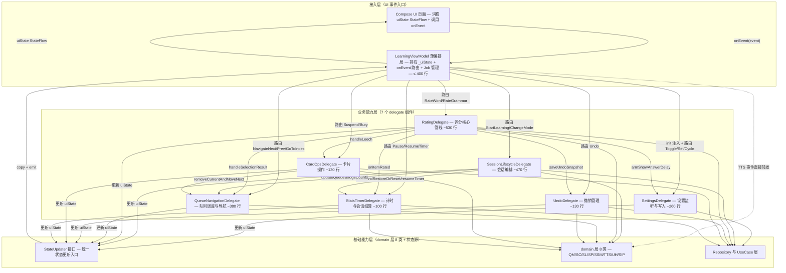
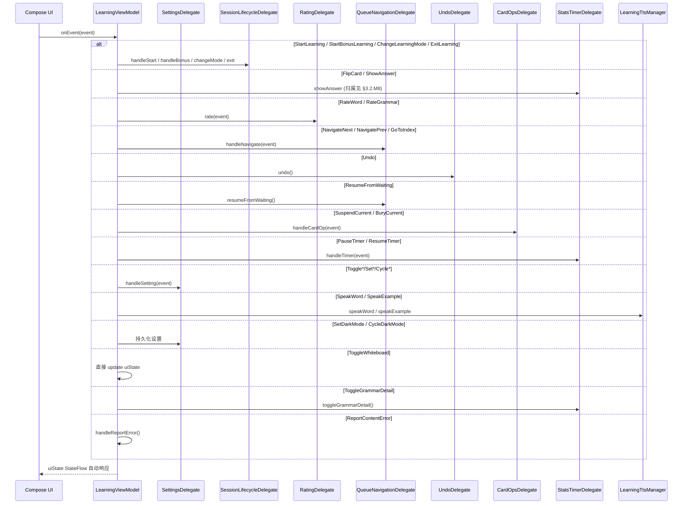
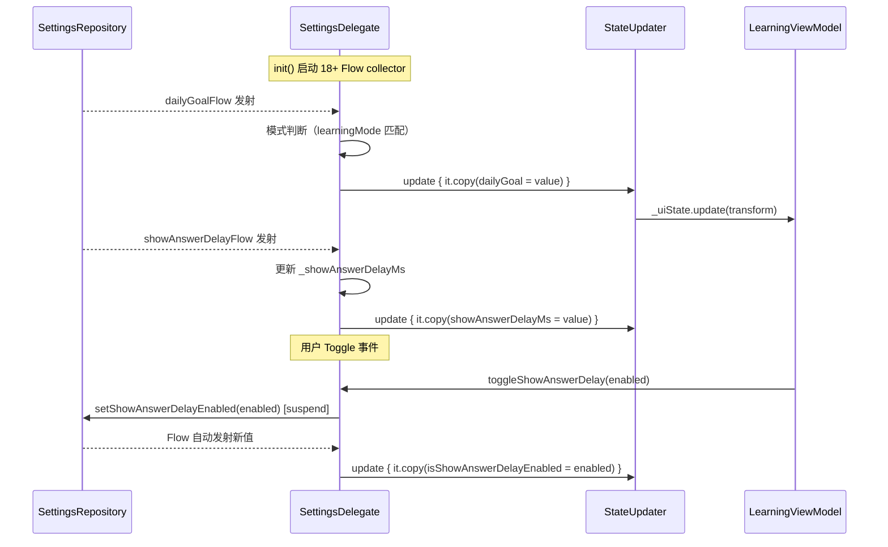
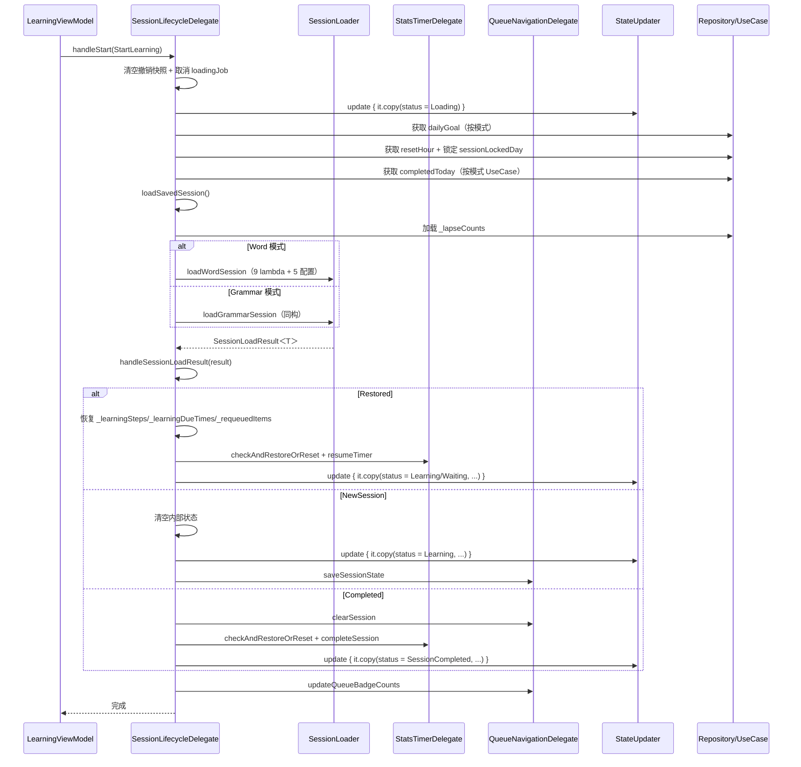
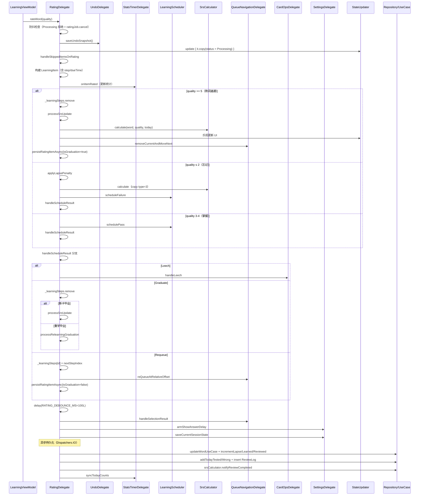
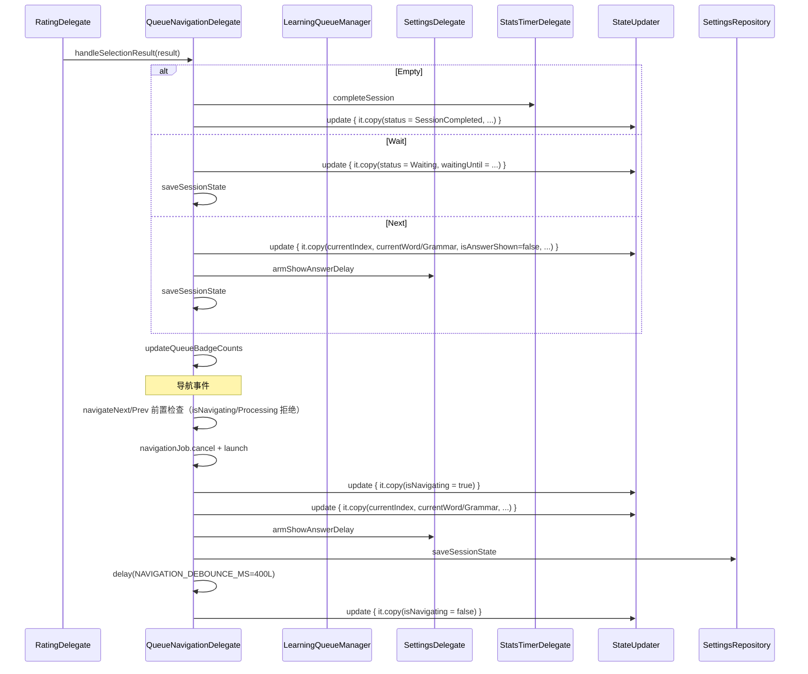
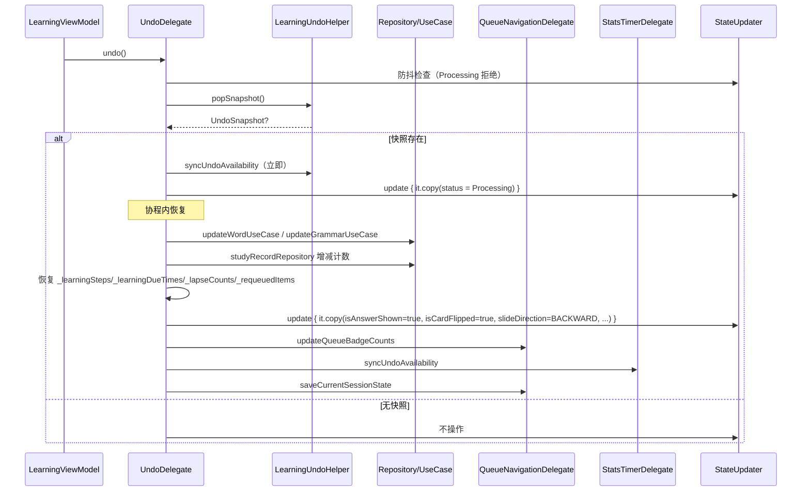
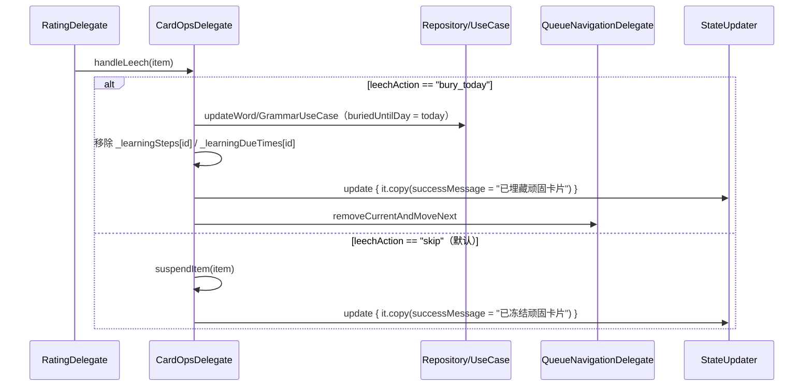
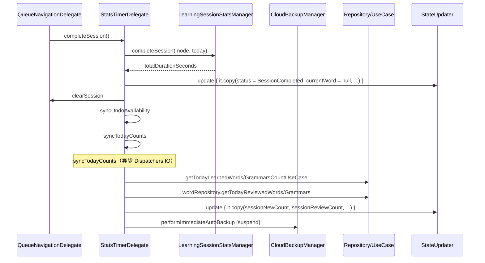
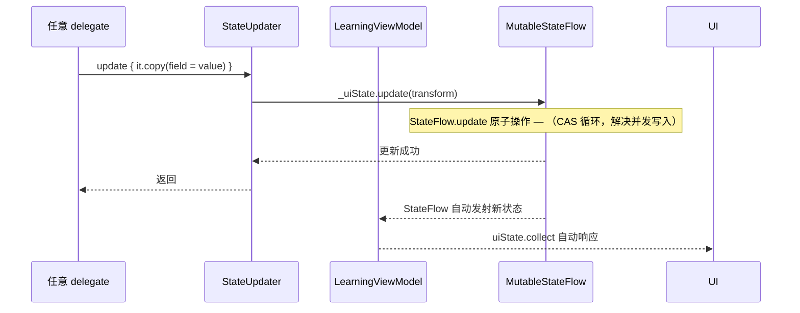

# AICoding 架构设计 · 系统设计

> 本文档为《AICoding 架构设计》核心产物之一，对应**系统架构设计模版**。
> 上游输入：《高层架构设计》（G3 已通过）产出的委托组件架构、系统依赖、业务闭环；
> 下游输出：用于驱动《UserStory》的实施与 R1~R8 演进路径落地。

> **模版适配说明（重构语境）**：
> 本设计是对**既有代码的重构**（LearningViewModel.kt 2443 行 → 7 delegate + 薄编排层），非新建系统。模板章节按以下原则适配：
> - DDD 限界上下文 → 7 个 delegate 组件的职责边界
> - 上下文映射 → delegate 间通过 StateUpdater 接口 + ViewModel 调度的通信方式
> - 模块设计五段式 → 每个 delegate 的概述 + 方法签名 + 结构定义 + 时序图 + 关键流程
> - 接口契约 → delegate 公开方法签名 + StateUpdater 接口 + 事件防抖/幂等约定
> - 数据设计 → 状态流转设计（_uiState 在 delegate 间流转）+ 内部状态字段归属
> - 数据库设计 → 无新增表（纯代码变更），§4 适配为状态字段归属与并发控制
> - 部署架构（§5）/ 网络架构（§6）/ 安全设计（§7）→ 纯代码变更无拓扑/边界变化，保留合规底线最小节
> - 可观测设计（§8）→ 适配为测试策略（行为契约测试 + delegate 单元测试）+ 编译验证
>
> **未启用章节**（在 §0 修订记录中注明）：
> - §4.4 缓存与 Key 规范（理由：无缓存组件，ViewModel 内部状态用 StateFlow 管理）
> - §6 网络架构（理由：纯代码变更，无网络拓扑变化）
> - §4.5 数据迁移与兼容性中的存量数据迁移（理由：无存量数据库迁移；重构兼容性保障见 §4.5 适配为行为契约测试）

---

## 0. 元信息：修订记录

| 文档版本 | 发布日期 | 修订人 | 修订说明 |
| --- | --- | --- | --- |
| v1.0 | 2026-10-29 | system-architect（高见远） | 文档初始版本，覆盖 §1~§8 全部章节，7 个 delegate 五段式设计 + StateUpdater 接口 + 状态字段归属表 + 测试策略 |

**未启用章节登记**：

| 章节号 | 未启用理由 | 替代方案 |
| --- | --- | --- |
| §4.4 | 无缓存组件，ViewModel 内部状态用 MutableStateFlow + StateUpdater 接口管理，无 Redis/Memcached | §4.2 状态字段归属设计覆盖状态管理 |
| §6 | 纯代码重构，无网络拓扑/入口流量/东西向流量变化，Nemo App 网络架构不变 | §3.1.3 集成架构覆盖 domain 层依赖关系 |
| §4.5（存量数据迁移部分） | 无存量数据库迁移需求 | §4.5 适配为重构兼容性保障（行为契约测试） |

---

## 1. 引言

### 1.1 文档目标

- **一句话定位**：本文档定义 Nemo 项目 `LearningViewModel.kt` 模块化瘦身重构在交付物中的所有系统设计相关产物。
- **读者对象**：架构师 / 维护开发者 / 测试工程师 / 评审委员会。
- **设计范围**：业务架构（delegate 限界上下文）+ 应用架构（7 delegate 五段式设计 + 接口契约）+ 状态设计（状态字段归属与流转）+ 测试策略（行为契约 + 单元测试 + 编译验证）。

### 1.2 关联文档清单

| 输入类型 | 内容要点 | 在本文档中的用途 | 形式 |
| --- | --- | --- | --- |
| 高层架构设计 | 7 delegate 组件架构、系统依赖架构（19 条）、业务闭环主链路、MVP/第二阶段/完整版三阶段决策 | 第 2/3/4 章业务架构与应用架构 | 外部文档（`.workbuddy/output/高层架构设计.md`，G3 已通过） |
| 资料摘要 | D1 LearningViewModel.kt 逐方法摘要 49 条 + D8 domain 层 8 类摘要 + X1~X10 冲突记录 | 第 3 章模块详细设计的方法迁移映射 | 外部文档（`.workbuddy/output/material_digest.md`，G1 已通过） |
| 行业调研报告 | B1~B5 标杆对比 + B3 Orbit ContainerHost 委托模式借鉴决策 | 第 3.1.5 技术选型选型理由 | 外部文档（`.workbuddy/output/research_report.md`，G2 已通过） |
| 非功能性需求 | 行为零变更（行为契约测试 100% 通过）、VM ≤ 400 行、delegate ≥ 80% 单测覆盖 | 第 2.5 / 8 章 | 本文 §2.5 自带 |
| 业务边界 | 不改业务逻辑/UI 层/数据层；不引入第三方 MVI 框架；遗留字段推迟完整版 | 第 2.4 章范围边界 | 本文 §2.4 自带 |

### 1.3 名词与术语表

| 业务术语 | 业务定义（≤ 30 字） | 应用层核心对象（§3.3 O-xx） | 数据库表名 |
| --- | --- | --- | --- |
| 委托组件（delegate） | 承接 ViewModel 单一职责域的独立可注入类 | `O-01 LearningViewModel` + `O-02~O-08` delegate | N/A（无新增表） |
| 状态更新器 | delegate 统一更新 _uiState 的接口 | `O-09 StateUpdater` | N/A |
| 评分管线 | rate→applyLapsePenalty→handleScheduleResult→persistRatingItemAsync 链路 | `O-04 RatingDelegate` | N/A |
| 队列选择结果 | LearningQueueManager 返回的下一步选择 | `O-10 QueueSelectionResult` | N/A |
| 会话加载结果 | SessionLoader 返回的恢复/新建/完成三态 | `O-11 SessionLoadResult` | N/A |
| 调度结果 | LearningScheduler 返回的重入队/毕业/钉子户三态 | `O-12 ScheduleResult` | N/A |
| 撤销快照 | 保存评分前状态的恢复数据 | `O-13 UndoSnapshot` | N/A |
| 学习项目 | 统一封装 Word/Grammar 的密封类 | `O-14 LearningItem` | N/A |
| 防抖常量 | 评分 100ms / 导航 400ms / 答案容差 150ms | `O-15 companion constants` | N/A |
| 内部状态字段 | _learningSteps/_learningDueTimes/_lapseCounts 等追踪 Map | `O-16 InternalStateFields` | N/A |

---

## 2. 业务架构

> **本章回答**：7 个 delegate 各自承接什么职责、delegate 间如何协作、评分主链路如何流转。
> **本章不回答**：具体方法实现细节、状态字段归属（归 §4）。

### 2.1 业务架构概览

#### 2.1.1 业务全景图

> 以**职责域**分块展示 LearningViewModel 拆解后的业务结构，块与块之间通过 StateUpdater + ViewModel 调度协作。

**职责域清单**：

| 职责域 | 核心场景 | 涉及角色 | 与其他职责域的关系 |
| --- | --- | --- | --- |
| 设置配置域 | 18+ Flow collector 监听 + toggle/cycle/set 持久化 + armShowAnswerDelay | 维护开发者 | 下游 StateUpdater；协作 RatingDelegate（armShowAnswerDelay 被评分链路调用） |
| 会话编排域 | startLearning/startBonusLearning/loadSession/handleSessionLoadResult/changeMode | 维护开发者 | 上游 ViewModel 路由；下游 SessionLoader + Repository；协作 StatsTimerDelegate（跨天重置） |
| 评分管线域 | rate/applyLapsePenalty/handleScheduleResult/processSrsUpdate/persistRatingItemAsync | 维护开发者 / 测试工程师 | 核心域；协作 UndoDelegate/StatsTimerDelegate/QueueNavigationDelegate/CardOpsDelegate/SettingsDelegate |
| 队列导航域 | reQueue/resumeFromWaiting/removeCurrentAndMoveNext/handleSelectionResult/navigate | 维护开发者 | 下游 LearningQueueManager；被 RatingDelegate/CardOpsDelegate 调用 |
| 撤销管理域 | saveUndoSnapshot/undo/syncUndoAvailability | 维护开发者 | 被 RatingDelegate 调用（评分前存快照）；下游 LearningUndoHelper |
| 卡片操作域 | handleLeech/suspendCurrentItem/buryCurrentItem/suspendItem | 维护开发者 | 被 RatingDelegate 调用（handleScheduleResult.Leech）；协作 QueueNavigationDelegate |
| 计时统计域 | completeSession/syncTodayCounts/pauseTimer/resumeTimer/checkAndRestoreOrReset | 维护开发者 | 被 RatingDelegate/QueueNavigationDelegate 调用；下游 LearningSessionStatsManager |

### 2.2 领域关系映射

#### 2.2.1 限界上下文清单

> 7 个 delegate 各对应一个限界上下文，外加 StateUpdater 通用域和 ViewModel 编排域，共 9 个限界上下文。

| 限界上下文 | 对应职责域 | 域类型 | 覆盖的核心业务实体 | 上下文边界（属于本域 vs 不属于） |
| --- | --- | --- | --- | --- |
| Settings-BC | 设置配置域 | 支撑域 | SettingsRepository Flow、18+ 配置字段（autoPlayAudio/showAnswerDelay/autoRevealAnswer 等） | 属于：设置监听/写入/armShowAnswerDelay；不属于：设置数据的持久化实现（归 SettingsRepository） |
| SessionLifecycle-BC | 会话编排域 | 核心域 | SessionLoadResult、SavedSession、LearningMode、completedToday/dailyGoal | 属于：会话启动/加载/恢复/模式切换/退出；不属于：队列调度（归 QueueNav-BC）、评分（归 Rating-BC） |
| Rating-BC | 评分管线域 | 核心域 | LearningItem、ScheduleResult、SrsCalculator 计算结果、_lapseCounts/_requeuedItems | 属于：评分/失败惩罚/调度结果处理/SRS 更新/毕业/持久化；不属于：队列选择（归 QueueNav-BC）、撤销存档（归 Undo-BC） |
| QueueNavigation-BC | 队列导航域 | 核心域 | QueueSelectionResult、_learningDueTimes、LearningQueueManager 调用 | 属于：重入队/恢复/移除/选择结果处理/导航；不属于：评分逻辑（归 Rating-BC） |
| Undo-BC | 撤销管理域 | 支撑域 | UndoSnapshot、LearningUndoHelper | 属于：快照保存/恢复/可用性同步；不属于：数据库恢复的具体实现（归 Repository） |
| CardOps-BC | 卡片操作域 | 支撑域 | Word/Grammar 的 buriedUntilDay/isSkipped 字段 | 属于：钉子户处理/暂停/埋藏；不属于：评分触发（归 Rating-BC 调用） |
| StatsTimer-BC | 计时统计域 | 支撑域 | SessionStats、LearningSessionStatsManager、CloudBackupManager | 属于：会话完成/今日计数同步/计时器/跨天重置；不属于：统计数据持久化实现（归 StatsManager） |
| StateUpdater-BC | 状态更新通用域 | 通用域 | LearningUiState、StateUpdater 接口 | 属于：统一状态更新入口；不属于：业务逻辑（各 delegate 各自拥有） |
| ViewModel-BC | 编排调度域 | 通用域 | onEvent 路由表、_uiState 持有、Job 管理 | 属于：事件路由/delegate 调度/生命周期；不属于：具体业务逻辑（各 delegate 各自拥有） |

**域类型说明**：

| 域类型 | 含义 | 投入策略 |
| --- | --- | --- |
| 核心域（Core） | 业务护城河，评分与队列是学习核心路径 | 投入最多资源自研，行为契约测试全覆盖 |
| 支撑域（Supporting） | 必要但非差异化（设置/撤销/卡片/计时） | 自研，单元测试覆盖 |
| 通用域（Generic） | 通用能力（StateUpdater 状态更新/ViewModel 编排） | 优先复用 Kotlin/Flow 原生能力 |

#### 2.2.2 上下文映射（Context Mapping）

| 关系编号 | 上游上下文 | 下游上下文 | 关系模式 | 同步方式 | 选择理由 |
| --- | --- | --- | --- | --- | --- |
| C-01 | ViewModel-BC | 全部 delegate-BC | Open Host Service | Kotlin 方法同步调用 | ViewModel 通过 onEvent 路由表提供标准事件分发入口，各 delegate 作为下游消费 |
| C-02 | 全部 delegate-BC | StateUpdater-BC | Shared Kernel | Kotlin 接口同步调用 | 7 个 delegate 共享 StateUpdater 接口这一小块代码模型，统一状态更新入口 |
| C-03 | Rating-BC | Undo-BC | Customer/Supplier | Kotlin 方法同步调用 | RatingDelegate 评分前调用 UndoDelegate.saveUndoSnapshot，下游配合上游节奏 |
| C-04 | Rating-BC | StatsTimer-BC | Customer/Supplier | Kotlin 方法同步调用 | RatingDelegate 评分时调用 StatsTimerDelegate.onItemRated 更新统计 |
| C-05 | Rating-BC | QueueNavigation-BC | Customer/Supplier | Kotlin 方法同步调用 | RatingDelegate 评分后调用 QueueNavigationDelegate.handleSelectionResult 切卡 |
| C-06 | Rating-BC | CardOps-BC | Customer/Supplier | Kotlin suspend 调用 | RatingDelegate.handleScheduleResult.Leech 分支调用 CardOpsDelegate.handleLeech |
| C-07 | Rating-BC | Settings-BC | Customer/Supplier | Kotlin 方法同步调用 | RatingDelegate 评分后调用 SettingsDelegate.armShowAnswerDelay |
| C-08 | QueueNavigation-BC | Settings-BC | Customer/Supplier | Kotlin 方法同步调用 | QueueNavigationDelegate.handleSelectionResult.Next 调用 armShowAnswerDelay |
| C-09 | CardOps-BC | QueueNavigation-BC | Customer/Supplier | Kotlin 方法同步调用 | CardOpsDelegate 操作后调用 removeCurrentAndMoveNext |
| C-10 | SessionLifecycle-BC | StatsTimer-BC | Customer/Supplier | Kotlin 方法同步调用 | SessionLifecycleDelegate 加载会话时调用 checkAndRestoreOrReset/resumeTimer |
| C-11 | SessionLifecycle-BC | QueueNavigation-BC | Customer/Supplier | Kotlin 方法同步调用 | SessionLifecycleDelegate 加载完成后调用 updateQueueBadgeCounts |
| C-12 | domain 层（LearningQueueManager/Scheduler/SessionLoader 等） | delegate-BC | ACL 防腐层 | @Inject constructor + Kotlin 调用 | domain 层模型不污染 delegate 内部，delegate 通过构造注入隔离 |
| C-13 | Repository/UseCase 层 | delegate-BC | Conformist | suspend 函数调用 | delegate 直接遵循 Repository/UseCase 的 suspend 接口契约，无议价能力 |

**关系模式说明**：

| 关系模式 | 本重构适用场景 |
| --- | --- |
| Open Host Service | ViewModel 通过 onEvent 对外提供标准事件入口，delegate 作为下游消费 |
| Shared Kernel | 7 delegate 共享 StateUpdater 接口，维护成本可控（仅一个接口 + 一个实现） |
| Customer/Supplier | delegate 间协作（Rating→Undo/Stats/QueueNav/CardOps/Settings），上游能影响下游迭代节奏 |
| ACL 防腐层 | domain 层已有独立模型，delegate 通过 @Inject 注入隔离，不污染内部 |
| Conformist | Repository/UseCase 接口已冻结，delegate 直接遵循 |

#### 2.2.3 跨域协作原则

| 原则编号 | 原则 |
| --- | --- |
| P-01 | 核心域（Rating/QueueNavigation/SessionLifecycle）→ 支撑域（Settings/Undo/CardOps/StatsTimer）：禁止反向依赖（支撑域不调用核心域内部模型） |
| P-02 | 核心域之间：RatingDelegate 可调用 QueueNavigationDelegate（评分后切卡），但 QueueNavigationDelegate 禁止调用 RatingDelegate（导航不触发评分） |
| P-03 | 全部 delegate → StateUpdater：必须通过 StateUpdater 接口更新 _uiState，禁止直接持有 MutableStateFlow 引用 |
| P-04 | delegate 间禁止循环依赖：RatingDelegate→UndoDelegate 是单向的，UndoDelegate 禁止反向调用 RatingDelegate |

### 2.3 详细业务架构

#### 2.3.1 用例图

> 重构语境下，"用例图"适配为 **onEvent 事件路由图**——体现"用户事件 → ViewModel 路由 → delegate 响应"的分发关系。

| 编号 | 用例图标题 | 涉及职责域 | 源文件位置 |
| --- | --- | --- | --- |
| UC-01 | onEvent 事件路由全景图（30+ 事件 → 7 delegate + TTS 直转） | 全部 | 本文 §3.2.M1.4 |
| UC-02 | 评分主链路用例图（RateWord/RateGrammar → RatingDelegate 全链路） | Rating + Undo + Stats + QueueNav + CardOps + Settings | 本文 §3.2.M4.4 |
| UC-03 | 会话启动用例图（StartLearning → SessionLifecycleDelegate） | SessionLifecycle + Stats + QueueNav | 本文 §3.2.M3.4 |

#### 2.3.2 业务流程图

> 关键业务以**角色泳道图**描述核心流程。以下为评分主链路——重构后行为 100% 不变的核心路径。

**关键流程清单**（核心业务覆盖度 ≥ 80%）：

| 流程编号 | 流程名 | 起点 | 终点 | 涉及职责域 | 源文件位置 |
| --- | --- | --- | --- | --- | --- |
| BF-01 | 评分主链路（quality 分支 + 调度结果三分支） | onEvent(RateWord/RateGrammar) | UI 渲染新卡片 | Rating + Undo + Stats + QueueNav + CardOps + Settings | 本文 §3.2.M4.5 + §4.2 状态流转 |
| BF-02 | 会话启动流程 | onEvent(StartLearning) | Learning/Waiting/Completed 状态 | SessionLifecycle + Stats + QueueNav | 本文 §3.2.M3.4 + §3.2.M3.5 |
| BF-03 | 撤销恢复流程 | onEvent(Undo) | UI 恢复上一张卡片 | Undo + Rating（恢复内部 Map） | 本文 §3.2.M6.4 + §3.2.M6.5 |
| BF-04 | 会话完成流程 | handleSelectionResult.Empty | SessionCompleted 状态 + 云备份 | Stats + QueueNav | 本文 §3.2.M8.5 |
| BF-05 | 设置变更实时生效流程 | SettingsRepository Flow 发射 | uiState 配置字段更新 | Settings | 本文 §3.2.M2.4 |

### 2.4 业务范围与边界

#### 2.4.1 功能模块清单

> 继承 G3 §6.1 需求边界，按"功能编号 → 子功能"两层组织，与 §2.1 职责域对应。

| 编号 | 一级功能名 | 子功能描述 | 对应职责域 | 实现状态 |
| --- | --- | --- | --- | --- |
| F1 | SettingsDelegate | — | 设置配置域 | — |
| F1.1 | — | init 块 18+ Flow collector 迁移 | 设置配置域 | MVP |
| F1.2 | — | toggle/cycle/set 系列 8 方法迁移 | 设置配置域 | MVP |
| F1.3 | — | armShowAnswerDelay 延迟计算迁移 | 设置配置域 | MVP |
| F2 | SessionLifecycleDelegate | — | 会话编排域 | — |
| F2.1 | — | startLearning/startBonusLearning 迁移 | 会话编排域 | MVP |
| F2.2 | — | loadWordSession/loadGrammarSession 迁移（第二阶段 X6 合并） | 会话编排域 | MVP（第二阶段合并） |
| F2.3 | — | handleSessionLoadResult 三分支迁移 | 会话编排域 | MVP |
| F2.4 | — | changeLearningMode/exitLearning 迁移 | 会话编排域 | MVP |
| F3 | RatingDelegate | — | 评分管线域 | — |
| F3.1 | — | rate 评分入口 + quality 分支迁移 | 评分管线域 | MVP |
| F3.2 | — | applyLapsePenalty/processSrsUpdate/processRelearningGraduation 迁移（第二阶段 X4 合并） | 评分管线域 | MVP（第二阶段合并） |
| F3.3 | — | handleScheduleResult 三分支迁移 | 评分管线域 | MVP |
| F3.4 | — | persistRatingItemAsync 后台持久化迁移 | 评分管线域 | MVP |
| F4 | QueueNavigationDelegate | — | 队列导航域 | — |
| F4.1 | — | reQueue/resumeFromWaiting/removeCurrentAndMoveNext 迁移 | 队列导航域 | MVP |
| F4.2 | — | handleSelectionResult 三分支迁移 | 队列导航域 | MVP |
| F4.3 | — | navigateNext/Prev/To 迁移 | 队列导航域 | MVP |
| F5 | UndoDelegate | — | 撤销管理域 | — |
| F5.1 | — | saveUndoSnapshot/syncUndoAvailability 迁移 | 撤销管理域 | MVP |
| F5.2 | — | undo 恢复流程迁移 | 撤销管理域 | MVP |
| F6 | CardOpsDelegate | — | 卡片操作域 | — |
| F6.1 | — | handleLeech(bury_today/skip) 迁移（第二阶段 X5 合并） | 卡片操作域 | MVP（第二阶段合并） |
| F6.2 | — | suspendCurrentItem/buryCurrentItem/suspendItem 迁移 | 卡片操作域 | MVP |
| F7 | StatsTimerDelegate | — | 计时统计域 | — |
| F7.1 | — | completeSession/syncTodayCounts 迁移 | 计时统计域 | MVP |
| F7.2 | — | pauseTimer/resumeTimer/checkAndRestoreOrReset 迁移 | 计时统计域 | MVP |
| F8 | StateUpdater 接口 | — | 状态更新通用域 | — |
| F8.1 | — | StateUpdater 接口定义 + ViewModel 实现 | 状态更新通用域 | MVP |
| F9 | onEvent 事件路由表 | — | 编排调度域 | — |
| F9.1 | — | 30+ LearningEvent → delegate 方法映射表 | 编排调度域 | MVP |
| F10 | LearningViewModel 薄编排层 | — | 编排调度域 | — |
| F10.1 | — | VM 持有 _uiState + delegate 调度 + Job 管理 ≤ 400 行 | 编排调度域 | MVP |

**In-Scope（本期 MVP 必做）**：

| 编号 | 本期必做的事项 |
| --- | --- |
| F1~F7 | 7 个 delegate 组件新建，承接 LearningViewModel 全部 12 类职责 |
| F8 | StateUpdater 统一状态更新接口设计与实现 |
| F9 | onEvent 事件路由表，保持 onEvent 签名不变 |
| F10 | LearningViewModel 瘦身至 ≤ 400 行薄编排层 |
| N1 | 行为契约测试 100% 通过（评分防抖/导航防抖/跨天重置/Learn Ahead/撤销恢复） |
| N2 | 对外接口兼容（StateFlow + onEvent 签名不变，Compose UI 零改动） |

**Out-of-Scope（本期不做）**：

| 编号 | 不做的事项 | 不做的原因 | 未来归属 |
| --- | --- | --- | --- |
| O1 | 不改业务逻辑/状态流转/边界条件/异常处理 | 用户诉求核心约束 1 | 永不做 |
| O2 | 不改 LearningEvent sealed interface（30+ 事件） | 违背核心约束 2（对外接口兼容） | 完整版 R7 |
| O3 | 不改 LearningUiState 字段定义（40+ 字段） | 违背核心约束 2 | 完整版 R8 |
| O4 | 不改 UI 层（Compose 页面与导航） | 用户诉求核心约束 2 | 永不做 |
| O5 | 不改数据层（Repository/UseCase/Room/Supabase） | 重构范围限定 ViewModel 内部 | 不做 |
| O6 | 不引入第三方 MVI 框架（Orbit/MVIKotlin/Mavericks） | research_report 否决结论 | 永不做 |
| O7 | loadWordSession/loadGrammarSession 泛型合并（X6） | 第二阶段重复消除 | 第二阶段 R3 |
| O8 | processSrsUpdate/processRelearningGraduation 合并（X4） | 第二阶段重复消除 | 第二阶段 R4 |
| O9 | buryCurrentItem/handleLeech 合并（X5） | 第二阶段重复消除 | 第二阶段 R5 |
| O10 | StatsManager 改 DI（X2） | 第二阶段 DI 统一 | 第二阶段 R6 |
| O11 | 自动翻面配置 Word/Grammar 统一（X3） | 涉及 LearningEvent 改造 | 完整版 R7 |
| O12 | 遗留字段清理（X7~X10） | 涉及 UI/数据层验证 | 完整版 R8 |

### 2.5 质量与柔性可用

#### 2.5.1 服务质量目标

> 按 ISO 25010 选出本重构**最重要的 5 个**质量目标（必须排序），并落到可验证场景。

**质量目标 Top 5**：

| 优先级 | 质量目标 | 业务驱动 | 受影响的关键章节 |
| --- | --- | --- | --- |
| Q1 | 功能正确性（行为零变更） | 用户诉求核心约束 1：重构后学习行为 100% 不变 | §3.2 模块设计 / §8.1 测试策略 |
| Q2 | 可维护性（VM ≤ 400 行 / 单一职责） | 维护开发者诉求：改一个功能不用通读 2443 行 | §3.1 应用架构 / §3.2 模块设计 |
| Q3 | 可测试性（delegate ≥ 80% 单测覆盖） | 测试工程师诉求：独立测试各职责域 | §8.1 测试策略 |
| Q4 | 兼容性（对外接口不变） | 用户诉求核心约束 2：Compose UI 零改动 | §3.5 接口契约 |
| Q5 | 可移植性（delegate 可复用） | 第二阶段/完整版演进：delegate 架构骨架可继承 | §3.1.5 技术选型 |

**可验证质量场景**：

| 场景编号 | 关联目标 | 触发源 | 触发条件 | 期望响应 | 度量指标 |
| --- | --- | --- | --- | --- | --- |
| QS-01 | Q1 | 用户评分 | 连续快速评分（间隔小于 100ms） | ratingJob 取消前序，仅最后一次生效 | 评分防抖测试通过率 100% |
| QS-02 | Q1 | 用户导航 | 连续快速导航（间隔小于 400ms） | navigationJob 取消前序，仅最后一次生效 | 导航防抖测试通过率 100% |
| QS-03 | Q1 | 跨天打开 App | checkAndRestoreOrReset 检测天数变化 | 统计清零 + 重新加载会话 | 跨天重置测试通过率 100% |
| QS-04 | Q1 | Learn Ahead Limit | dueTime > now + learnAheadLimit | 设 Waiting 状态 + waitingUntil | Learn Ahead 测试通过率 100% |
| QS-05 | Q1 | 用户撤销 | 评分后点击 Undo | 恢复上一张卡片 + 数据库回滚 | 撤销恢复测试通过率 100% |
| QS-06 | Q2 | 维护开发者修改 | 改评分逻辑只动 RatingDelegate | LearningViewModel 行数 ≤ 400 | VM 行数检查 |
| QS-07 | Q3 | 测试工程师 | 对 RatingDelegate 独立单测 | 无需 mock 21 个依赖 | RatingDelegate 单测覆盖率 ≥ 80% |

#### 2.5.2 业务柔性可用策略

> 重构语境下，"柔性可用"适配为**降级回滚策略**——重构出问题时"保住什么、放弃什么"。

**业务功能优先级分层**：

| 层级 | 含义 | 重构语境下的处置方向 | 用户感知 |
| --- | --- | --- | --- |
| L0 核心业务 | 评分/导航/队列调度——学习主链路 | 行为契约测试 100% 覆盖，重构后不允许任何行为偏差 | 无 |
| L1 重要业务 | 设置监听/撤销/会话编排——高频辅助 | delegate 单测覆盖，重构后行为不变 | 无 |
| L2 辅助业务 | 卡片操作/计时统计——低频操作 | delegate 单测覆盖，重构后行为不变 | 无 |
| L3 附加业务 | TTS 直转/反馈——外围 | ViewModel 直接转发，不拆 delegate | 无 |

**降级回滚清单**：

| 编号 | 关联功能 | 触发条件 | 降级动作 | 用户感知 | 决策类型 |
| --- | --- | --- | --- | --- | 自动 |
| BD-01 | 全部 delegate | 行为契约测试失败 | 阻止合并，回退到重构前 commit | 无（开发阶段拦截） | 自动 |
| BD-02 | 全部 delegate | 编译失败 | 阻止合并，修复编译错误 | 无（开发阶段拦截） | 自动 |
| BD-03 | 单个 delegate | 单测覆盖率不足 80% | 标记技术债务，不阻止 MVP 合并 | 无 | 手动 |

---

## 3. 应用架构

> **本章回答**：LearningViewModel 拆解为哪些 delegate、每个 delegate 的内部交互链路是什么、delegate 间如何协作。
> **本章是系统设计的核心**，占整个文档篇幅的 40%~50%。

### 3.1 应用架构概览

#### 3.1.1 系统上下文

> LearningViewModel 作为**中心节点**，周围辐射出"Compose UI 消费方 + domain 层依赖 + Repository/UseCase 层依赖"关系。

**系统上下文要素清单**：

| 节点类型 | 节点名 | 与本系统的关系 | 关系语义 |
| --- | --- | --- | --- |
| 角色 | 维护开发者 | 修改/扩展 | 通过 delegate 隔离修改影响面 |
| 角色 | 测试工程师 | 测试 | 针对单个 delegate 独立单测 |
| 上游消费方 | Compose UI 页面（LearningScreen 等） | 消费 uiState StateFlow + 调用 onEvent | 对外接口不变（核心约束 2） |
| 上游消费方 | Compose 导航（Navigation Compose） | 消费导航事件 | 对外接口不变 |
| domain 依赖 | LearningQueueManager | delegate 调用 | QueueNavigationDelegate 核心依赖 |
| domain 依赖 | LearningScheduler | delegate 调用 | RatingDelegate 核心依赖 |
| domain 依赖 | SessionLoader | delegate 调用 | SessionLifecycleDelegate 核心依赖 |
| domain 依赖 | LearningSessionPolicy | SessionLoader 间接调用 | 无直接交互 |
| domain 依赖 | LearningSessionStatsManager | delegate 调用 | StatsTimerDelegate 依赖（第二阶段改 DI） |
| domain 依赖 | LearningTtsManager | ViewModel 直接转发 | TTS 事件不拆 delegate |
| domain 依赖 | LearningUndoHelper | delegate 调用 | UndoDelegate 核心依赖 |
| domain 依赖 | SrsIntervalPreview | delegate 调用 | RatingDelegate 依赖 |
| Repository 依赖 | SettingsRepository | delegate 调用 | SettingsDelegate 监听 18+ Flow |
| Repository 依赖 | WordRepository / GrammarRepository | delegate 调用 | RatingDelegate/UndoDelegate/CardOpsDelegate 持久化 |
| Repository 依赖 | StudyRecordRepository | delegate 调用 | UndoDelegate/StatsTimerDelegate 计数同步 |
| Repository 依赖 | ContentReportRepository | ViewModel 直接调用 | handleReportError 不单独拆 delegate |
| Repository 依赖 | ReviewLogRepository | delegate 调用 | RatingDelegate persistRatingItemAsync |
| Repository 依赖 | CloudBackupManager | delegate 调用 | StatsTimerDelegate completeSession 后触发 |
| UseCase 依赖 | SrsCalculator（Service） | delegate 调用 | RatingDelegate 核心依赖 |
| UseCase 依赖 | Word UseCase（5 个） | delegate 调用 | SessionLifecycleDelegate 加载 + RatingDelegate 持久化 |
| UseCase 依赖 | Grammar UseCase（5 个） | delegate 调用 | SessionLifecycleDelegate 加载 + RatingDelegate 持久化 |

#### 3.1.2 系统模块图

> 三层架构图（继承 G3 §5.1），每一层标出关键组件与数据流方向。



**分层组件清单**：

| 层次 | 内容 | 数据来源 |
| --- | --- | --- |
| 接入层 | Compose UI 页面（消费 uiState + onEvent）/ LearningViewModel 薄编排层（≤ 400 行） | §2.3 用例图角色 |
| 应用层（业务能力层） | 7 个 delegate 组件（与 §3.2 一一对应） | §2.1 职责域 / §3.2 |
| 中间件层（基础能力层） | StateUpdater 接口 / domain 层 8 类 / Repository 与 UseCase 层 | §3.1.3 依赖清单 |
| 集成对接层 | domain 层通过 @Inject constructor 注入 / Repository 通过 @Inject constructor 注入 | §3.1.3 依赖清单 |

#### 3.1.3 集成架构

> **适配说明**：本重构为纯代码变更，无外部系统（E-xx）新增和云组件（C-xx）新增。以下列出 delegate 组件的**依赖方清单**——从 delegate 视角看，domain 层和 Repository/UseCase 层即是其"外部依赖"。

##### 外部依赖清单（delegate 视角的 domain + Repository + UseCase）

| ID | 依赖系统 | 归属模块 | 类别 | 使用方式 | 集成方式 | 协议/版本 | 功能定位（≤ 30 字） | 消费 delegate |
| --- | --- | --- | --- | --- | --- | --- | --- | --- |
| E-01 | LearningQueueManager | feature/learning/domain | domain 依赖 | 消费 | @Inject constructor | Kotlin 同步 | 队列调度（sort/reorder/select/remove） | QueueNavigationDelegate |
| E-02 | LearningScheduler | feature/learning/domain | domain 依赖 | 消费 | @Inject constructor | Kotlin 同步 | 评分调度（scheduleFailure/Pass） | RatingDelegate |
| E-03 | SessionLoader | feature/learning/domain | domain 依赖 | 消费 | @Inject constructor | Kotlin suspend | 泛型会话加载（loadSession） | SessionLifecycleDelegate |
| E-04 | LearningSessionPolicy | feature/learning/domain | domain 依赖 | 间接消费 | SessionLoader 间接调用 | Kotlin 同步 | FSRS 策略（partition/mix） | SessionLifecycleDelegate（间接） |
| E-05 | LearningSessionStatsManager | feature/learning/domain | domain 依赖 | 消费 | 直接 new（X2，第二阶段改 @Inject） | Kotlin 同步 + SharedPreferences | 统计计时（check/restore/pause/resume/complete） | StatsTimerDelegate |
| E-06 | LearningTtsManager | feature/learning/domain | domain 依赖 | 消费 | @Inject constructor | Kotlin 异步（Flow） | TTS 朗读（speakWord/speakExample） | ViewModel（直接转发） |
| E-07 | LearningUndoHelper | feature/learning/domain | domain 依赖 | 消费 | @Inject constructor | Kotlin 同步 | 撤销快照（save/pop/canUndo） | UndoDelegate |
| E-08 | SrsIntervalPreview | feature/learning/domain | domain 依赖 | 消费 | @Inject constructor | Kotlin 同步 | SRS 间隔预览（calculate） | RatingDelegate |
| E-09 | SettingsRepository | core/data | Repository 依赖 | 消费 | @Inject constructor | Kotlin Flow 读 / suspend 写 | 设置读写（18+ Flow + toggle 持久化） | SettingsDelegate |
| E-10 | WordRepository | core/data | Repository 依赖 | 消费 | @Inject constructor | Kotlin suspend | 词库 CRUD | RatingDelegate/UndoDelegate/CardOpsDelegate/SessionLifecycleDelegate |
| E-11 | GrammarRepository | core/data | Repository 依赖 | 消费 | @Inject constructor | Kotlin suspend | 语法库 CRUD | RatingDelegate/UndoDelegate/CardOpsDelegate/SessionLifecycleDelegate |
| E-12 | StudyRecordRepository | core/data | Repository 依赖 | 消费 | @Inject constructor | Kotlin suspend | 学习记录（今日新学/复习/重学计数） | UndoDelegate/StatsTimerDelegate |
| E-13 | ContentReportRepository | core/data | Repository 依赖 | 消费 | @Inject constructor | Kotlin suspend | 内容错误反馈 | ViewModel（直接调用） |
| E-14 | ReviewLogRepository | core/data | Repository 依赖 | 消费 | @Inject constructor | Kotlin suspend | 复习日志记录 | RatingDelegate |
| E-15 | CloudBackupManager | core/data | Repository 依赖 | 消费 | @Inject constructor | Kotlin suspend 异步 | 云端备份 | StatsTimerDelegate |
| E-16 | SrsCalculator（Service） | core/domain | Service 依赖 | 消费 | @Inject constructor | Kotlin 同步 | FSRS 算法计算 | RatingDelegate |
| E-17 | Word UseCase（GetNewWords/GetDueWords/GetLearningWords/UpdateWord/GetTodayLearnedWordsCount） | core/domain | UseCase 依赖 | 消费 | @Inject constructor | Kotlin suspend | 单词查询/更新/计数 | SessionLifecycleDelegate/RatingDelegate |
| E-18 | Grammar UseCase（GetNewGrammars/GetDueGrammars/GetLearningGrammars/UpdateGrammar/GetTodayLearnedGrammarsCount） | core/domain | UseCase 依赖 | 消费 | @Inject constructor | Kotlin suspend | 语法查询/更新/计数 | SessionLifecycleDelegate/RatingDelegate |

##### 云组件 / 基础设施清单

> **N/A**：本重构为纯代码变更，无新增云组件/基础设施。Nemo App 已有的 Supabase/Room/Hilt 基础设施不变，不在本期系统设计范围。

##### 组件依赖关系

| delegate 组件 | 依赖的 domain 类（E-xx） | 依赖的 Repository/UseCase（E-xx） | 故障传导风险 |
| --- | --- | --- | --- |
| SettingsDelegate | — | E-09 SettingsRepository | E-09 不可用 → 设置变更无法生效（降级：使用默认值） |
| SessionLifecycleDelegate | E-03 SessionLoader, E-04 LearningSessionPolicy（间接） | E-10/11 Word/GrammarRepository, E-17/18 Word/Grammar UseCase | E-03 异常 → 会话无法加载（设 Error 状态） |
| RatingDelegate | E-02 LearningScheduler, E-08 SrsIntervalPreview, E-16 SrsCalculator | E-10/11 Word/GrammarRepository, E-12 StudyRecordRepository, E-14 ReviewLogRepository, E-17/18 Word/Grammar UseCase | E-16 异常 → 评分计算失败（设 Error 状态） |
| QueueNavigationDelegate | E-01 LearningQueueManager | — | E-01 不可用 → 队列调度失败（纯内存计算，无 I/O 风险） |
| UndoDelegate | E-07 LearningUndoHelper | E-10/11 Word/GrammarRepository, E-12 StudyRecordRepository, E-17/18 Word/Grammar UseCase | E-07 不可用 → 撤销不可用（syncUndoAvailability 返回 false） |
| CardOpsDelegate | — | E-10/11 Word/GrammarRepository, E-17/18 Word/Grammar UseCase | Repository 异常 → 持久化失败（内存移除不阻塞用户） |
| StatsTimerDelegate | E-05 LearningSessionStatsManager | E-10/11 Word/GrammarRepository, E-12 StudyRecordRepository, E-15 CloudBackupManager | E-05 异常 → 统计不准确（fallback 到 StatsManager 值） |

#### 3.1.4 工程结构

> 重构不改变工程物理组织，仅在 feature/learning/presentation 内新增 delegate 包。

```
feature/learning/presentation/
├── LearningViewModel.kt              # 薄编排层（≤ 400 行，重构后）
├── LearningEvent.kt                  # sealed interface（不变）
├── LearningUiState.kt                # data class + 枚举（不变）
├── LearningModels.kt                 # LearningItem sealed class（不变）
├── LearningExt.kt                    # 扩展函数（不变）
├── LearningMode.kt                   # sealed class（不变）
└── delegate/                         # 新增 delegate 包
    ├── StateUpdater.kt              # 统一状态更新接口（新建）
    ├── SettingsDelegate.kt           # 设置监听与写入（新建）
    ├── SessionLifecycleDelegate.kt   # 会话编排（新建）
    ├── RatingDelegate.kt            # 评分核心管线（新建）
    ├── QueueNavigationDelegate.kt    # 队列调度与导航（新建）
    ├── UndoDelegate.kt              # 撤销管理（新建）
    ├── CardOpsDelegate.kt           # 卡片操作（新建）
    └── StatsTimerDelegate.kt        # 计时与会话结算（新建）
```

#### 3.1.5 技术选型（版本约束）

| 技术分类 | 选型 | 版本 | 备注 / 选型理由 |
| --- | --- | --- | --- |
| 开发语言 | Kotlin | 1.9+ | Nemo 项目固定（D9 §3），与 Compose/Coroutines/Hilt 兼容 |
| 异步框架 | Coroutines + Flow | 1.7+ | Nemo 项目固定；StateFlow 提供 MVI 单一状态源，viewModelScope 管理协程生命周期 |
| 依赖注入 | Hilt (Dagger) | 2.48+ | Nemo 项目固定（D9 §3）；delegate 通过 @Inject constructor 注入，零额外 DI 配置成本 |
| UI 架构 | MVI + UDF | — | 单向数据流：onEvent → delegate → StateUpdater → _uiState → UI；与 Nemo 现有范式一致 |
| 状态管理 | StateFlow + data class | — | 不可变状态 + copy 更新；delegate 通过 StateUpdater 接口统一更新，禁止直接持有 MutableStateFlow |
| delegate 模式 | 自研委托组件（借鉴 B3 Orbit ContainerHost） | — | 为什么选自研不选 Orbit 框架：research_report B3 加权 4.00，委托思想借鉴但框架引入有范式迁移成本（sideEffect→SharedFlow 映射）；自研 delegate 零范式迁移，保持 StateFlow+onEvent 范式不变 |
| StateUpdater 实现 | Kotlin functional interface + ViewModel 实现 | — | 为什么选接口不选抽象类：delegate 只需 update(transform) 单一能力，接口轻量；ViewModel 实现该接口，delegate 通过构造注入接口而非具体类，实现解耦 |
| 测试框架 | JUnit4 + Mockk + Turbine | — | JUnit4（Nemo 现有）；Mockk（Kotlin mock 友好）；Turbine（Flow 测试）；行为契约测试用 Turbine 验证 StateFlow 序列 |

### 3.2 模块详细设计

> **核心方法论**：模块详细设计画的是**业务逻辑在 delegate 和 domain 层之间流动的过程**。
> **组织原则**：先在 §3.2.1 给出跨模块共享约束；§3.2.2 给出模块清单；§3.2.3 给出五段式模板说明；之后每个模块在 §3.2.M{N} 下独立成节。

#### 3.2.1 模块公共约束（Common）

**通信方式约束**：

| 约束项 | 取值 |
| --- | --- |
| delegate 间通信 | Kotlin 方法同步调用（非 REST/MQ）；suspend 方法用于含 I/O 的操作 |
| 协议 | Kotlin 函数调用 + Coroutines suspend |
| 数据格式 | LearningUiState data class（不可变）+ copy 更新 |
| 字符编码 | UTF-8（Kotlin 默认） |

**通用基础结构**：

| 基类 / 结构 | 用途 | 包路径 |
| --- | --- | --- |
| `StateUpdater` | delegate 统一状态更新接口 | `feature.learning.presentation.delegate` |
| `LearningUiState` | MVI 单一不可变状态源（40+ 字段，不变） | `feature.learning.presentation` |
| `LearningEvent` | UI 事件 sealed interface（30+ 事件，不变） | `feature.learning.presentation` |
| `LearningItem` | Word/Grammar 统一封装 sealed class（不变） | `feature.learning.presentation` |
| companion constants | 防抖/容差常量（NAVIGATION_DEBOUNCE_MS=400L / RATING_DEBOUNCE_MS=100L / SHOW_ANSWER_GRACE_MS=150L） | delegate 各自 companion 或共用 |

#### 3.2.2 模块清单与编号规则

| 编号 | 模块名 | 职责域（§2.1） | 模块负责人 | 关联子领域 |
| --- | --- | --- | --- | --- |
| M1 | LearningViewModel（薄编排层） | 编排调度域 | @system-architect | 事件路由 / Job 管理 / 生命周期 |
| M2 | SettingsDelegate | 设置配置域 | @system-architect | 设置监听 / toggle 持久化 / armShowAnswerDelay |
| M3 | SessionLifecycleDelegate | 会话编排域 | @system-architect | 会话启动 / 加载 / 恢复 / 模式切换 |
| M4 | RatingDelegate | 评分管线域 | @system-architect | 评分 / 失败惩罚 / SRS 更新 / 毕业调度 / 持久化 |
| M5 | QueueNavigationDelegate | 队列导航域 | @system-architect | 重入队 / 恢复 / 移除 / 选择结果 / 导航 |
| M6 | UndoDelegate | 撤销管理域 | @system-architect | 快照保存 / 恢复 / 可用性同步 |
| M7 | CardOpsDelegate | 卡片操作域 | @system-architect | 钉子户 / 暂停 / 埋藏 |
| M8 | StatsTimerDelegate | 计时统计域 | @system-architect | 会话完成 / 计数同步 / 计时器 / 跨天重置 |
| M9 | StateUpdater | 状态更新通用域 | @system-architect | 统一状态更新入口 |

**编号规则**：
- 模块编号 `M{N}` 全局唯一，与 §2.1 职责域一致；
- 每个模块在 §3.2 下独立成节，编号 `§3.2.M{N}`；
- 节内五段式编号 `§3.2.M{N}.1` ~ `§3.2.M{N}.5`，顺序与 §3.2.3 模板一致。

#### 3.2.3 单模块设计模板（五段式）

> 本节定义"每个模块在 §3.2.M{N} 下五段各应该**产出什么内容**"。**本节本身不是任何模块的内容**。
>
> 适配说明（重构语境）：
> - **接口清单**：RESTful 路径适配为 **Kotlin 公开方法签名**（方法名 / 参数 / 返回类型 / 用途 / 对应 LearningEvent）；
> - **关键结构定义（DTO）**：适配为 delegate 使用的**数据类 / sealed class / 接口**定义；
> - **时序图**：Mermaid sequenceDiagram，参与者为 delegate / domain 类 / Repository / StateUpdater；
> - **关键流程逻辑**：评分管线等复杂流程的伪代码 + 状态机迁移表。

---

#### 3.2.M1 LearningViewModel（薄编排层）

##### §3.2.M1.1 模块概述

LearningViewModel 薄编排层覆盖**事件路由 + delegate 调度 + 状态持有**业务流程，业务逻辑在 Compose UI（事件入口）与 7 个 delegate（职责执行）之间流动，同时涉及 StateUpdater（状态更新）、LearningTtsManager（TTS 直转）、domain 层（通过 delegate 间接）等内外部系统的数据流动。重构后 VM 仅承担编排职责，不再包含任何业务逻辑实现。

##### §3.2.M1.2 接口清单

| 方法分类 | 方法签名 | 用途（≤ 20 字） | 对应 LearningEvent | 幂等（防抖） |
| --- | --- | --- | --- | --- |
| 事件入口 | `fun onEvent(event: LearningEvent)` | UI 事件唯一入口 | 全部 30+ 事件 | 见 §3.5.2 |
| 状态暴露 | `val uiState: StateFlow＜LearningUiState＞` | 暴露不可变状态流 | — | 天然 |
| 状态更新 | `override fun update(transform: (LearningUiState) -> LearningUiState)` | StateUpdater 实现 | — | 原子（StateFlow.update） |
| 状态快照 | `override val currentState: LearningUiState` | 获取当前状态快照 | — | 天然 |
| 生命周期 | `override fun onCleared()` | VM 销毁时停止 TTS | — | — |

##### §3.2.M1.3 关键结构定义

```kotlin
@HiltViewModel
class LearningViewModel @Inject constructor(
    // 7 个 delegate 组件（≤ 8 个构造参数）
    private val settingsDelegate: SettingsDelegate,
    private val sessionLifecycleDelegate: SessionLifecycleDelegate,
    private val ratingDelegate: RatingDelegate,
    private val queueNavigationDelegate: QueueNavigationDelegate,
    private val undoDelegate: UndoDelegate,
    private val cardOpsDelegate: CardOpsDelegate,
    private val statsTimerDelegate: StatsTimerDelegate,
    // TTS 直接复用，无需 delegate 包裹
    private val learningTtsManager: LearningTtsManager,
) : ViewModel(), StateUpdater {

    private val _uiState = MutableStateFlow(LearningUiState())
    val uiState: StateFlow＜LearningUiState＞ = _uiState.asStateFlow()

    // StateUpdater 实现——delegate 通过此接口更新 _uiState
    override fun update(transform: (LearningUiState) -> LearningUiState) {
        _uiState.update(transform)
    }
    override val currentState: LearningUiState get() = _uiState.value

    // Job 管理传给 delegate（防抖用）
    private var ratingJob: Job? = null
    private var navigationJob: Job? = null
    private var loadingJob: Job? = null
}
```

##### §3.2.M1.4 模块逻辑时序图

**时序图清单**：

| 编号 | 标题 | 场景类别 | 是否包含异常分支 |
| --- | --- | --- | --- |
| SQ-M1-01 | LearningViewModel - onEvent 事件路由全景 | 事件分发 | 否 |



##### §3.2.M1.5 关键流程逻辑

**onEvent 事件路由表**（30+ 事件 → delegate 方法映射）：

```
触发：onEvent(event: LearningEvent)

when(event) {
    // 会话生命周期
    is StartLearning -> sessionLifecycleDelegate.handleStart(event)
    is StartBonusLearning -> sessionLifecycleDelegate.handleBonusStart(event)
    is ChangeLearningMode -> sessionLifecycleDelegate.changeLearningMode(event)
    is ExitLearning -> sessionLifecycleDelegate.exitLearning()

    // 卡片交互
    is FlipCard, is ShowAnswer -> statsTimerDelegate.showAnswer()  // 含冷却检查
    is RateWord -> ratingDelegate.rateWord(event.quality)
    is RateGrammar -> ratingDelegate.rateGrammar(event.quality)

    // 导航
    is NavigateNext -> queueNavigationDelegate.navigateNext()
    is NavigatePrev -> queueNavigationDelegate.navigatePrev()
    is GoToIndex -> queueNavigationDelegate.navigateTo(event.index)

    // 撤销与恢复
    is Undo -> undoDelegate.undo()
    is ResumeFromWaiting -> queueNavigationDelegate.resumeFromWaiting()

    // 卡片操作
    is SuspendCurrent -> cardOpsDelegate.suspendCurrentItem()
    is BuryCurrent -> cardOpsDelegate.buryCurrentItem()

    // 计时器
    is PauseTimer -> statsTimerDelegate.pauseTimer()
    is ResumeTimer -> statsTimerDelegate.resumeTimer()

    // 设置切换（→ SettingsDelegate）
    is ToggleAutoPlayAudio -> settingsDelegate.toggleAutoPlayAudio(event.enabled)
    is ToggleShowAnswerDelay -> settingsDelegate.toggleShowAnswerDelay(event.enabled)
    is CycleShowAnswerDelayDuration -> settingsDelegate.cycleShowAnswerDelayDuration()
    is SetShowAnswerDelayMs -> settingsDelegate.setShowAnswerDelayMs(event.ms)
    is ToggleAutoRevealAnswer -> settingsDelegate.toggleAutoRevealAnswer(event.enabled)
    is CycleAutoRevealAnswerDuration -> settingsDelegate.cycleAutoRevealAnswerDuration()
    is SetAutoRevealAnswerMs -> settingsDelegate.setAutoRevealAnswerMs(event.ms)
    is ToggleGrammarAutoRevealAnswer -> settingsDelegate.toggleGrammarAutoRevealAnswer(event.enabled)
    is CycleGrammarAutoRevealAnswerDuration -> settingsDelegate.cycleGrammarAutoRevealAnswerDuration()
    is SetGrammarAutoRevealAnswerMs -> settingsDelegate.setGrammarAutoRevealAnswerMs(event.ms)

    // TTS 直转
    is SpeakWord -> learningTtsManager.speakWord(event.text, event.chinese)
    is SpeakExample -> learningTtsManager.speakExample(event.japanese, event.chinese, event.id)

    // 语法专用
    is ToggleGrammarDetail -> statsTimerDelegate.toggleGrammarDetail()
    is LoadPreviousGrammar -> queueNavigationDelegate.navigatePrev()
    is LoadNextGrammar -> queueNavigationDelegate.navigateNext()
    is MasterGrammar -> ratingDelegate.rateGrammar(5)

    // 反馈与显示
    is ReportContentError -> handleReportError(event)  // VM 直接处理（逻辑简单）
    is OpenReportErrorDialog, is CancelReportErrorDialog, is ClearSuccessMessage, is ClearErrorMessage ->
        update { it.copy(对应字段) }  // VM 直接更新
    is SetDarkMode -> settingsDelegate.setDarkMode(event.enabled)
    is CycleDarkMode -> settingsDelegate.cycleDarkMode()
    is ToggleWhiteboard -> update { it.copy(isWhiteboardEnabled = event.enabled) }
}
```

---

#### 3.2.M2 SettingsDelegate

##### §3.2.M2.1 模块概述

SettingsDelegate 覆盖**设置监听与写入**业务流程，业务逻辑在 SettingsRepository（Flow 源）与 LearningUiState（状态目标）之间流动，同时涉及 armShowAnswerDelay（被评分链路调用的延迟计算）。承接 D1 §4 init 块 18+ Flow collector（L155-335）+ §15 toggle/cycle/set 系列 8 方法（L995-1080）+ §16 armShowAnswerDelay（L1082-1102）。

##### §3.2.M2.2 接口清单

| 子领域 | 方法签名 | 用途（≤ 20 字） | 对应 LearningEvent | 幂等 |
| --- | --- | --- | --- | --- |
| 初始化 | `fun init(stateUpdater: StateUpdater, scope: CoroutineScope)` | 注入 StateUpdater + 启动 Flow collector | — | — |
| 设置切换 | `fun toggleAutoPlayAudio(enabled: Boolean)` | 切换自动朗读 | ToggleAutoPlayAudio | 天然 |
| 设置切换 | `fun toggleShowAnswerDelay(enabled: Boolean)` | 切换显示答案延迟 | ToggleShowAnswerDelay | 天然 |
| 设置切换 | `fun cycleShowAnswerDelayDuration()` | 循环切换延迟档位 | CycleShowAnswerDelayDuration | 天然 |
| 设置切换 | `fun setShowAnswerDelayMs(ms: Long)` | 设置延迟毫秒 | SetShowAnswerDelayMs | 天然 |
| 设置切换 | `fun toggleAutoRevealAnswer(enabled: Boolean)` | 切换 Word 自动翻面 | ToggleAutoRevealAnswer | 天然 |
| 设置切换 | `fun cycleAutoRevealAnswerDuration()` | 循环 Word 翻面档位 | CycleAutoRevealAnswerDuration | 天然 |
| 设置切换 | `fun setAutoRevealAnswerMs(ms: Long)` | 设置 Word 翻面毫秒 | SetAutoRevealAnswerMs | 天然 |
| 设置切换 | `fun toggleGrammarAutoRevealAnswer(enabled: Boolean)` | 切换 Grammar 自动翻面 | ToggleGrammarAutoRevealAnswer | 天然 |
| 设置切换 | `fun cycleGrammarAutoRevealAnswerDuration()` | 循环 Grammar 翻面档位 | CycleGrammarAutoRevealAnswerDuration | 天然 |
| 设置切换 | `fun setGrammarAutoRevealAnswerMs(ms: Long)` | 设置 Grammar 翻面毫秒 | SetGrammarAutoRevealAnswerMs | 天然 |
| 延迟计算 | `fun armShowAnswerDelay()` | 装填显示答案延迟计时 | 被 RatingDelegate/QueueNavigationDelegate 调用 | — |
| 显示模式 | `fun setDarkMode(enabled: Boolean?)` | 设置深色模式 | SetDarkMode | 天然 |
| 显示模式 | `fun cycleDarkMode()` | 循环切换深色模式 | CycleDarkMode | 天然 |

##### §3.2.M2.3 关键结构定义

```kotlin
class SettingsDelegate @Inject constructor(
    private val settingsRepository: SettingsRepository,
) {
    // 可变配置变量（从 ViewModel 迁移）
    private var _resetHour: Int = 0
    private var _leechThreshold: Int = 5
    private var _leechAction: String = "skip"
    private var _learningStepsConfig: List＜Int＞ = listOf(1, 10)
    private var _relearningStepsConfig: List＜Int＞ = listOf(1, 10)
    private var _learnAheadLimitMs: Long = 20 * 60 * 1000L
    private var _showAnswerDelayMs: Long = 0L

    private lateinit var stateUpdater: StateUpdater
    private lateinit var scope: CoroutineScope

    fun init(stateUpdater: StateUpdater, scope: CoroutineScope) {
        this.stateUpdater = stateUpdater
        this.scope = scope
        collectSettings()  // 启动 18+ Flow collector
    }
}
```

##### §3.2.M2.4 模块逻辑时序图



##### §3.2.M2.5 关键流程逻辑

**armShowAnswerDelay 延迟计算逻辑**（D1 §16 L1082-1102）：

```
触发：armShowAnswerDelay()

Step 1: 前置检查（同步）
  ├── uiState.status != Learning → 清零 showAnswerAvailableAt = 0L，返回
  ├── uiState.isAnswerShown == true → 清零返回
  └── 无待处理项（!hasPendingItems）→ 清零返回

Step 2: 计算冷却锁定期（同步）
  ├── 当前卡片 dueTime = _learningDueTimes[currentItemId]
  ├── now = System.currentTimeMillis()
  ├── isCooling = dueTime - now > _learnAheadLimitMs
  └── coolingTarget = isCooling ? dueTime : 0L

Step 3: 计算延迟目标（同步）
  └── delayTarget = isShowAnswerDelayEnabled ? now + _showAnswerDelayMs : 0

Step 4: 取最大值并写入状态（同步）
  ├── availableAt = max(delayTarget, coolingTarget)
  └── StateUpdater.update { it.copy(showAnswerAvailableAt = availableAt) }
```

---

#### 3.2.M3 SessionLifecycleDelegate

##### §3.2.M3.1 模块概述

SessionLifecycleDelegate 覆盖**会话生命周期编排**业务流程，承接 D1 §7 startLearning（L466-537）/§8 startBonusLearning（L542-687）/§8.5 loadSavedSession（L689-704）/§11 loadWordSession（L706-749）/§12 loadGrammarSession（L751-794）/§13 handleSessionLoadResult（L796-961）/§42 changeLearningMode（L2260-2277）/§44 exitLearning（L2286-2294）。依赖 SessionLoader + 各 UseCase/Repository。第二阶段合并 X6。

##### §3.2.M3.2 接口清单

| 子领域 | 方法签名 | 用途 | 对应 LearningEvent |
| --- | --- | --- | --- |
| 会话启动 | `fun handleStart(event: StartLearning)` | 启动学习会话 | StartLearning |
| 加餐学习 | `fun handleBonusStart(event: StartBonusLearning)` | 启动加餐学习 | StartBonusLearning |
| 模式切换 | `fun changeLearningMode(event: ChangeLearningMode)` | 切换 Word/Grammar | ChangeLearningMode |
| 退出学习 | `fun exitLearning()` | 退出并重置状态 | ExitLearning |
| 恢复会话 | `private suspend fun loadSavedSession(): SavedSession?` | 从持久化恢复会话 | — |
| 加载单词会话 | `private suspend fun loadWordSession(...)` | 委托 SessionLoader 加载 | — |
| 加载语法会话 | `private suspend fun loadGrammarSession(...)` | 委托 SessionLoader 加载 | — |
| 处理加载结果 | `private fun ＜T＞ handleSessionLoadResult(result: SessionLoadResult＜T＞)` | 处理恢复/新建/完成三分支 | — |

##### §3.2.M3.3 关键结构定义

```kotlin
class SessionLifecycleDelegate @Inject constructor(
    private val sessionLoader: SessionLoader,
    private val wordRepository: WordRepository,
    private val grammarRepository: GrammarRepository,
    private val getNewWordsUseCase: GetNewWordsUseCase,
    private val getDueWordsUseCase: GetDueWordsUseCase,
    private val getLearningWordsUseCase: GetLearningWordsUseCase,
    private val getTodayLearnedWordsCountUseCase: GetTodayLearnedWordsCountUseCase,
    private val getNewGrammarsUseCase: GetNewGrammarsUseCase,
    private val getDueGrammarsUseCase: GetDueGrammarsUseCase,
    private val getLearningGrammarsUseCase: GetLearningGrammarsUseCase,
    private val getTodayLearnedGrammarsCountUseCase: GetTodayLearnedGrammarsCountUseCase,
    private val settingsRepository: SettingsRepository,
    // 协作 delegate
    private val statsTimerDelegate: StatsTimerDelegate,
    private val queueNavigationDelegate: QueueNavigationDelegate,
) {
    // 内部状态（归属本 delegate）
    var sessionLockedDay: Long? = null  // _sessionLockedDay
}
```

##### §3.2.M3.4 模块逻辑时序图



##### §3.2.M3.5 关键流程逻辑

**handleSessionLoadResult 状态机迁移表**：

| 起始状态 | 触发事件 | 终止状态 | 触发条件 / 校验 | 副作用 |
| --- | --- | --- | --- | --- |
| Loading | SessionLoadResult.Restored | Learning / Waiting | 恢复内部 Map/Set + waitingUntil 判断 | checkAndRestoreOrReset + resumeTimer + 恢复统计字段 |
| Loading | SessionLoadResult.NewSession | Learning | 清空内部状态 | saveSessionState 保存初始会话 |
| Loading | SessionLoadResult.Completed | SessionCompleted | clearSession + completeSession | cloudBackupManager.performImmediateAutoBackup + syncTodayCounts |
| Loading | 异常（CancellationException） | Loading | 重抛 CancellationException | 协程取消 |
| Loading | 异常（其他） | Error | 设 Error 状态 + 错误消息 | — |

---

#### 3.2.M4 RatingDelegate

##### §3.2.M4.1 模块概述

RatingDelegate 覆盖**评分核心管线**业务流程，是重构中最复杂的 delegate。承接 D1 §19 rate（L1235-1362）/§20 applyLapsePenalty（L1370-1405）/§21 processRelearningGraduation（L1413-1460）/§22 handleScheduleResult（L1465-1524）/§23 processSrsUpdate（L1531-1585）/§24 persistRatingItemAsync（L1590-1697）/§37 getCurrentItem（L2173-2179）/§38 calculateRatingIntervals（L2181-2190）。依赖 LearningScheduler + SrsCalculator + SrsIntervalPreview。第二阶段合并 X4。

##### §3.2.M4.2 接口清单

| 子领域 | 方法签名 | 用途 | 对应 LearningEvent |
| --- | --- | --- | --- |
| 评分入口 | `fun rateWord(quality: Int)` | 单词评分入口 | RateWord |
| 评分入口 | `fun rateGrammar(quality: Int)` | 语法评分入口 | RateGrammar |
| 失败惩罚 | `private fun applyLapsePenalty(item: LearningItem): LearningItem` | 纯内存计算失败惩罚 | — |
| SRS 更新 | `private fun processSrsUpdate(item: LearningItem, isGraduation: Boolean)` | SRS 更新与毕业 | — |
| 重学毕业 | `private fun processRelearningGraduation(item: LearningItem)` | 重学毕业处理 | — |
| 调度结果 | `private suspend fun handleScheduleResult(result: ScheduleResult, item: LearningItem, ...)` | 处理重入队/毕业/钉子户 | — |
| 持久化 | `private fun persistRatingItemAsync(item: LearningItem, isGraduation: Boolean, isLapse: Boolean)` | 后台异步持久化 | — |
| 间隔预览 | `private fun calculateRatingIntervals(): Map＜Int, String＞` | 计算 quality 0-5 间隔文本 | — |
| 当前项 | `private fun getCurrentItem(): LearningItem?` | 构建当前 LearningItem | — |

##### §3.2.M4.3 关键结构定义

```kotlin
class RatingDelegate @Inject constructor(
    private val learningScheduler: LearningScheduler,
    private val srsCalculator: SrsCalculator,
    private val srsIntervalPreview: SrsIntervalPreview,
    private val wordRepository: WordRepository,
    private val grammarRepository: GrammarRepository,
    private val updateWordUseCase: UpdateWordUseCase,
    private val updateGrammarUseCase: UpdateGrammarUseCase,
    private val studyRecordRepository: StudyRecordRepository,
    private val reviewLogRepository: ReviewLogRepository,
    private val getTodayLearnedWordsCountUseCase: GetTodayLearnedWordsCountUseCase,
    private val getTodayLearnedGrammarsCountUseCase: GetTodayLearnedGrammarsCountUseCase,
    // 协作 delegate
    private val undoDelegate: UndoDelegate,
    private val statsTimerDelegate: StatsTimerDelegate,
    private val queueNavigationDelegate: QueueNavigationDelegate,
    private val cardOpsDelegate: CardOpsDelegate,
    private val settingsDelegate: SettingsDelegate,
) {
    // 内部状态（归属本 delegate，读写）
    private val _lapseCounts = MutableStateFlow＜Map＜Int, Int＞＞(emptyMap())
    private val _requeuedItems = mutableSetOf＜Int＞

    // 共享状态（与 SessionLifecycleDelegate / QueueNavigationDelegate 共享）
    private val _learningSteps = mutableMapOf＜Int, Int＞()
    private val _learningDueTimes = mutableMapOf＜Int, Long＞()

    // Job（由 ViewModel 传入）
    private var ratingJob: Job? = null

    companion object {
        private const val RATING_DEBOUNCE_MS = 100L
    }
}
```

##### §3.2.M4.4 模块逻辑时序图



##### §3.2.M4.5 关键流程逻辑

**rate 方法状态机迁移表**（D1 §19 L1235-1362）：

| 起始状态 | 触发事件 | 终止状态 | 触发条件 / 校验 | 副作用 |
| --- | --- | --- | --- | --- |
| Learning/Waiting | RateWord/RateGrammar | Processing | status != Processing + ratingJob.cancel | saveUndoSnapshot + 设 Processing |
| Processing | quality == 5 | Processing→Learning | 熟词速通 | _learningSteps.remove + processSrsUpdate |
| Processing | quality ≤ 2 | Processing→Learning | 忘记 | applyLapsePenalty + scheduleFailure + handleScheduleResult |
| Processing | quality 3-4 + isLearning | Processing→Learning | 掌握中 | schedulePass + handleScheduleResult |
| Processing | quality 3-4 + !isLearning | Processing→Learning | 掌握已毕业 | processSrsUpdate |
| Processing | 异常 | Error | CancellationException 重抛，其他设 Error | uiState.error |
| Processing | delay(100ms) | Learning | 评分防抖结束 | handleSelectionResult 切卡 |

**handleScheduleResult 三分支状态机**（D1 §22 L1465-1524）：

| 起始状态 | 触发事件 | 终止状态 | 触发条件 | 副作用 |
| --- | --- | --- | --- | --- |
| Processing | ScheduleResult.Leech | Processing→Learning | 钉子户触发 | CardOpsDelegate.handleLeech |
| Processing | ScheduleResult.Graduate + 新卡 | Processing→Learning | 新卡毕业 | _learningSteps.remove + processSrsUpdate |
| Processing | ScheduleResult.Graduate + 重学 | Processing→Learning | 重学毕业 | _learningSteps.remove + processRelearningGraduation |
| Processing | ScheduleResult.Requeue | Processing→Learning | 重入队 | _learningSteps[id]=nextStep + reQueueAtRelativeOffset + persistRatingItemAsync |

---

#### 3.2.M5 QueueNavigationDelegate

##### §3.2.M5.1 模块概述

QueueNavigationDelegate 覆盖**队列调度与导航**业务流程，承接 D1 §25 reQueueAtRelativeOffset（L1702-1754）/§26 resumeFromWaiting（L1759-1803）/§27 removeCurrentAndMoveNext（L1808-1850）/§28 handleSelectionResult（L1852-1959）/§31 navigateNext（L2068-2103）/§32 navigatePrev（L2108）/§36 navigateTo（L2108-2171）/§34 updateQueueBadgeCounts（L2197-2226）/§40 saveSessionState（L2228-2249）/§41 clearSession（L2251-2258）。依赖 LearningQueueManager。

##### §3.2.M5.2 接口清单

| 子领域 | 方法签名 | 用途 | 对应 LearningEvent |
| --- | --- | --- | --- |
| 重入队 | `fun reQueueAtRelativeOffset(item: LearningItem, step: Int, dueTime: Long)` | Anki 重入队 | — |
| 恢复等待 | `fun resumeFromWaiting()` | 从等待状态恢复 | ResumeFromWaiting |
| 移除切卡 | `fun removeCurrentAndMoveNext()` | 移出已毕业卡片 | — |
| 选择结果 | `fun ＜T＞ handleSelectionResult(result: QueueSelectionResult＜T＞)` | 处理 Empty/Wait/Next | — |
| 导航 | `fun navigateNext()` | 导航下一个 | NavigateNext |
| 导航 | `fun navigatePrev()` | 导航上一个 | NavigatePrev |
| 导航 | `fun navigateTo(index: Int)` | 导航指定索引 | GoToIndex |
| 队列计数 | `fun updateQueueBadgeCounts()` | 统计各状态卡片数 | — |
| 会话保存 | `fun saveSessionState()` | 持久化会话进度 | — |
| 会话保存 | `fun saveCurrentSessionState()` | 快捷保存当前状态 | — |
| 会话清理 | `fun clearSession()` | 清除会话持久化 | — |

##### §3.2.M5.3 关键结构定义

```kotlin
class QueueNavigationDelegate @Inject constructor(
    private val learningQueueManager: LearningQueueManager,
    private val settingsRepository: SettingsRepository,
    // 协作 delegate
    private val statsTimerDelegate: StatsTimerDelegate,
    private val settingsDelegate: SettingsDelegate,
    // 共享状态引用
    private val learningSteps: MutableMap＜Int, Int＞,      // 与 RatingDelegate 共享
    private val learningDueTimes: MutableMap＜Int, Long＞,  // 与 RatingDelegate 共享
) {
    // Job（由 ViewModel 传入）
    private var navigationJob: Job? = null

    companion object {
        private const val NAVIGATION_DEBOUNCE_MS = 400L
    }
}
```

##### §3.2.M5.4 模块逻辑时序图



##### §3.2.M5.5 关键流程逻辑

**handleSelectionResult 三分支状态机**（D1 §28 L1852-1959）：

| 起始状态 | 触发事件 | 终止状态 | 触发条件 | 副作用 |
| --- | --- | --- | --- | --- |
| Processing | QueueSelectionResult.Empty | SessionCompleted | 队列空 | completeSession + clearSession + cloudBackup |
| Processing | QueueSelectionResult.Wait | Waiting | Learn Ahead 超限 | 设 waitingUntil + saveSessionState |
| Processing | QueueSelectionResult.Next | Learning | 有下一张 | 更新 currentIndex/currentWord + armShowAnswerDelay + saveSessionState |

**navigateTo 防抖逻辑**：
- 前置检查：isNavigating == true 或 status == Processing → 拒绝
- navigationJob.cancel + launch 新协程
- 设 isNavigating = true → 更新状态 → armShowAnswerDelay → saveSessionState → delay(400ms) → 设 isNavigating = false

---

#### 3.2.M6 UndoDelegate

##### §3.2.M6.1 模块概述

UndoDelegate 覆盖**撤销管理**业务流程，承接 D1 §17 saveUndoSnapshot（L1107-1133）/§17.5 syncUndoAvailability（L1138-1141）/§18 undo（L1146-1228）。依赖 LearningUndoHelper + Repository/UseCase。单步撤销（保留最后一次快照）。

##### §3.2.M6.2 接口清单

| 子领域 | 方法签名 | 用途 | 对应 LearningEvent |
| --- | --- | --- | --- |
| 快照保存 | `fun saveUndoSnapshot()` | 保存评分前状态 | 被 RatingDelegate 调用 |
| 撤销 | `fun undo()` | 恢复上一张卡片 | Undo |
| 可用性同步 | `fun syncUndoAvailability()` | 同步 canUndo 状态 | — |

##### §3.2.M6.3 关键结构定义

```kotlin
class UndoDelegate @Inject constructor(
    private val learningUndoHelper: LearningUndoHelper,
    private val wordRepository: WordRepository,
    private val grammarRepository: GrammarRepository,
    private val updateWordUseCase: UpdateWordUseCase,
    private val updateGrammarUseCase: UpdateGrammarUseCase,
    private val studyRecordRepository: StudyRecordRepository,
    // 协作 delegate
    private val queueNavigationDelegate: QueueNavigationDelegate,
    private val statsTimerDelegate: StatsTimerDelegate,
    // 共享状态引用
    private val learningSteps: MutableMap＜Int, Int＞,
    private val learningDueTimes: MutableMap＜Int, Long＞,
    private val lapseCounts: MutableStateFlow＜Map＜Int, Int＞＞,
    private val requeuedItems: MutableSet＜Int＞,
) {
    private lateinit var stateUpdater: StateUpdater
    private lateinit var scope: CoroutineScope
}
```

##### §3.2.M6.4 模块逻辑时序图



##### §3.2.M6.5 关键流程逻辑

**undo 恢复逻辑**（D1 §18 L1146-1228）：

```
触发：undo()

Step 1: 前置检查（同步）
  └── status == Processing → 拒绝返回

Step 2: 获取快照（同步）
  ├── learningUndoHelper.popSnapshot() → UndoSnapshot?
  └── 立即 syncUndoAvailability（即使快照为空也同步）

Step 3: 恢复（协程内，设 Processing 状态）
  ├── 恢复数据库：updateWord/GrammarUseCase（恢复 originalWord/originalGrammar）
  ├── 恢复计数：studyRecordRepository 增减（wasNew 时新学-1，sessionProcessedCount-1）
  ├── 恢复内部 Map/Set：_learningSteps/_learningDueTimes/_lapseCounts/_requeuedItems
  └── 恢复 UI 状态：isAnswerShown=true, isCardFlipped=true, slideDirection=BACKWARD

Step 4: 后续（同步）
  ├── updateQueueBadgeCounts
  ├── syncUndoAvailability
  └── saveCurrentSessionState
```

---

#### 3.2.M7 CardOpsDelegate

##### §3.2.M7.1 模块概述

CardOpsDelegate 覆盖**卡片操作**业务流程，承接 D1 §45 handleLeech（L2301-2343）/§46 suspendCurrentItem（L2348-2360）/§47 buryCurrentItem（L2366-2402）/§48 suspendItem（L2409-2435）。第二阶段合并 X5（buryCurrentItem/handleLeech bury_today 逻辑重复）。

##### §3.2.M7.2 接口清单

| 子领域 | 方法签名 | 用途 | 对应 LearningEvent |
| --- | --- | --- | --- |
| 钉子户 | `suspend fun handleLeech(item: LearningItem)` | 处理钉子户（bury_today/skip） | 被 RatingDelegate.handleScheduleResult.Leech 调用 |
| 暂停 | `fun suspendCurrentItem()` | 手动暂停当前项 | SuspendCurrent |
| 埋藏 | `fun buryCurrentItem()` | 今日暂缓 | BuryCurrent |
| 执行暂停 | `private suspend fun suspendItem(item: LearningItem)` | 执行暂停逻辑 | — |

##### §3.2.M7.3 关键结构定义

```kotlin
class CardOpsDelegate @Inject constructor(
    private val wordRepository: WordRepository,
    private val grammarRepository: GrammarRepository,
    private val updateWordUseCase: UpdateWordUseCase,
    private val updateGrammarUseCase: UpdateGrammarUseCase,
    // 协作 delegate
    private val queueNavigationDelegate: QueueNavigationDelegate,
    private val statsTimerDelegate: StatsTimerDelegate,
    // 共享状态引用
    private val learningSteps: MutableMap＜Int, Int＞,
    private val learningDueTimes: MutableMap＜Int, Long＞,
    // 配置（从 SettingsDelegate 读取）
    private val leechAction: () -> String,
) {
    private lateinit var stateUpdater: StateUpdater
    private lateinit var scope: CoroutineScope
}
```

##### §3.2.M7.4 模块逻辑时序图



##### §3.2.M7.5 关键流程逻辑

**handleLeech 状态机**（D1 §45 L2301-2343）：

| 起始状态 | 触发事件 | 终止状态 | 触发条件 | 副作用 |
| --- | --- | --- | --- | --- |
| Processing | leechAction == "bury_today" | Learning | 钉子户埋藏 | 持久化 buriedUntilDay + 移除内存 + removeCurrentAndMoveNext |
| Processing | leechAction == "skip" | Learning | 钉子户冻结 | suspendItem（持久化 isSkipped=true + 移除内存） |

---

#### 3.2.M8 StatsTimerDelegate

##### §3.2.M8.1 模块概述

StatsTimerDelegate 覆盖**计时与会话结算**业务流程，承接 D1 §29 completeSession（L1964-1993）/§30 syncTodayCounts（L1998-2036）/§30.5 pauseTimer（L2041-2044）/§30.6 resumeTimer（L2049-2055）/§30.7 checkAndRestoreOrReset（L2060-2063）/§14 showAnswer（L969-993）/§43 toggleGrammarDetail（L2281-2284）/§7 handleReportError（L430-461）。依赖 LearningSessionStatsManager（第二阶段改 DI）。

##### §3.2.M8.2 接口清单

| 子领域 | 方法签名 | 用途 | 对应 LearningEvent |
| --- | --- | --- | --- |
| 会话完成 | `fun completeSession()` | 完成会话结算 | 被 QueueNavigationDelegate.handleSelectionResult.Empty 调用 |
| 计数同步 | `fun syncTodayCounts()` | 从数据库同步今日计数 | — |
| 计时器 | `fun pauseTimer()` | 暂停计时器 | PauseTimer |
| 计时器 | `fun resumeTimer()` | 恢复计时器 | ResumeTimer |
| 跨天检查 | `fun checkAndRestoreOrReset()` | 检查跨天重置 | — |
| 显示答案 | `fun showAnswer()` | 显示答案（含冷却检查） | FlipCard / ShowAnswer |
| 语法详情 | `fun toggleGrammarDetail()` | 切换语法详情可见性 | ToggleGrammarDetail |
| 评分统计 | `fun onItemRated(item: LearningItem, wasNew: Boolean)` | 评分时更新统计 | 被 RatingDelegate 调用 |

##### §3.2.M8.3 关键结构定义

```kotlin
class StatsTimerDelegate @Inject constructor(
    // 第二阶段改为 @Inject constructor + @ApplicationContext
    private val context: Context,
    private val wordRepository: WordRepository,
    private val grammarRepository: GrammarRepository,
    private val getTodayLearnedWordsCountUseCase: GetTodayLearnedWordsCountUseCase,
    private val getTodayLearnedGrammarsCountUseCase: GetTodayLearnedGrammarsCountUseCase,
    private val cloudBackupManager: CloudBackupManager,
    // 协作 delegate
    private val settingsDelegate: SettingsDelegate,
    private val queueNavigationDelegate: QueueNavigationDelegate,
) {
    // 第二阶段前：直接 new（保持 X2 现状，零逻辑变更）
    private val sessionStatsManager = LearningSessionStatsManager(context)

    private lateinit var stateUpdater: StateUpdater
    private lateinit var scope: CoroutineScope

    companion object {
        private const val SHOW_ANSWER_GRACE_MS = 150L
    }
}
```

##### §3.2.M8.4 模块逻辑时序图



##### §3.2.M8.5 关键流程逻辑

**跨天重置逻辑**（D1 §30.7 L2060-2063 + §30.6 L2049-2055）：

```
触发：resumeTimer()

Step 1: 前置检查（同步）
  └── sessionStartTime == 0L && status == Learning → 继续；否则返回

Step 2: 跨天检查（同步）
  ├── sessionStatsManager.checkAndRestoreOrReset(mode, today)
  │     ├── 同天：恢复计时器（resume）
  │     └── 跨天：清零统计 + 重新计数
  └── sessionStatsManager.resumeTimer(mode, today)
```

**showAnswer 冷却检查逻辑**（D1 §14 L969-993）：

```
触发：showAnswer()

Step 1: 前置检查（同步）
  ├── status == Processing → 拒绝返回
  └── showAnswerAvailableAt != 0L && now 早于 showAnswerAvailableAt - SHOW_ANSWER_GRACE_MS → 拒绝返回

Step 2: 更新状态（同步）
  └── StateUpdater.update { it.copy(isAnswerShown = true, isCardFlipped = true, showAnswerAvailableAt = 0L) }

Step 3: 自动朗读（同步）
  └── isAutoAudioEnabled && learningMode == Word → learningTtsManager.speakWord(hiragana, chinese)

Step 4: 保存会话（同步）
  └── saveCurrentSessionState（记录 isAnswerShown = true）
```

---

#### 3.2.M9 StateUpdater

##### §3.2.M9.1 模块概述

StateUpdater 是**状态更新通用域**的唯一模块，覆盖 delegate 统一更新 _uiState 的业务流程。所有 delegate 通过此接口更新状态，而非直接持有 MutableStateFlow 引用，保证状态更新的统一入口和可追踪性，解决多 delegate 并发写入问题。

##### §3.2.M9.2 接口清单

| 方法签名 | 用途 | 调用方 |
| --- | --- | --- |
| `fun update(transform: (LearningUiState) -> LearningUiState)` | 原子更新 _uiState | 全部 7 个 delegate |
| `val currentState: LearningUiState` | 获取当前状态快照 | 全部 7 个 delegate |

##### §3.2.M9.3 关键结构定义

```kotlin
// 统一状态更新接口
interface StateUpdater {
    fun update(transform: (LearningUiState) -> LearningUiState)
    val currentState: LearningUiState
}

// LearningViewModel 实现该接口
class LearningViewModel @Inject constructor(...) : ViewModel(), StateUpdater {
    private val _uiState = MutableStateFlow(LearningUiState())
    val uiState: StateFlow＜LearningUiState＞ = _uiState.asStateFlow()

    override fun update(transform: (LearningUiState) -> LearningUiState) {
        _uiState.update(transform)  // StateFlow.update 原子操作
    }
    override val currentState: LearningUiState get() = _uiState.value
}
```

##### §3.2.M9.4 模块逻辑时序图



##### §3.2.M9.5 关键流程逻辑

**并发写入安全逻辑**：

```
触发：delegate 调用 StateUpdater.update(transform)

Step 1: StateFlow.update 原子操作（同步）
  ├── while (true) {
  │     val current = _uiState.value
  │     val updated = transform(current)
  │     if (_uiState.compareAndSet(current, updated)) return
  │   }
  └── CAS（Compare-And-Set）循环，保证并发写入安全

Step 2: StateFlow 自动发射（异步）
  └── 新状态自动通知所有 collect 方（Compose UI 自动重组）
```

无复杂状态机/事务/跨多步异步，并发安全由 StateFlow.update 的 CAS 循环保证。

---

### 3.3 核心业务对象清单

#### 3.3.1 对象定义

| 编号 | 对象名（代码类名） | 对象类型 | 包路径 | 模块归属 | 被哪些模块复用 | 实例化策略 | 序列化约定 | 持久化策略 |
| --- | --- | --- | --- | --- | --- | --- | --- | --- |
| O-01 | `LearningViewModel` | 编排入口 | `feature.learning.presentation` | M1 | — | @HiltViewModel + @Inject constructor | — | 不落表 |
| O-02 | `SettingsDelegate` | delegate 组件 | `feature.learning.presentation.delegate` | M2 | M1 | @Inject constructor | — | 不落表 |
| O-03 | `SessionLifecycleDelegate` | delegate 组件 | `feature.learning.presentation.delegate` | M3 | M1 | @Inject constructor | — | 不落表 |
| O-04 | `RatingDelegate` | delegate 组件 | `feature.learning.presentation.delegate` | M4 | M1 | @Inject constructor | — | 不落表 |
| O-05 | `QueueNavigationDelegate` | delegate 组件 | `feature.learning.presentation.delegate` | M5 | M1/M4/M7 | @Inject constructor | — | 不落表 |
| O-06 | `UndoDelegate` | delegate 组件 | `feature.learning.presentation.delegate` | M6 | M1/M4 | @Inject constructor | — | 不落表 |
| O-07 | `CardOpsDelegate` | delegate 组件 | `feature.learning.presentation.delegate` | M7 | M1/M4 | @Inject constructor | — | 不落表 |
| O-08 | `StatsTimerDelegate` | delegate 组件 | `feature.learning.presentation.delegate` | M8 | M1/M3/M4/M5 | @Inject constructor | — | 不落表 |
| O-09 | `StateUpdater` | 接口 | `feature.learning.presentation.delegate` | M9 | M2~M8 | ViewModel 实现 | — | 不落表 |
| O-10 | `QueueSelectionResult` | sealed class | `feature.learning.domain` | domain | M5 | LearningQueueManager 创建 | — | 不落表，内存 |
| O-11 | `SessionLoadResult` | sealed class | `feature.learning.domain` | domain | M3 | SessionLoader 创建 | — | 不落表，内存 |
| O-12 | `ScheduleResult` | sealed class | `feature.learning.domain` | domain | M4 | LearningScheduler 创建 | — | 不落表，内存 |
| O-13 | `UndoSnapshot` | data class | `feature.learning.domain` | domain | M6 | LearningUndoHelper 创建 | — | 不落表，内存（单步） |
| O-14 | `LearningItem` | sealed class | `feature.learning.presentation` | presentation | M4/M5/M6/M7 | 工厂方法（从 Word/Grammar 构建） | — | 不落表，内存 |
| O-15 | `companion constants` | 常量 | delegate 各自 companion | M4/M5/M8 | — | — | — | — |
| O-16 | `InternalStateFields` | 内部状态 | delegate 各自私有字段 | M3/M4/M5 | — | mutableMapOf/mutableSetOf/MutableStateFlow | — | 不落表，内存 |

#### 3.3.2 命名漂移登记表

| 业务实体（§2） | 代码类名（§3.3.1） | 数据库表名 | 漂移原因 |
| --- | --- | --- | --- |
| 设置配置域 | `SettingsDelegate` | N/A | delegate 命名与职责域一致，无漂移 |
| 评分管线域 | `RatingDelegate` | N/A | delegate 命名与职责域一致，无漂移 |
| 状态更新器 | `StateUpdater` | N/A | 接口命名与限界上下文一致，无漂移 |

> 本重构无命名漂移——delegate 命名与 §2.2.1 限界上下文保持一致。

### 3.4 跨模块公共能力

> 仅登记**横切多个 delegate、以接口/共享状态形式提供**的能力。

| 公共能力 | 简述 | 提供方 | 被哪些 delegate 复用 | 接入方式 |
| --- | --- | --- | --- | --- |
| 统一状态更新 | delegate 通过 StateUpdater.update 更新 _uiState | `StateUpdater` 接口 + ViewModel 实现 | 全部 7 个 delegate | 构造注入 StateUpdater 接口 |
| 共享内部状态 | _learningSteps/_learningDueTimes 跨 delegate 共享 | 构造注入 MutableMap 引用 | RatingDelegate + SessionLifecycleDelegate + QueueNavigationDelegate | delegate 构造时传入同一 Map 引用 |
| 防抖 Job 管理 | ratingJob/navigationJob 防抖 | ViewModel 持有 Job + 传给 delegate | RatingDelegate + QueueNavigationDelegate | delegate.init() 时传入 Job 引用 |
| TTS 事件转发 | SpeakWord/SpeakExample 直接转发 | LearningTtsManager（@Inject） | ViewModel 直接调用 | 不拆 delegate，ViewModel 直接转发 |
| 内容反馈 | handleReportError 逻辑简单不单独拆 delegate | ViewModel 直接调用 ContentReportRepository | ViewModel | 不拆 delegate |

### 3.5 接口契约

> 本系统（delegate 架构）对外的接口契约在错误处理、防抖、幂等上的全局约定。**所有 delegate 必须遵守，不在每个方法下重复声明**。

#### 3.5.1 全局错误码体系

> 适配说明：本重构为纯代码变更，无 HTTP 错误码。错误处理适配为 **LearningUiState.error 字段** + 异常分类处理。

**错误处理约定**：

> 错误码格式：6 位编码（类别 1 位 + delegate 2 位 + 序号 3 位），如 E000001（E=Error，00=通用，001=协程取消）。

| 错误码 | delegate | 含义 | 重试建议 | 处理方式 |
| --- | --- | --- | --- |
| E000001 | 全部 | CancellationException（协程取消） | 不重试 | 重抛，不设 Error |
| E010001 | 触发异常的 delegate | 业务异常（Repository 失败） | 不重试 | 设 Error 状态 + 错误消息 |
| E040001 | RatingDelegate | 持久化失败（persistRatingItemAsync） | 不重试 | 静默失败（后台异步，已乐观更新 UI） |
| E070001 | CardOpsDelegate | 持久化失败（suspendItem） | 不重试 | 继续内存移除（不阻塞用户） |

**错误消息文案约定**：

| 场景 | 文案 | 来源 |
| --- | --- | --- |
| 通用错误 | 异常 message | D1 各方法 catch 块 |
| 内容反馈-重复提交 | "您已提交过此内容的反馈" | D1 §7 handleReportError |
| 内容反馈-网络错误 | "网络连接异常，请检查后重试" | D1 §7 |
| 内容反馈-其他 | 异常 message | D1 §7 |

#### 3.5.2 幂等性约定

> 适配说明：本重构的"幂等"适配为 **事件防抖**——防止用户快速重复操作导致的状态不一致。

| 事件类型 | 是否要求防抖 | 防抖机制 | 防抖键 |
| --- | --- | --- | --- |
| 评分（RateWord/RateGrammar） | 是 | ratingJob.cancel + Processing 状态拒绝 | ratingJob + status == Processing |
| 导航（NavigateNext/Prev/GoToIndex） | 是 | navigationJob.cancel + isNavigating 拒绝 | navigationJob + isNavigating |
| 会话加载（StartLearning） | 是 | loadingJob.cancel | loadingJob |
| 设置切换（Toggle*/Set*/Cycle*） | 否 | 天然幂等（Repository 直接持久化） | — |
| 撤销（Undo） | 是 | Processing 状态拒绝 | status == Processing |
| 显示答案（ShowAnswer） | 是 | showAnswerAvailableAt 冷却检查 | showAnswerAvailableAt - SHOW_ANSWER_GRACE_MS |
| 卡片操作（Suspend/Bury） | 否 | 天然幂等（操作后 removeCurrentAndMoveNext） | — |

#### 3.5.3 限流约定

> 适配说明：本重构为本地 App，无 QPS 限流。限流适配为 **防抖常量基线**。

| 维度 | 默认值 | 触发动作 | 调整方式 |
| --- | --- | --- | --- |
| 评分防抖 | RATING_DEBOUNCE_MS = 100L | 前序评分被取消，仅最后一次生效 | 代码常量（companion） |
| 导航防抖 | NAVIGATION_DEBOUNCE_MS = 400L | 前序导航被取消，仅最后一次生效 | 代码常量（companion） |
| 答案容差 | SHOW_ANSWER_GRACE_MS = 150L | 倒计时到点仍允许显示答案 | 代码常量（companion） |

#### 3.5.4 默认超时与重试基线

> N/A：本重构为纯本地代码，无跨服务调用超时。Repository/UseCase 的 suspend 调用超时由 Nemo 现有逻辑管理，不在本期范围。

#### 3.5.5 事件路由设计规范

> onEvent 事件路由表——LearningEvent → delegate 方法映射，见 §3.2.M1.5。

**路由规范**：

| 维度 | 取值 |
| --- | --- |
| 路由方式 | when(event) 分发（保持 onEvent 签名不变） |
| 路由延迟 | ≤ 1 方法调用（无额外间接层） |
| 异常处理 | delegate 内部 catch，设 Error 状态 |
| TTS 直转 | SpeakWord/SpeakExample 直接转发 learningTtsManager，不拆 delegate |
| 简单逻辑直处理 | ToggleWhiteboard/ClearSuccessMessage 等直接 update uiState |

---

## 4. 数据设计

> **本章回答**：状态在 delegate 间如何流转、内部状态字段归属哪个 delegate、并发写入如何控制。
> **适配说明**：本重构无新增数据库表（纯代码变更），§4 适配为**状态字段归属与流转设计**。

### 4.1 全局状态约定

| 约定项 | 取值 | 说明 |
| --- | --- | --- |
| 状态源 | `MutableStateFlow＜LearningUiState＞` | MVI 单一不可变状态源，delegate 不直接持有 |
| 状态更新 | 通过 StateUpdater 接口 update(transform) | 全部 delegate 统一入口，禁止直接持有 MutableStateFlow |
| 状态不可变性 | `LearningUiState` 为 data class，更新用 copy | 不可变对象 + copy 更新，保证线程安全 |
| 内部状态命名 | `_learningSteps`/`_learningDueTimes`/`_lapseCounts`/`_requeuedItems`/`_sessionLockedDay` | 下划线前缀表示私有，保持与原代码一致 |
| 内部状态类型 | MutableMap/MutableSet/MutableStateFlow | Map/Set 用于纯内存追踪；StateFlow 用于需并发安全的字段（_lapseCounts） |
| 防抖 Job | ratingJob/navigationJob/loadingJob | ViewModel 持有，传给 delegate；cancel 保证防抖 |
| 配置变量 | `_resetHour`/`_leechThreshold`/`_leechAction`/`_learningStepsConfig`/`_relearningStepsConfig`/`_learnAheadLimitMs`/`_showAnswerDelayMs` | SettingsDelegate 持有，从 init Flow collector 更新 |

### 4.2 状态字段归属设计

> 替代模板 §4.2 单表设计——本重构无表，以"状态字段归属"为五段式核心。

#### 4.2.1 _uiState 字段归属（LearningUiState 40+ 字段）

| 字段组 | 字段 | 写入 delegate | 读取 delegate | 并发安全 |
| --- | --- | --- | --- | --- |
| 学习模式 | learningMode | SessionLifecycleDelegate | 全部 | StateUpdater |
| 学习模式 | status | 全部 delegate（设 Processing/Error/Learning 等） | 全部 | StateUpdater |
| 学习模式 | currentWord/currentIndex/wordList | SessionLifecycleDelegate + QueueNavigationDelegate | RatingDelegate/StatsTimerDelegate | StateUpdater |
| 学习模式 | currentGrammar/grammarList/currentGrammarIndex | SessionLifecycleDelegate + QueueNavigationDelegate | RatingDelegate/StatsTimerDelegate | StateUpdater |
| 学习模式 | isGrammarDetailVisible | StatsTimerDelegate | — | StateUpdater |
| 卡片状态 | isCardFlipped | StatsTimerDelegate(showAnswer) + UndoDelegate | — | StateUpdater |
| 学习设置 | selectedLevel | SessionLifecycleDelegate | — | StateUpdater（遗留字段 X7） |
| 学习设置 | dailyGoal | SettingsDelegate | SessionLifecycleDelegate | StateUpdater |
| 学习设置 | completedToday | SessionLifecycleDelegate | — | StateUpdater |
| SRS | isAnswerShown | StatsTimerDelegate + UndoDelegate | RatingDelegate | StateUpdater |
| SRS | sessionQueue | — | — | 遗留字段 X9（未使用） |
| SRS | completedThisSession | RatingDelegate | — | StateUpdater |
| SRS | ratingIntervals | RatingDelegate + QueueNavigationDelegate | — | StateUpdater |
| SRS | slideDirection | QueueNavigationDelegate + UndoDelegate | — | StateUpdater |
| SRS | isNavigating | QueueNavigationDelegate | RatingDelegate | StateUpdater |
| 复习 | reviewDueCount | SessionLifecycleDelegate | — | StateUpdater |
| 会话统计 | sessionInitialSize | SessionLifecycleDelegate | — | StateUpdater |
| 会话统计 | sessionCorrectCount | — | — | 遗留字段 X10（未使用） |
| 会话统计 | sessionProcessedCount | RatingDelegate + UndoDelegate | — | StateUpdater |
| 会话统计 | canUndo | UndoDelegate | — | StateUpdater |
| 会话统计 | waitingUntil | QueueNavigationDelegate | RatingDelegate | StateUpdater |
| 会话统计 | playingAudioId | LearningTtsManager（ViewModel 直转） | — | StateUpdater |
| 自定义开关 | isAutoAudioEnabled | SettingsDelegate | StatsTimerDelegate | StateUpdater |
| 自定义开关 | isShowAnswerDelayEnabled/showAnswerDelayMs/showAnswerAvailableAt | SettingsDelegate + StatsTimerDelegate(showAnswer 清零) | RatingDelegate | StateUpdater |
| 自定义开关 | isAutoRevealAnswerEnabled/autoRevealAnswerMs | SettingsDelegate | — | StateUpdater |
| 自定义开关 | isGrammarAutoRevealAnswerEnabled/grammarAutoRevealAnswerMs | SettingsDelegate | — | StateUpdater |
| 报告错误 | showReportErrorDialog/successMessage/error | ViewModel + StatsTimerDelegate | — | StateUpdater |
| 队列计数 | queueNewCount/queueLearningCount/queueReviewCount/queueRelearnCount | QueueNavigationDelegate | — | StateUpdater |
| 显示模式 | isDarkMode | SettingsDelegate | — | StateUpdater |
| 显示模式 | isWhiteboardEnabled | ViewModel(直处理) | — | StateUpdater |
| 结算统计 | sessionDurationSeconds | StatsTimerDelegate | — | StateUpdater |
| 结算统计 | sessionMaxCombo | StatsTimerDelegate | — | StateUpdater |
| 结算统计 | sessionNewCount/sessionReviewCount/sessionRelearnCount | StatsTimerDelegate | — | StateUpdater |
| 结算统计 | tomorrowReviewForecastCount/todayDueReviewCount | SessionLifecycleDelegate | — | StateUpdater |
| 结算统计 | dailyStreak | SettingsDelegate | — | StateUpdater |
| 结算统计 | settingIconStyle | SettingsDelegate | — | StateUpdater |

#### 4.2.2 内部状态字段归属（非 _uiState 的私有字段）

| 字段名 | 类型 | 归属 delegate | 共享 delegate | 并发安全机制 |
| --- | --- | --- | --- | --- |
| _learningSteps | MutableMap＜Int, Int＞ | RatingDelegate（读写） | SessionLifecycleDelegate（恢复时写）/ QueueNavigationDelegate（读） | 构造注入同一 Map 引用；单线程主线程访问 |
| _learningDueTimes | MutableMap＜Int, Long＞ | RatingDelegate（读写） | QueueNavigationDelegate（读写）/ SessionLifecycleDelegate（恢复时写） | 构造注入同一 Map 引用；单线程主线程访问 |
| _lapseCounts | MutableStateFlow＜Map＜Int, Int＞＞ | RatingDelegate（读写） | UndoDelegate（恢复时写） | MutableStateFlow + CAS（并发安全） |
| _requeuedItems | MutableSet＜Int＞ | RatingDelegate（读写） | UndoDelegate（恢复时写）/ SessionLifecycleDelegate（恢复时写） | 构造注入同一 Set 引用；单线程主线程访问 |
| _sessionLockedDay | Long? | SessionLifecycleDelegate | — | 单线程主线程访问 |
| ratingJob | Job? | RatingDelegate（cancel + 赋值） | — | ViewModel 持有，传给 delegate |
| navigationJob | Job? | QueueNavigationDelegate（cancel + 赋值） | — | ViewModel 持有，传给 delegate |
| loadingJob | Job? | SessionLifecycleDelegate（cancel + 赋值） | — | ViewModel 持有，传给 delegate |
| _resetHour | Int | SettingsDelegate | SessionLifecycleDelegate（读取） | 单线程主线程访问 |
| _leechThreshold | Int | SettingsDelegate | RatingDelegate（读取，间接通过 CardOpsDelegate） | 单线程主线程访问 |
| _leechAction | String | SettingsDelegate | CardOpsDelegate（读取） | 单线程主线程访问 |
| _learningStepsConfig | List＜Int＞ | SettingsDelegate | RatingDelegate（读取，传给 LearningScheduler） | 单线程主线程访问 |
| _relearningStepsConfig | List＜Int＞ | SettingsDelegate | RatingDelegate（读取，传给 LearningScheduler） | 单线程主线程访问 |
| _learnAheadLimitMs | Long | SettingsDelegate | RatingDelegate（读取，armShowAnswerDelay 用） | 单线程主线程访问 |
| _showAnswerDelayMs | Long | SettingsDelegate | StatsTimerDelegate（读取，showAnswer 用） | 单线程主线程访问 |

#### 4.2.3 状态流转主链路（评分核心路径）

```
用户评分 → onEvent(RateWord) → ViewModel 路由 → RatingDelegate.rateWord(quality)
  → [UndoDelegate] saveUndoSnapshot（存快照）
  → [StateUpdater] 设 Processing 状态
  → [LearningQueueManager] handleSkippedItemsOnRating（跳过卡片顺延）
  → [RatingDelegate] 构建 LearningItem（含 step/dueTime）
  → [StatsTimerDelegate] onItemRated（更新统计）
  → 按 quality 分支：
      quality==5 → [RatingDelegate] processSrsUpdate → srsCalculator.calculate → copy → [StateUpdater] 乐观更新 UI → [QueueNavigationDelegate] removeCurrentAndMoveNext → [RatingDelegate] persistRatingItemAsync
      quality≤2 → [RatingDelegate] applyLapsePenalty → srsCalculator.calculate → copy type=3 → [LearningScheduler] scheduleFailure → [RatingDelegate] handleScheduleResult
      quality 3-4 → [LearningScheduler] schedulePass → [RatingDelegate] handleScheduleResult
  → [RatingDelegate] handleScheduleResult 分支：
      Leech → [CardOpsDelegate] handleLeech（bury_today 或 skip）
      Graduate → [RatingDelegate] processSrsUpdate 或 processRelearningGraduation
      Requeue → [QueueNavigationDelegate] reQueueAtRelativeOffset → [RatingDelegate] persistRatingItemAsync
  → [RatingDelegate] persistRatingItemAsync（Dispatchers.IO 后台持久化）
  → [RatingDelegate] delay(RATING_DEBOUNCE_MS=100L)
  → [QueueNavigationDelegate] handleSelectionResult（Empty→completeSession / Wait→设 Waiting / Next→更新 uiState）
  → [StateUpdater] 更新 _uiState（新 currentIndex/currentWord/isAnswerShown=false/slideDirection=FORWARD）
  → [SettingsDelegate] armShowAnswerDelay（计算显示答案延迟）
  → [SettingsDelegate] saveCurrentSessionState（持久化会话进度）
  → UI 自动响应 StateFlow 更新渲染新卡片
```

#### 4.2.4 并发写入控制

| 并发场景 | 风险 | 控制机制 |
| --- | --- | --- |
| 多 delegate 同时更新 _uiState | 状态丢失（后写覆盖前写） | StateUpdater.update 内部 StateFlow.update CAS 循环，原子操作 |
| _lapseCounts 并发读写 | 计数不一致 | MutableStateFlow + CAS（唯一用 StateFlow 的内部字段） |
| _learningSteps/_learningDueTimes 跨 delegate 共享 | 并发修改异常 | 构造注入同一引用；全部在主线程（viewModelScope）访问，无跨线程竞争 |
| ratingJob/navigationJob 防抖 | 快速重复操作状态不一致 | cancel + 新 launch；Processing/isNavigating 状态拒绝 |
| persistRatingItemAsync 后台 I/O | I/O 阻塞 UI | Dispatchers.IO 异步执行；乐观更新 UI 不等持久化 |

### 4.3 数据部署与备份

> N/A：本重构无新增持久化存储。LearningSessionStatsManager 的 SharedPreferences 持久化不变；Repository/UseCase 层的 Room/Supabase 持久化不变。

| 存储类型 | 用途 | 部署模式 | HA 方案 | 备份策略 | 日志去向 |
| --- | --- | --- | --- | --- | --- |
| SharedPreferences | LearningSessionStatsManager 统计计时 | 本地文件 | N/A（单设备 App） | N/A | N/A |
| Room DB | Word/Grammar/StudyRecord/ReviewLog | 本地 SQLite | N/A | N/A | N/A |
| Supabase | 云端备份 | 云端 | Supabase SLA | CloudBackupManager 触发 | N/A |

### 4.4 缓存与 Key 规范

> **未启用**：本重构无缓存组件（无 Redis/Memcached）。ViewModel 内部状态用 MutableStateFlow + StateUpdater 接口管理。

### 4.5 数据迁移与兼容性

> 适配说明：本重构无存量数据库迁移。本节适配为**重构兼容性保障**——保证重构后行为 100% 一致。

#### 4.5.1 兼容性范围

| 兼容维度 | 重构前 | 重构后 | 保障方式 |
| --- | --- | --- | --- |
| 对外接口（StateFlow） | `val uiState: StateFlow＜LearningUiState＞` | 不变 | 签名不变 |
| 对外接口（onEvent） | `fun onEvent(event: LearningEvent)` | 不变 | 签名不变 + 内部路由到 delegate |
| UI 层消费 | Compose UI collect uiState + 调用 onEvent | 不变 | Compose UI 零改动 |
| 导航消费 | Navigation Compose 消费导航事件 | 不变 | 导航零改动 |
| 业务逻辑 | LearningViewModel 2443 行内嵌 | 迁移到 7 delegate，逻辑 100% 一致 | 行为契约测试 |
| 状态流转 | _uiState + 内部 Map/Set | 不变（StateUpdater 统一更新） | 行为契约测试 |

#### 4.5.2 兼容性验证方案

| 方案 | 适用场景 | 是否选用 | 说明 |
| --- | --- | --- | --- |
| 行为契约测试 | 验证重构后行为 100% 一致 | 是 | 覆盖评分防抖/导航防抖/跨天重置/Learn Ahead/撤销恢复 |
| delegate 单元测试 | 验证各 delegate 独立正确性 | 是 | 每个 delegate ≥ 80% 覆盖 |
| 编译验证 | 验证重构后编译通过 | 是 | ./gradlew assembleDebug + lint |
| 金丝雀对比 | 逐方法对比重构前后输出 | 否 | 行为契约测试已覆盖 |

**选型理由**：行为契约测试是验证"零逻辑变更"的唯一可靠方案——通过对比重构前后的 StateFlow 状态序列，确保每个事件触发的状态变化完全一致。

#### 4.5.3 验证分阶段计划

| 阶段 | 阶段名称 | 进入条件 | 退出条件 | 回滚预案 | Owner |
| --- | --- | --- | --- | --- | --- |
| T0 | delegate 化拆分 | G3 通过 | 7 delegate + StateUpdater + onEvent 路由完成 | — | @system-architect |
| T1 | 编译验证 | T0 完成 | ./gradlew assembleDebug 通过 + lint 无新增 error | 修复编译错误 | @维护开发者 |
| T2 | 行为契约测试 | T1 通过 | 评分防抖/导航防抖/跨天重置/Learn Ahead/撤销恢复全部通过 | 回退到重构前 commit | @测试工程师 |
| T3 | delegate 单测 | T2 通过 | 每个 delegate ≥ 80% 覆盖 | 标记技术债务 | @测试工程师 |
| T4 | MVP 合并 | T3 通过 | 全部测试通过 + VM ≤ 400 行 | 回退到重构前 commit | @维护开发者 |

#### 4.5.4 验证校验

| 校验类型 | 方式 | 阈值 |
| --- | --- | --- |
| 编译校验 | ./gradlew assembleDebug | 0 error |
| Lint 校验 | ./gradlew lint | 0 新增 error |
| 行为契约 | Turbine 对比 StateFlow 序列 | 100% 一致 |
| delegate 单测 | Mockk + JUnit4 | ≥ 80% 覆盖 |
| VM 行数 | 代码行数统计 | ≤ 400 行 |

#### 4.5.5 回滚预案

| 阶段 | 回滚动作 | RTO | RPO | 数据丢失风险 |
| --- | --- | --- | --- | --- |
| T1 编译 | 修复编译错误，无回滚需求 | 小于 1h | RPO=0（纯代码，无数据变更） | 0 |
| T2 行为契约 | 回退到重构前 commit | 小于 5min | RPO=0（纯代码，git revert） | 0（纯代码，git revert） |
| T3 单测 | 标记技术债务，不阻止 MVP | — | RPO=0 | 0 |
| T4 合并 | 回退到重构前 commit | 小于 5min | RPO=0 | 0 |

---

## 5. 部署架构

> **本章定位**：本重构为纯代码变更，**无部署拓扑变化**——Nemo App 的部署环境、集群划分、容器编排、网络拓扑均不变。本章仅记录合规底线。

### 5.1 环境与集群划分

| 环境名称 | 环境定位 | 集群隔离 | 说明 |
| --- | --- | --- | --- |
| dev | 开发自测 | N/A（本地 Android Studio） | delegate 开发与单测 |
| int | 联调 | N/A（本地模拟器/真机） | 行为契约测试 |
| prod | 生产 | N/A（App Store/Play Store 发布） | 重构后 App 发布 |

**配置策略**：本重构不涉及配置层级变化（L1 代码内 / L2 配置中心 / L3 环境变量 / L4 Secret 均不变）。

### 5.2 运行时高可用与弹性

> N/A：本重构为 Android App 本地代码变更，无服务端高可用/弹性伸缩/容灾级别变化。

**对开发的约束**：

| 契约项 | 本系统取值 | 开发实现要求 |
| --- | --- | --- |
| 无状态化 | delegate 无状态（状态在 _uiState + 内部 Map） | delegate 禁止本地落文件；状态全部通过 StateUpdater 或构造注入 |
| 生命周期 | ViewModel onCleared 停止 TTS + 取消所有 Job | delegate 不持有 ViewModel 引用；Job 由 ViewModel 管理 |

### 5.3 服务级别（SLA）

> N/A：本重构不改变 Nemo App 的 SLA。App 可用性由现有架构保障。

### 5.4 部署拓扑图

> N/A：纯代码变更，无部署拓扑图。

### 5.5 容量规划

> N/A：纯代码变更，无容量规划变化。

---

## 7. 安全设计

> **本章定位**：本重构为纯代码变更，**无安全边界变化**——Nemo App 的认证、数据安全、密钥管理、审计日志、访问控制均不变。本章仅记录合规底线。

### 7.1 架构安全全景

| 能力域 | 选用产品 / 机制 | 作用范围 | 是否启用 |
| --- | --- | --- | --- |
| 抗 DDoS | N/A | N/A（本地 App） | 不适用（本地 App 无公网入口） |
| WAF | N/A | N/A | 不适用 |
| 防火墙 / 安全组 | N/A | N/A | 不适用 |
| 主机安全 | Android 系统安全 | App 沙箱 | 是（Android 沙箱隔离） |
| 容器安全 | N/A | N/A | 不适用 |
| 数据安全审计 | N/A | N/A | 不适用 |
| 密钥管理（KMS） | N/A | N/A | 不适用（无新增密钥） |
| 安全运营中心（SOC） | N/A | N/A | 不适用 |
| 堡垒机 | N/A | N/A | 不适用 |

### 7.2 业务安全架构

> N/A：本重构不改变 Nemo App 的用户认证、数据安全、密钥管理、审计日志、访问控制。delegate 组件不引入新的安全需求。

**对开发的约束**：

| 契约项 | 本系统取值 | 开发实现要求 |
| --- | --- | --- |
| 数据隔离 | delegate 不访问用户敏感数据（仅通过 Repository 间接访问） | delegate 禁止直接读取用户 PII；Repository 层已有脱敏 |
| 日志安全 | delegate 不打印敏感信息 | ERROR 日志禁止包含用户输入原文 |

---

## 8. 可观测设计

> **本章回答**：重构后怎么验证行为一致、delegate 怎么独立测试、编译怎么保证。
> **适配说明**：本重构为纯代码变更，可观测设计适配为**测试策略 + 编译验证**，替代传统的 Metrics/Logs/Traces/告警。

### 8.1 测试策略（替代 Metrics）

#### 8.1.1 测试分层

| 测试层 | 示例 | 工具 |
| --- | --- | --- |
| 行为契约测试 | 评分防抖/导航防抖/跨天重置/Learn Ahead/撤销恢复 | Turbine + JUnit4 |
| delegate 单元测试 | RatingDelegate.rate quality 分支/UndoDelegate.undo 恢复 | Mockk + JUnit4 |
| 集成测试 | ViewModel + 7 delegate 组合行为 | Turbine + Mockk |
| 编译验证 | ./gradlew assembleDebug + lint | Gradle |

#### 8.1.2 关键测试场景清单（测试 Dashboard）

| 测试场景 | 关联目标 | 测试类型 | 覆盖 delegate | 度量指标 |
| --- | --- | --- | --- | --- |
| 评分防抖（连续快速评分） | Q1 | 行为契约 | RatingDelegate | 100% 通过 |
| 导航防抖（连续快速导航） | Q1 | 行为契约 | QueueNavigationDelegate | 100% 通过 |
| 跨天重置（天数变化检测） | Q1 | 行为契约 | StatsTimerDelegate + SessionLifecycleDelegate | 100% 通过 |
| Learn Ahead Limit（超限设 Waiting） | Q1 | 行为契约 | QueueNavigationDelegate + RatingDelegate | 100% 通过 |
| 撤销恢复（评分后 Undo） | Q1 | 行为契约 | UndoDelegate + RatingDelegate | 100% 通过 |
| quality==5 熟词速通 | Q1 | delegate 单测 | RatingDelegate | 分支覆盖 |
| quality≤2 忘记惩罚 | Q1 | delegate 单测 | RatingDelegate | 分支覆盖 |
| quality 3-4 掌握 | Q1 | delegate 单测 | RatingDelegate | 分支覆盖 |
| handleScheduleResult 三分支 | Q1 | delegate 单测 | RatingDelegate + CardOpsDelegate + QueueNavigationDelegate | 分支覆盖 |
| 设置变更实时生效 | Q1 | delegate 单测 | SettingsDelegate | Flow 测试 |
| 会话加载三分支 | Q1 | delegate 单测 | SessionLifecycleDelegate | 分支覆盖 |
| VM 行数 ≤ 400 | Q2 | 编译验证 | LearningViewModel | 行数检查 |

### 8.2 日志与调试（替代 Logs）

#### 8.2.1 日志分级与去向

| 日志类型 | 级别 | 保留时间 | 日志去向 |
| --- | --- | --- | --- |
| 行为契约测试日志 | INFO | 测试运行期间 | JUnit 报告 |
| delegate 单测日志 | INFO | 测试运行期间 | JUnit 报告 |
| 编译错误 | ERROR | 开发期间 | Gradle 控制台 |
| 运行时异常 | ERROR | App 运行期间 | Android Logcat（Nemo 现有） |

#### 8.2.2 结构化日志规范

> N/A：本重构不新增日志格式。delegate 内部异常按 Nemo 现有 Logcat 方式记录（保持零逻辑变更）。

**硬性要求**：

| 要求项 | 内容 |
| --- | --- |
| 必含字段 | 本重构为本地 App，无分布式链路追踪；行为契约测试日志以 delegate 名 + 方法名为 traceId 等效标识；Nemo App 为单用户 App，无 tenantId 概念（tenantId 标记为 N/A） |
| 敏感字段 | 禁止打印用户输入原文（与 §7.2 联动） |
| ERROR 级别 | 必须含完整堆栈 + delegate 名 + 方法名 + 业务上下文（当前 itemId/quality 等） |
| CancellationException | 重抛不记录（协程取消是正常行为） |

### 8.3 编译验证（替代 Traces）

| 项 | 取值 |
| --- | --- |
| 编译命令 | `./gradlew assembleDebug` |
| Lint 命令 | `./gradlew lint` |
| 验证频率 | 每次 commit（CI 触发） |
| 采样策略 | 全量编译（非采样） |
| 关键检查点 | delegate @Inject constructor 注入正确 / StateUpdater 接口实现正确 / onEvent 路由表完整 |

### 8.4 告警体系（替代告警 → 质量门禁）

#### 8.4.1 质量门禁分级（告警分级 P0/P1/P2/P3）

| 级别 | 适用场景 | 响应时间 | 通知方式 |
| --- | --- | --- | --- |
| P0 阻断 | 编译失败 / 行为契约测试失败 | 立即 | 阻止合并 |
| P1 高 | delegate 单测覆盖率不足 80% | 合并前 | 标记技术债务 |
| P2 中 | VM 行数超过 400 | 合并前 | 警告 |
| P3 低 | 代码风格 / lint warning | 工作时间 | 提示 |

#### 8.4.2 质量门禁规则

| 编号 | 级别 | 触发条件 | 维度 | Owner | Runbook |
| --- | --- | --- | --- | --- | --- |
| QG-01 | P0 | ./gradlew assembleDebug 失败 | 编译 | @维护开发者 | 修复编译错误 |
| QG-02 | P0 | 行为契约测试失败 | 行为一致性 | @测试工程师 | 定位失败场景，对比重构前后 |
| QG-03 | P0 | lint 新增 error | 代码质量 | @维护开发者 | 修复 lint error |
| QG-04 | P1 | delegate 单测覆盖率不足 80% | 测试覆盖 | @测试工程师 | 补充单测 |
| QG-05 | P2 | LearningViewModel 行数超过 400 | 可维护性 | @维护开发者 | 进一步拆分逻辑到 delegate |
| QG-06 | P2 | delegate 间循环依赖 | 架构约束 | @维护开发者 | 消除循环依赖 |

**判定合格**：
- 关键测试覆盖行为/编译/覆盖率/行数四层；
- P0 门禁全部有 Owner；
- 行为契约测试 100% 通过；
- VM 行数 ≤ 400 行；
- delegate 间无循环依赖。

---

## 附录 A：自检报告（中间确认协议）

> 本附录按 `intermediate_confirmation.md` 协议 §2.4 节奏，在关键章节产出后进行自检。

### A.1 §2 完成后自检（业务架构 / DDD 限界上下文 / 上下文映射）

**§2.1 方案分歧型判定**：
- 当前决策点：7 个 delegate 的限界上下文边界划分。
- 是否存在 ≥2 种方案：否——G3 §5.1 已冻结 7 个 delegate 组件架构（7 delegate + StateUpdater + 薄编排层），限界上下文边界直接继承 G3 决策。
- 用户原始诉求是否已冻结：是——用户在 G3 门审核中已批准"7 个 delegate 组件 + StateUpdater 接口 + 薄编排层 VM(≤400行) + 三阶段演进"方案。
- **结论：未命中 §2.1**。

**§2.3 反向验证 3 问**：

| 问题 | 答案与证据 |
| --- | --- |
| Q1：若 3 个月后 delegate 边界被推翻，工程返工成本可控吗？ | 返工范围 = §2.2 限界上下文清单（9 条）+ §3.2 模块详细设计（9 个 delegate 五段式）+ §4.2 状态字段归属表。切换成本 = 约 2~3 人天（delegate 间职责重新划分，但 domain 层和 Repository 层不变）。**可控**。 |
| Q2：用户/客户/监管能感知到吗？ | 用户感知不到——delegate 边界是内部架构决策，对外接口（StateFlow + onEvent）不变，Compose UI 零改动，终端学习者无感知。维护开发者/测试工程师可感知——delegate 划分影响修改和测试的粒度。但这是正面感知（改一个功能只需改一个 delegate），不触发中间确认。**感知不到（用户）/ 正面感知（开发者）**。 |
| Q3：与用户原始诉求一致吗？ | 用户原始诉求："对 Nemo 项目 LearningViewModel.kt（2443 行）进行模块化瘦身与架构解耦：零逻辑变更、对外接口兼容（StateFlow+onEvent不变）、现代 Android 架构（UDF/SRP）。G3 已批准方案：7 个 delegate 组件 + StateUpdater 接口 + 薄编排层 VM(≤400行) + 三阶段演进。" 本设计的 7 个 delegate 限界上下文完全继承 G3 决策，**一致**。 |

**判定：未命中 §2.2，无需发起 [中间确认]**。

### A.2 §3 完成后自检（应用架构 / 模块设计 / 接口契约）

**§2.1 方案分歧型判定**：
- 当前决策点：delegate 间依赖方式（RatingDelegate 直接依赖 UndoDelegate/StatsTimerDelegate/QueueNavigationDelegate/CardOpsDelegate/SettingsDelegate）。
- 是否存在 ≥2 种方案：是——方案 A（RatingDelegate 构造注入协作 delegate，直接调用）；方案 B（ViewModel 编排，RatingDelegate.rate 返回结果后 VM 调用其他 delegate）；方案 C（RatingDelegate 依赖接口隔离 UndoPort/StatsPort 等）。
- 用户原始诉求是否已冻结：是——G3 §6.5 明确"delegate 间调用时序：RatingDelegate.rate → UndoDelegate.saveUndoSnapshot → StatsTimerDelegate.onItemRated → QueueNavigationDelegate.handleSelectionResult → SettingsDelegate.armShowAnswerDelay（主链路时序不可变）"，即 RatingDelegate 调用其他 delegate（方案 A）。
- **结论：未命中 §2.1**（用户已冻结方案 A）。

**§2.3 反向验证 3 问**：

| 问题 | 答案与证据 |
| --- | --- |
| Q1：若 3 个月后 delegate 依赖方式从方案 A 改为方案 B，返工成本可控吗？ | 返工范围 = §3.2.M4 RatingDelegate 五段式（接口清单 + 结构定义）+ §3.2.M1 LearningViewModel onEvent 路由（将 rate 的编排逻辑从 RatingDelegate 移到 VM）。切换成本 = 约 1~2 人天（RatingDelegate 内部方法不变，仅改调用入口）。**可控**。 |
| Q2：用户/客户/监管能感知到吗？ | 用户感知不到——无论方案 A/B/C，对外接口（onEvent + StateFlow）不变，行为 100% 一致。开发者可感知——方案 A 的 RatingDelegate 构造参数多，方案 B 的 VM 行数可能超 400。但这是内部实现选择，不改变产品形态。**感知不到（用户）**。 |
| Q3：与用户原始诉求一致吗？ | G3 §6.5 已显式冻结"RatingDelegate.rate → UndoDelegate.saveUndoSnapshot → ...（主链路时序不可变）"，即方案 A。本设计 §3.2.M4 采用方案 A，**一致**。 |

**判定：未命中 §2.2，无需发起 [中间确认]**。

### A.3 §4 完成后自检（状态设计 / 状态字段归属）

**§2.1 方案分歧型判定**：
- 当前决策点：内部状态字段（_learningSteps/_learningDueTimes）的归属——RatingDelegate 持有 + 其他 delegate 构造注入共享引用。
- 是否存在 ≥2 种方案：是——方案 A（RatingDelegate 持有，其他 delegate 构造注入同一 Map 引用）；方案 B（提取为独立 SharedState 类，全部 delegate 注入该类）；方案 C（放入 StateUpdater，通过 currentState 读取）。
- 用户原始诉求是否已冻结：是——G3 §8 明确"_learningSteps（ItemId->StepIndex）→ RatingDelegate + SessionLifecycleDelegate 共享；_learningDueTimes（ItemId->DueTime）→ RatingDelegate + QueueNavigationDelegate 共享；ratingJob/navigationJob/loadingJob → ViewModel 持有，传给 delegate"。
- **结论：未命中 §2.1**（用户已冻结方案 A 的变体——RatingDelegate 持有 + 共享引用）。

**§2.3 反向验证 3 问**：

| 问题 | 答案与证据 |
| --- | --- |
| Q1：若 3 个月后状态字段归属改为方案 B（独立 SharedState 类），返工成本可控吗？ | 返工范围 = §4.2.2 内部状态字段归属表（15 条字段）+ §3.2 各 delegate 构造函数（增加 SharedState 参数）。切换成本 = 约 1~2 人天（字段不变，仅改注入方式）。**可控**。 |
| Q2：用户/客户/监管能感知到吗？ | 用户感知不到——内部状态字段归属是纯实现细节，对外行为不变。**感知不到**。 |
| Q3：与用户原始诉求一致吗？ | G3 §8 已显式冻结状态字段归属，本设计 §4.2 完全继承，**一致**。 |

**判定：未命中 §2.2，无需发起 [中间确认]**。

### A.4 §5 完成后自检（部署架构——最后一次完整复核）

**§2.1 方案分歧型判定**：
- 当前决策点：无——§5 部署架构为 N/A（纯代码变更，无部署拓扑变化），不存在方案选择。
- **结论：未命中 §2.1**。

**§2.3 反向验证 3 问**：

| 问题 | 答案与证据 |
| --- | --- |
| Q1：若 3 个月后需要改变部署方式，返工成本可控吗？ | N/A——本重构不涉及部署，无返工风险。**不适用**。 |
| Q2：用户/客户/监管能感知到吗？ | N/A——纯代码变更，部署不变，用户无感知。**感知不到**。 |
| Q3：与用户原始诉求一致吗？ | 用户诉求未提及部署（纯代码重构），本设计 §5 标注 N/A，**一致**。 |

**判定：未命中 §2.2，无需发起 [中间确认]**。

### A.5 自检总结

| 自检节点 | §2.1 方案分歧 | §2.2 不可逆/跨界 | 反向验证 3 问 | 是否发起 [中间确认] |
| --- | --- | --- | --- | --- |
| §2 完成后 | 未命中（G3 已冻结） | 未命中 | 3 问全部给出证据 | 否 |
| §3 完成后 | 未命中（G3 已冻结） | 未命中 | 3 问全部给出证据 | 否 |
| §4 完成后 | 未命中（G3 已冻结） | 未命中 | 3 问全部给出证据 | 否 |
| §5 完成后 | 未命中（N/A） | 未命中 | 3 问全部给出证据 | 否 |

**总结**：本系统设计的全部关键决策均继承 G3 已冻结方案，或为纯实现细节（不改变产品形态/对外承诺），未触发中间确认。自检报告已随本文档提交，作为 G4 审核追溯材料。

---

## 附录 B：模板覆盖情况

| 模板章节 | 本文档对应章节 | 覆盖状态 |
| --- | --- | --- |
| §0 修订记录 | §0 | ✅ 完整 |
| §1 引言 | §1 | ✅ 完整 |
| §2 业务架构 | §2（适配 delegate 限界上下文） | ✅ 完整适配 |
| §3 应用架构 | §3（7 delegate 五段式 + StateUpdater） | ✅ 完整适配 |
| §4 数据库设计 | §4（适配状态字段归属与流转） | ✅ 完整适配 |
| §4.4 缓存 | 未启用（理由见 §0） | ✅ 已注明 |
| §4.5 数据迁移 | §4.5（适配重构兼容性） | ✅ 完整适配 |
| §5 部署架构 | §5（N/A，合规底线） | ✅ 最小节 |
| §6 网络架构 | 未启用（理由见 §0） | ✅ 已注明 |
| §7 安全设计 | §7（N/A，合规底线） | ✅ 最小节 |
| §8 可观测设计 | §8（适配测试策略） | ✅ 完整适配 |

---

decision: "系统设计冻结，部署和安全可进入"
