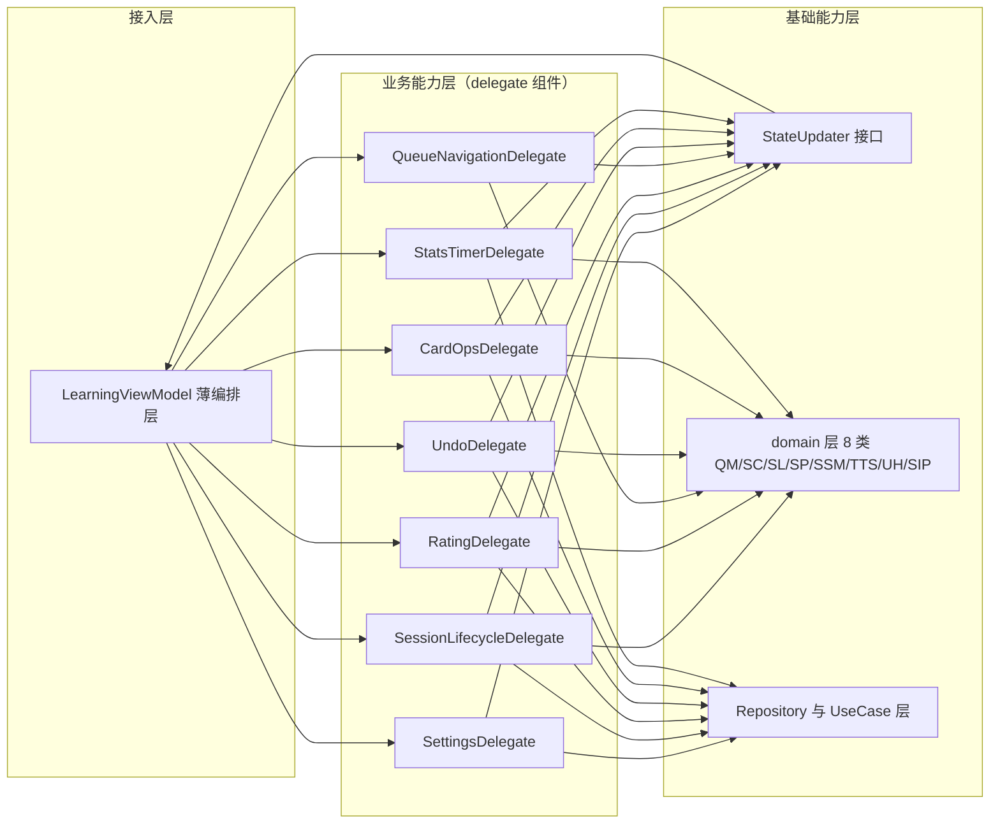
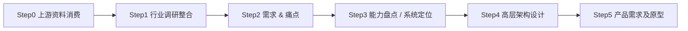

# AICoding 架构设计 · 高层架构设计

> 本文档为《AICoding 架构设计》核心产物之一，对应**高层架构设计模版**。
> 上游输入：业务原始诉求 + 行业调研结论 + 现有架构知识库；
> 下游输出：驱动《系统设计》《部署设计》《安全设计》《UserStory》四份文档的撰写。

---

## 0. 元信息：修订记录

> 记录文档版本、变更内容、修订人、修订时间，确保设计文档的可追溯。

```yaml
标题: Nemo - LearningViewModel 模块化瘦身重构 - 高层架构设计 v0.1
版本: v0.1
状态: Draft   # Draft | Reviewing | Approved | Deprecated
创建日期: 2026-10-29
最后更新: 2026-10-29
作者: business-architect（许边界）
评审人:
  - team-lead（主理人）
  - 用户（G3 方案获批门审核人）

关联文档:
  上游输入:
    - 业务原始诉求: Nemo 日语词汇学习 App LearningViewModel.kt（2443 行）模块化瘦身与架构解耦
    - 行业调研报告: .workbuddy/output/research_report.md（G2 已通过）
    - 现有架构知识库: .workbuddy/output/material_digest.md（G1 已通过，D1~D10 共 10 份资料 + X1~X10 冲突记录）
  下游产出:
    - 系统设计: AICoding架构设计-2-系统设计.md
    - 部署设计: N/A（纯代码变更，无部署拓扑变化）
    - 安全设计: N/A（纯代码变更，无安全边界变化）
    - UserStory: AICoding架构设计-5-UserStory.md
```

| 版本 | 日期 | 作者 | 变更内容 | 评审状态 |
| --- | --- | --- | --- | --- |
| v0.1 | 2026-10-29 | business-architect（许边界） | 初稿，覆盖 §1~§6 全部章节，7 个 delegate 组件架构方案，3 阶段 MVP/完整版决策 | Draft |

> **版本管理纪律**：破坏性变更（章节结构调整 / 关键决策反转）升 MAJOR；新增章节、扩充内容升 MINOR。

---

## 1. 需求概要

### 1.1 需求概要说明

Nemo 是一款专为日语学习者设计的灵动词汇学习 App（Kotlin + Jetpack Compose + MVI + Hilt + Coroutines/Flow），其学习模块核心文件 `LearningViewModel.kt` 已膨胀至 2443 行，承担 12 类职责（事件分发、设置监听、会话编排、评分管线、队列调度、撤销管理、卡片操作、计时结算、TTS、反馈、模式切换、导航），构造参数达 21 个，是典型的 God ViewModel。本期需求对该文件进行模块化瘦身与架构解耦，在不改变任何业务逻辑、状态流转和对外接口的前提下，将其拆解为职责明确、可维护、可测试的委托组件（delegate）架构，服务于 Nemo 项目的维护开发者与测试人员。

### 1.2 关键决策摘要

| 编号 | 决策类别 | 决策内容 | 关联章节 |
| --- | --- | --- | --- |
| D1 | 范围决策 | 本期聚焦 LearningViewModel.kt 单文件委托化拆分，不扩展至其他 feature 模块；不改业务逻辑、不改 UI 层、不改数据层 | §6.1 需求边界 |
| D2 | 技术选型决策 | 借鉴 B3 Orbit MVI 的 ContainerHost 委托模式思想，自研 delegate 组件（不引入 Orbit/MVIKotlin/Mavericks 框架），保持 StateFlow + onEvent 现有范式 | §3.2 / §4 / §5.1 |
| D3 | MVP / 完整版边界 | 第一阶段（MVP）完成 delegate 化拆分 + 接口兼容（R1~R2）；第二阶段完成重复消除（R3~R6）；完整版推迟自动翻面统一与遗留字段清理（R7~R8） | §4.3 |
| D4 | 复用 vs 新建 | 复用已有 domain 层 8 个类（LearningQueueManager/LearningScheduler/SessionLoader 等）作为 delegate 底层依赖；新建 7 个 delegate 组件承接 ViewModel 内部职责 | §5.2 |
| D5 | 遗留字段处理策略 | X7~X10 共 4 条遗留字段（selectedLevel/NoMoreWords/sessionQueue/sessionCorrectCount）推迟至完整版单独清理，不在本期 MVP 或第二阶段处理 | §4.3 / §6.1 |

**硬指标**：≥ 3 条，≤ 5 条；每条决策必须能映射到正文具体章节。✅ 共 5 条，均已映射。

### 1.3 价值主张

> 明确本系统/本期需求对业务的核心价值贡献（效率、合规、收入、成本、体验等维度）。

| 价值维度 | 量化目标 | 度量指标 | 当前值 | 目标值 | 截止时间 |
| --- | --- | --- | --- | --- | --- |
| 效率（可维护性） | 单文件行数降低 | LearningViewModel.kt 行数 | 2443 行 | ≤ 400 行（薄编排层） | 第一阶段完成 |
| 效率（可维护性） | 单类职责数降低 | LearningViewModel 职责数 | 12 类 | 1 类（编排调度） | 第一阶段完成 |
| 效率（可维护性） | 构造参数降低 | LearningViewModel 构造参数数 | 21 个 | ≤ 8 个（仅编排层 delegate + uiState） | 第一阶段完成 |
| 成本（可测试性） | 最大 delegate 单测覆盖率可达 | delegate 组件单元测试覆盖率 | 无独立单测（ViewModel 整体测试困难） | ≥ 80% | 第二阶段完成 |
| 体验（行为不变） | 重构后行为一致性 | 行为契约测试通过率 | 无行为契约测试 | 100% 通过 | 第一阶段完成 |

**硬指标**：业务价值 ≥ 2 条 + 技术/成本价值 ≥ 1 条；每条必须可量化。✅ 效率维度 3 条 + 成本维度 1 条 + 体验维度 1 条，共 5 条，全部可量化。

---

## 2. 需求分析 & 痛点解构

### 2.1 核心角色关注点

> 按"甲方决策者 / 最终用户 / 受影响方"维度盘点角色诉求。

本期重构涉及的核心角色包括：甲方决策者（用户，项目需求方）、最终用户角色（维护开发者、测试工程师）、受影响方角色（终端学习者）。各角色的 Top1 关心点如下：

| 角色 | 业务身份 | 主要操作 | Top1 关心点 | 来源 |
| --- | --- | --- | --- | --- |
| 甲方决策者（用户） | 项目负责人 / 需求方 | 审核重构方案、批准实施 | 零逻辑与语义变更——重构后学习行为 100% 不变 | 用户诉求核心约束 1 |
| 最终用户：维护开发者 | Android 开发工程师 | 修改/扩展 LearningViewModel 功能 | 单类行数与职责数可控——改一个功能不用通读 2443 行 | material_digest D1 §1（21 构造参数、12 类职责） |
| 最终用户：测试工程师 | QA / 测试开发 | 编写/执行 LearningViewModel 相关测试 | 可独立测试各职责域——不需要 mock 21 个依赖才能测一个 toggle | material_digest D1 §3（构造参数极度臃肿） |
| 受影响方：终端学习者 | Nemo App 用户 | 使用学习功能（评分/翻面/导航/撤销） | 重构后功能完全不变——学习进度/评分/撤销等行为无感知差异 | 用户诉求核心约束 2（对外接口与调用方兼容） |

**硬指标**：≥ 3 类（甲方决策者 / 最终用户 / 受影响方各至少一行）。✅ 共 4 类（甲方决策者 1 + 最终用户 2 + 受影响方 1），每行均有 Top1 关心点。

### 2.2 核心痛点

> 以 P1 / P2 / P3 ... 的优先级编码，列出本期需要解决的关键痛点。

| 编号 | 痛点描述 | 现象 / 数据 | 影响角色 | 影响程度 | 优先级 |
| --- | --- | --- | --- | --- | --- |
| P1 | LearningViewModel 承担 12 类职责，2443 行单文件 God ViewModel，构造参数 21 个，任何功能修改需通读全文定位逻辑 | 行数 2443 行；职责 12 类；构造参数 21 个；init 块含 18+ 个 Flow collector（D1 §4，L155-335） | 维护开发者 | 高（维护成本与缺陷率正相关） | P1 |
| P2 | 评分管线逻辑跨越 6 个方法（rate/applyLapsePenalty/handleScheduleResult/processSrsUpdate/processRelearningGraduation/persistRatingItemAsync），~530 行，时序依赖隐式且无独立测试 | 评分方法链 ~530 行；含防抖常量 RATING_DEBOUNCE_MS=100L 时序依赖（D1 §20-§25，L1235-1697） | 维护开发者 / 测试工程师 | 高（评分是核心业务路径） | P1 |
| P3 | Word/Grammar 双模式存在大量同构重复代码：loadWordSession/loadGrammarSession 完全同构（X6）、processSrsUpdate/processRelearningGraduation 结构相似（X4）、buryCurrentItem/handleLeech(bury_today) 逻辑重复（X5） | X6：两方法仅类型替换；X4：仅 SRS 字段来源不同；X5：仅提示文案不同（material_digest §3 冲突记录） | 维护开发者 | 中（修改一处需同步改另一处，易遗漏） | P2 |
| P4 | LearningSessionStatsManager 是唯一未走 DI 的 domain 类（直接 new），破坏 DI 一致性（X2），导致难以 mock 测试 | D1 §3 L132：`sessionStatsManager = LearningSessionStatsManager(context)`；其他 7 个 domain 类均 @Inject constructor（D7/D8） | 测试工程师 | 中（测试需额外 mock Context + SharedPreferences） | P2 |
| P5 | init 块 18+ 个 Flow collector 与 toggle* 系列方法中，Word/Grammar 自动翻面配置完全分离（X3），设置监听代码量大且对称性不统一 | X3：显示答案等待用 isGrammar 参数统一，自动翻面用完全分离的事件和方法（D2 §9 + D1 §4/§15） | 维护开发者 | 中（新增配置项需在 Word/Grammar 两处分别实现） | P3 |

**优先级标准**：
- **P1**：直接影响业务核心流程或合规底线，不解决无法上线。
- **P2**：影响用户体验或运营效率，可在 MVP 后迭代。
- **P3**：体验型 / 长尾问题，列入完整版或后续版本。

**硬指标**：每条痛点必须有"现象 / 数据"佐证；P1 ≥ 1 条且必须在 §2.3 有对应目标。✅ P1 痛点 2 条（P1、P2），P2 痛点 2 条（P3、P4），P3 痛点 1 条（P5），每条均有行号/数据佐证。

### 2.3 期待目标

> 以 V1 / V2 / V3 ... 的形式列出可量化的业务目标，对齐核心痛点。

| 编号 | 目标描述 | 对齐痛点 | 度量指标 | 当前值 | 目标值 | 截止时间 |
| --- | --- | --- | --- | --- | --- | --- |
| V1 | LearningViewModel 拆分为薄编排层 + 7 个 delegate 组件 | P1 | LearningViewModel 行数 / 职责数 / 构造参数数 | 2443 行 / 12 类 / 21 参数 | ≤ 400 行 / 1 类 / ≤ 8 参数 | 第一阶段（MVP） |
| V2 | 评分管线独立为 RatingDelegate，可独立单元测试 | P2 | RatingDelegate 行数 / 单测覆盖率 | 530 行内嵌 ViewModel / 无单测 | ~530 行独立 delegate / ≥ 80% 单测覆盖 | 第一阶段（MVP） |
| V3 | Word/Grammar 同构代码消除重复 | P3 | loadWordSession/loadGrammarSession 合并为 1 个泛型方法；processSrsUpdate/processRelearningGraduation 合并；buryCurrentItem/handleLeech 合并 | 3 组重复代码 | 3 组各合并为 1 个公共方法 | 第二阶段 |
| V4 | LearningSessionStatsManager 改为 DI 注入 | P4 | StatsManager 注入方式 | 直接 new（L132） | @Inject constructor + @ApplicationContext | 第二阶段 |
| V5 | 重构后行为 100% 一致 | P1 + P2 | 行为契约测试通过率 | 无行为契约测试 | 100% 通过（评分防抖/导航防抖/跨天重置/Learn Ahead 全覆盖） | 第一阶段（MVP） |

**硬指标**：每条目标必须有数字 + 对齐至少 1 条痛点；P1 痛点必须有对应 V 级目标。✅ V1~V5 全部有数字，P1 对齐 V1+V5，P2 对齐 V2+V5，P3 对齐 V3，P4 对齐 V4。

### 2.4 基线复用

> 现有架构 / 现有能力中可直接复用的组件、平台、模型、数据资产。

| 复用类别 | 现有能力 | 复用方式 | 来源系统 | 备注 |
| --- | --- | --- | --- | --- |
| domain 层领域类 | LearningQueueManager（281 行，队列调度） | delegate 组件直接调用，不改造 | feature/learning/domain（D8 §1） | QueueNavigationDelegate 核心依赖 |
| domain 层领域类 | LearningScheduler（155 行，评分调度） | delegate 组件直接调用，不改造 | feature/learning/domain（D8 §2） | RatingDelegate 核心依赖 |
| domain 层领域类 | SessionLoader（242 行，泛型会话加载） | delegate 组件直接调用，不改造 | feature/learning/domain（D8 §3） | SessionLifecycleDelegate 核心依赖，已有泛型基础 |
| domain 层领域类 | LearningSessionPolicy（218 行，FSRS 策略） | SessionLoader 间接调用，不改造 | feature/learning/domain（D8 §4） | 无需 delegate 直接交互 |
| domain 层领域类 | LearningTtsManager（71 行，TTS 管理） | delegate 组件直接调用，不改造 | feature/learning/domain（D8 §6） | 可直接复用，无需包裹 |
| domain 层领域类 | LearningUndoHelper（79 行，撤销辅助） | UndoDelegate 直接调用，不改造 | feature/learning/domain（D8 §7） | UndoDelegate 核心依赖 |
| domain 层领域类 | SrsIntervalPreview（126 行，间隔预览） | delegate 组件直接调用，不改造 | feature/learning/domain（D8 §8） | RatingDelegate 依赖 |
| UI 事件模型 | LearningEvent sealed interface（30+ 事件） | 保持不变，onEvent 路由到 delegate | feature/learning/presentation（D2） | 核心约束 2：接口兼容 |
| UI 状态模型 | LearningUiState data class（40+ 字段）+ LearningStatus 枚举（8 种） | 保持不变，delegate 通过统一状态更新接口修改 | feature/learning/presentation（D3） | 核心约束 2：接口兼容 |
| DI 基础设施 | Hilt @Inject constructor + LearningModule | delegate 组件通过 @Inject 注入 | feature/learning/di（D7） | 零额外 DI 配置成本 |
| domain 层领域类 | LearningSessionStatsManager（244 行，统计计时） | 第二阶段改为 @Inject 后复用 | feature/learning/domain（D8 §5） | 当前直接 new（X2），第二阶段改造 |

**硬指标**：必须先盘点再决定新建；凡列入"功能缺口"的能力，必须先在本节确认基线无法覆盖。✅ 已盘点全部 8 个 domain 类 + 3 个 UI 模型 + DI 基础设施，新建项仅为 delegate 组件（ViewModel 内部职责抽取）。

### 2.5 功能缺口

> 在现有基线之上仍需新建的功能能力。

| 阶段 | 功能缺口 | 必要性 | 优先级 | 对齐目标 |
| --- | --- | --- | --- | --- |
| 第一阶段（delegate 化拆分） | 7 个 delegate 组件新建：SettingsDelegate / SessionLifecycleDelegate / RatingDelegate / QueueNavigationDelegate / UndoDelegate / CardOpsDelegate / StatsTimerDelegate | 必须 | MVP | V1 |
| 第一阶段（接口兼容） | 统一状态更新接口（StateUpdater）设计——delegate 通过该接口更新 _uiState，而非直接持有 MutableStateFlow 引用 | 必须 | MVP | V1 + V5 |
| 第一阶段（行为保障） | 行为契约测试——覆盖评分防抖、导航防抖、跨天重置、Learn Ahead Limit、撤销恢复等关键时序场景 | 必须 | MVP | V5 |
| 第一阶段（事件路由） | onEvent 事件路由表——保持 onEvent 签名不变，内部改为 when 分发到对应 delegate | 必须 | MVP | V1 + V5 |
| 第二阶段（重复消除） | loadWordSession/loadGrammarSession 泛型合并（X6） | 重要 | 第二阶段 | V3 |
| 第二阶段（重复消除） | processSrsUpdate/processRelearningGraduation 公共方法抽取（X4） | 重要 | 第二阶段 | V3 |
| 第二阶段（重复消除） | buryCurrentItem/handleLeech(bury_today) 公共方法抽取（X5） | 重要 | 第二阶段 | V3 |
| 第二阶段（DI 统一） | LearningSessionStatsManager 改为 @Inject constructor + @ApplicationContext（X2） | 重要 | 第二阶段 | V4 |
| 完整版（推迟） | 自动翻面配置 Word/Grammar 统一（X3）——涉及 LearningEvent sealed interface 改造 | 非必须 | 完整版 | — |
| 完整版（推迟） | 遗留字段清理——selectedLevel 默认值统一（X7）、NoMoreWords 移除（X8）、sessionQueue 移除（X9）、sessionCorrectCount 移除（X10） | 非必须 | 完整版 | — |

**硬指标**：每条缺口必须对齐 §2.3 至少一条目标；MVP 缺口必须在 §6.3 功能清单中对应有 MVP 范围标记。✅ MVP 缺口 4 条（V1/V5 对齐），第二阶段缺口 4 条（V3/V4 对齐），完整版缺口 2 条（无 V 对齐，标注"非必须"）。

---

## 3. 行业调研

### 3.1 行业标杆系统分析

> 对标行业内代表性产品/系统，输出标签化清单。以下整合自 research_report.md（G2 已通过）的 B1~B5 标杆。

| 标杆系统 | 厂商 / 来源 | 场景覆盖 | 技术亮点 | 商业模式 | 适用度 |
| --- | --- | --- | --- | --- | --- |
| B1 Android Architecture Blueprints | Google（官方） | Android App 架构模式展示（TODO App） | Compose + ViewModel per screen + Flow + Hilt + 单 Activity + Navigation Compose | 开源（Apache 2.0） | 高 |
| B2 Now in Android（NiA） | Google（官方） | 生产级 Android App（新闻聚合）完整架构示例 | 三层架构（data/domain/UI）+ UDF + StateFlow sealed interface + Hilt + 模块化 | 开源（Apache 2.0） | 高 |
| B3 Orbit MVI | Orbit MVI 社区 | MVI 状态管理框架（Android/iOS/桌面） | ContainerHost 委托模式 + intent/reduce/sideEffect 三分离 + 内外部状态分离 | 开源（Apache 2.0） | 高 |
| B4 Mavericks（原 MvRx） | Airbnb（头部公司） | Android 状态管理框架（生产级） | MavericksState + setState/withState + invalidate 自动响应 + Redux 启发 | 开源（Apache 2.0） | 低 |
| B5 MVIKotlin | arkivanov（社区） | MVI 框架（Kotlin Multiplatform） | Store/Executor/Bootstrapper/Reducer 四组件分离 + Decompose 生态 + 时间旅行调试 | 开源（Apache 2.0） | 低 |

**硬指标**：≥ 3 家；至少包含 1 家头部 SaaS + 1 家开源/自研代表。✅ 共 5 家，B1/B2 为 Google 官方（头部代表），B3/B4/B5 为开源/自研代表。说明：Android ViewModel 架构模式领域不存在传统意义的"SaaS 产品"，"头部代表"界定为 Google 官方（行业标准制定者）和 Airbnb（头部互联网公司生产级框架）。

### 3.2 方案对标及优先级打分

> 横向对比矩阵 + 打分结果。以下整合自 research_report.md §3.1 的 5 维度加权矩阵。

**对比矩阵**（每行权重之和 = 1）：

| 评估维度 | 权重 | 权重理由 | B1 得分 | B2 得分 | B3 得分 | B4 得分 | B5 得分 |
| --- | --- | --- | --- | --- | --- | --- | --- |
| 场景契合度 | 0.30 | 用户诉求核心是 God ViewModel（2443 行、12 类职责）拆分，标杆与该场景的契合度最重要 | 4 | 4 | 5 | 4 | 4 |
| 合规可控性 | 0.25 | 用户诉求硬约束"零逻辑与语义变更、对外接口兼容"，标杆是否能保证接口兼容 | 5 | 5 | 4 | 3 | 3 |
| 集成难度（反向） | 0.20 | Nemo 已有 Hilt DI + domain 层 8 个类 + 纯 StateFlow 模式，集成难度越低越好 | 4 | 4 | 3 | 2 | 2 |
| 技术成熟度 | 0.15 | 标杆方案的成熟度、社区验证程度、持续维护状态 | 5 | 5 | 4 | 5 | 4 |
| 成本（反向） | 0.10 | 引入标杆方案的成本（框架引入 / 学习 / 迁移），越低越好 | 4 | 4 | 3 | 2 | 2 |
| **加权总分** | **1.00** | — | **4.40** | **4.40** | **4.00** | **3.30** | **3.15** |

**结论摘要**：
- **优先借鉴**：B1 Android Architecture Blueprints（4.40）+ B2 Now in Android（4.40）—— 理由：Google 官方架构标杆，技术栈与 Nemo（Kotlin+Compose+MVI+Hilt+Flow）完全一致，合规可控性 5/5（标准 StateFlow + 方法调用，完全可控接口兼容，无框架引入成本）。B2 的三层架构 + domain use cases + sealed interface UI state 是 Nemo 重构的目标范式，B1 提供标准 Compose+Hilt+Flow 基线。
- **部分借鉴**：B3 Orbit MVI（4.00）—— 借鉴点：ContainerHost 委托模式（状态管理委托给独立容器，解决 ViewModel 职责拆分）、intent/reduce/sideEffect 三分离（指导 onEvent 重构为 intent 分发 + reduce 状态更新 + sideEffect 副作用处理）、内外部状态分离（保持对外 StateFlow 接口不变同时内部拆分状态管理）。不借鉴的部分：不引入 Orbit 框架本身（避免范式迁移成本和 sideEffect→SharedFlow 映射适配）。
- **不借鉴**：B4 Mavericks（3.30）+ B5 MVIKotlin（3.15）—— 否决理由：B4 的 MavericksViewModel 继承体系与 Nemo 现有 ViewModel 冲突，setState 替换 StateFlow 需改造对外接口（合规可控性 3/5），违背零破坏性约束；B5 的 Store/Executor/Reducer 概念体系与现有 ViewModel+StateFlow 范式差异最大，学习曲线最陡（集成难度反向 2/5）。两者均违背"零破坏性重构"核心约束。

**方案组合**：B2 三层架构基线 + B3 ContainerHost 委托模式（不引入框架，借鉴委托思想自研 delegate 组件），覆盖目标架构基线 + domain use cases 方向验证 + ViewModel 内部职责委托拆分模式 + intent/reduce/sideEffect 分离思想。迁移成本约 1~2 人月用于 LearningViewModel 2443 行的委托化拆分。

### 3.3 完整报告参考

> 给出行业调研完整报告的链接或归档路径，供深度查阅。

- 完整报告路径：`.workbuddy/output/research_report.md`
- 调研工具：`tech-research-advisor`（见附录 B）
- 调研日期：2026-10-29
- 调研归档：`.workbuddy/output/research_report.md`

---

## 4. 方案决策

### 4.1 价值定位澄清

> 当前需求/系统对业务全局的价值贡献。

**定位三段式**：

```
对外价值（终端用户侧）: 重构后学习行为 100% 不变——评分/翻面/导航/撤销/计时等全部交互无感知差异，保证学习进度连续性
对内价值（维护侧）    : LearningViewModel 从 2443 行/12 类职责/21 构造参数 降维至 ≤400 行/1 类编排职责/≤8 构造参数，7 个 delegate 组件各自可独立维护与单元测试
差异化价值            : 借鉴 B3 Orbit MVI 的 ContainerHost 委托模式思想但自研 delegate 组件——不引入任何第三方 MVI 框架（Orbit/MVIKotlin/Mavericks），零范式迁移成本，保持 Nemo 现有 StateFlow + onEvent + Hilt 技术栈不变
```

**与产品矩阵的关系**：本次重构是 Nemo App `feature/learning` 模块内部的代码级重构，不涉及产品功能变更，与 `feature/library`、`feature/statistics`、`feature/settings` 等上下游模块的交互接口（LearningUiState StateFlow + onEvent 方法签名）保持完全不变。

### 4.2 系统定位澄清

> 当前系统在产品矩阵 / 技术架构中的边界与上下游。

| 维度 | 内容 |
| --- | --- |
| 系统名称 | LearningViewModel 委托化架构重构 |
| 系统类型 | 改造（既有代码重构，非新建系统） |
| 部署形态 | N/A（纯代码变更，无部署拓扑变化，无服务器/容器/网络变化） |
| 多租户 | N/A（单用户 App，无多租户概念） |
| 服务对象 | Nemo 维护开发者（直接）/ Nemo 终端学习者（间接受益于可维护性提升） |
| 上游依赖 | feature/learning/presentation 的 Compose UI 页面（通过 uiState StateFlow + onEvent 方法消费）、feature/learning/domain 层 8 个领域类、feature/learning/di 的 Hilt 模块（详见 §5.2） |
| 下游消费者 | 无新增下游；重构后 LearningViewModel 对外接口（StateFlow + onEvent）完全不变，现有 Compose UI 页面与导航无需任何改动 |
| 边界（不做） | 不改业务逻辑/状态流转/边界条件/异常处理；不改 LearningEvent sealed interface；不改 LearningUiState 字段定义；不改 UI 层（Compose 页面与导航）；不改数据层（Repository/UseCase/Room）；不引入第三方 MVI 框架；不决定数据库表结构 |

### 4.3 MVP 与完整版决策

> 明确 MVP 范围、完整版范围、两者的演进关系。

| 阶段 | 范围（功能编号） | 架构差异点 | 退出标准 | 不做（延后） |
| --- | --- | --- | --- | --- |
| 第一阶段（MVP） | R1 delegate 化拆分（7 个 delegate 组件 + StateUpdater 接口 + onEvent 路由表 + 行为契约测试）、R2 接口兼容（StateFlow + onEvent 签名不变） | delegate 组件通过 @Inject 注入；onEvent 内部改为 when 路由到 delegate；_uiState 通过 StateUpdater 接口统一更新；行为契约测试 100% 通过 | LearningViewModel ≤ 400 行；7 个 delegate 各自可编译运行；行为契约测试覆盖评分防抖/导航防抖/跨天重置/Learn Ahead/撤销恢复全部通过；现有 Compose UI 无任何改动 | R3~R8 |
| 第二阶段 | R3 loadWordSession/loadGrammarSession 泛型合并（X6）、R4 processSrsUpdate/processRelearningGraduation 合并（X4）、R5 buryCurrentItem/handleLeech 合并（X5）、R6 StatsManager 改 DI（X2） | 消除 Word/Grammar 同构重复；StatsManager 改为 @Inject constructor + @ApplicationContext | 3 组重复代码各合并为 1 个公共方法；StatsManager 通过 Hilt 注入；行为契约测试全部通过 | R7~R8 |
| 完整版（推迟） | R7 自动翻面配置 Word/Grammar 统一（X3）、R8 遗留字段清理（X7 selectedLevel / X8 NoMoreWords / X9 sessionQueue / X10 sessionCorrectCount） | LearningEvent sealed interface 可能调整（R7）；LearningUiState 字段可能删减（R8） | 自动翻面统一为参数化方法；遗留字段清理并验证 UI 层无引用 | — |

**演进纪律**（重要）：
- ✅ MVP 的架构骨架（delegate + StateUpdater + onEvent 路由）必须是完整版的**子集**——第二阶段和完整版只做"delegate 内部重复消除"和"遗留清理"，不改变 delegate 架构骨架，不允许推倒重来。
- ✅ MVP 中 delegate 组件可能暂时保留 Word/Grammar 分离代码（如 loadWordSession/loadGrammarSession 暂时各保留一份），第二阶段再合并，这是可控的技术债务。
- ❌ 禁止：MVP 为了赶工而引入"完整版无法继承"的临时架构（如临时把 delegate 写成 God Delegate 再拆分——必须一步到位拆为 7 个职责明确的 delegate）。

---

## 5. 业务架构设计

### 5.1 业务架构图

> LearningViewModel 委托组件架构图，体现三层结构与数据流方向。

**绘制规范**：
- 三层：**接入层（UI 事件入口）→ 业务能力层（delegate 组件）→ 基础能力层（domain 层 + 状态源）**。
- 每个模块有标准名（与 §4.2 / §6.2 一致）。
- 数据流方向：实线 = 同步调用、虚线 = 异步事件/Flow 订阅、粗线 = 主链路。

```mermaid
flowchart TB
    subgraph 接入层["接入层（UI 事件入口）"]
        UI["Compose UI 页面 - 消费 uiState StateFlow + 调用 onEvent"]
        VM["LearningViewModel 薄编排层 - 持有 _uiState + onEvent 路由 - ≤400行"]
    end
    subgraph 业务能力层["业务能力层（7 个 delegate 组件）"]
        SD["SettingsDelegate 设置监听与写入 ~260行"]
        SLD["SessionLifecycleDelegate 会话编排 ~470行"]
        RD["RatingDelegate 评分核心管线 ~530行"]
        QND["QueueNavigationDelegate 队列调度与导航 ~380行"]
        UD["UndoDelegate 撤销管理 ~130行"]
        CD["CardOpsDelegate 卡片管理操作 ~130行"]
        STD["StatsTimerDelegate 计时与会话结算 ~100行"]
    end
    subgraph 基础能力层["基础能力层（domain 层 8 类 + 状态源）"]
        SU["StateUpdater 接口 - 统一状态更新入口"]
        QM["LearningQueueManager 队列调度 281行"]
        SC["LearningScheduler 评分调度 155行"]
        SL["SessionLoader 会话加载 242行"]
        SP["LearningSessionPolicy FSRS 策略 218行"]
        SSM["LearningSessionStatsManager 统计计时 244行"]
        TTS["LearningTtsManager TTS 管理 71行"]
        UH["LearningUndoHelper 撤销辅助 79行"]
        SIP["SrsIntervalPreview 间隔预览 126行"]
        REPO["Repository 与 UseCase 层"]
    end

    UI -->|"onEvent(event)"| VM
    VM -->|"uiState StateFlow"| UI

    VM -->|"路由 StartLearning/ChangeLearningMode"| SLD
    VM -->|"路由 RateWord/RateGrammar"| RD
    VM -->|"路由 NavigateNext/Prev/GoToIndex"| QND
    VM -->|"路由 Undo"| UD
    VM -->|"路由 SuspendCurrent/BuryCurrent"| CD
    VM -->|"路由 PauseTimer/ResumeTimer"| STD
    VM -->|"init 注入 + 路由 Toggle*/Set*/Cycle*"| SD
    VM -.->|"TTS 事件直接转发"| TTS

    SD -->|"toggle/cycle/set 持久化"| REPO
    SD -.->|"监听 18+ Flow"| REPO
    SLD -->|"loadSession 泛型"| SL
    SLD -->|"completedToday/dailyGoal"| REPO
    RD -->|"scheduleFailure/Pass"| SC
    RD -->|"calculate SRS"| REPO
    RD -->|"persist updateWord/Grammar"| REPO
    QND -->|"reorderQueue/selectNext/removeCurrent"| QM
    UD -->|"saveSnapshot/popSnapshot"| UH
    UD -->|"恢复 updateWord/Grammar"| REPO
    CD -->|"bury/suspend persist"| REPO
    STD -->|"completeSession/pause/resume"| SSM
    STD -->|"syncTodayCounts"| REPO
    RD -->|"calculate 间隔预览"| SIP

    SD -->|"更新 uiState"| SU
    SLD -->|"更新 uiState"| SU
    RD -->|"更新 uiState"| SU
    QND -->|"更新 uiState"| SU
    UD -->|"更新 uiState"| SU
    CD -->|"更新 uiState"| SU
    STD -->|"更新 uiState"| SU
    SU -->|"copy + emit"| VM

    SL --> SP
```



**架构图说明**：

1. **接入层**：Compose UI 页面通过 `onEvent(LearningEvent)` 发送用户交互事件，通过 `uiState StateFlow` 消费 UI 状态。LearningViewModel 保持为薄编排层（≤ 400 行），持有 `_uiState`（MutableStateFlow 类型，承载 LearningUiState），`onEvent` 方法签名不变，内部改为 `when(event)` 路由到对应 delegate。

2. **业务能力层**：7 个 delegate 组件各自承担单一职责域，通过 Hilt `@Inject constructor` 注入。每个 delegate 通过 `StateUpdater` 接口更新 `_uiState`（而非直接持有 MutableStateFlow 引用），保证状态更新的统一入口和可追踪性。

3. **基础能力层**：domain 层 8 个已抽取类保持不变（第二阶段 StatsManager 改 DI），Repository/UseCase 层保持不变。StateUpdater 接口是新增的统一状态更新入口，delegate 组件通过该接口向 `_uiState` 写入状态。

### 5.2 系统依赖架构

> delegate 组件与 domain 层 / Repository / UseCase 的依赖关系。

| 依赖类型 | 系统 / 模块 | 提供方 | 依赖能力 | 接入方式 | 同步/异步 | 关键约束 |
| --- | --- | --- | --- | --- | --- | --- |
| 复用底座 | LearningQueueManager | feature/learning/domain（D8 §1） | 队列调度（sortAnkiStyle/reorderQueueAnkiStyle/selectNextItem/removeCurrent） | @Inject constructor | 同步 | 纯内存计算无 I/O；QueueNavigationDelegate 核心依赖 |
| 复用底座 | LearningScheduler | feature/learning/domain（D8 §2） | 评分调度（scheduleFailure/schedulePass） | @Inject constructor | 同步 | 纯逻辑无 I/O；RatingDelegate 核心依赖 |
| 复用底座 | SessionLoader | feature/learning/domain（D8 §3） | 泛型会话加载（loadSession 泛型约束 SrsItem） | @Inject constructor | 同步（suspend） | 已有泛型基础；SessionLifecycleDelegate 核心依赖 |
| 复用底座 | LearningSessionPolicy | feature/learning/domain（D8 §4） | FSRS 策略（partitionOverdueItems/mixSessionItems） | @Inject constructor（被 SessionLoader 间接调用） | 同步 | SessionLoader 内部调用，delegate 不直接交互 |
| 复用底座 | LearningSessionStatsManager | feature/learning/domain（D8 §5） | 统计计时（checkAndRestoreOrReset/resumeTimer/pauseTimer/onItemRated/completeSession） | 直接 new（X2，第二阶段改 @Inject + @ApplicationContext） | 同步 + SharedPreferences I/O | 当前唯一未走 DI 的 domain 类；StatsTimerDelegate 依赖；第二阶段改造 |
| 复用底座 | LearningTtsManager | feature/learning/domain（D8 §6） | TTS 朗读（speakWord/speakExample/observeTtsEvents/stop） | @Inject constructor | 异步（Flow） | LearningViewModel 可直接转发 TTS 事件，无需包裹为 delegate |
| 复用底座 | LearningUndoHelper | feature/learning/domain（D8 §7） | 撤销快照（saveSnapshot/popSnapshot/canUndo/clear） | @Inject constructor | 同步 | UndoDelegate 核心依赖；单步撤销（保留最后一次快照） |
| 复用底座 | SrsIntervalPreview | feature/learning/domain（D8 §8） | SRS 间隔预览（calculate 返回 Map 映射 quality 到间隔文本） | @Inject constructor | 同步 | RatingDelegate 依赖；quality 0-5 间隔文本 |
| 上游 | SettingsRepository | core/data | 设置读写（Flow 读取 + suspend 写入） | @Inject constructor | 异步（Flow 读）/ 同步（suspend 写） | SettingsDelegate 监听 18+ Flow；toggle/cycle/set 持久化 |
| 上游 | WordRepository / GrammarRepository | core/data | 词库/语法库 CRUD | @Inject constructor | 同步（suspend） | RatingDelegate/UndoDelegate/CardOpsDelegate persist；SessionLifecycleDelegate 加载 |
| 上游 | StudyRecordRepository | core/data | 学习记录（今日新学/复习/重学计数） | @Inject constructor | 同步（suspend） | UndoDelegate 恢复时增减计数；StatsTimerDelegate syncTodayCounts |
| 上游 | SrsCalculator（Service） | core/domain | FSRS 算法计算 | @Inject constructor | 同步 | RatingDelegate applyLapsePenalty/processSrsUpdate 核心依赖 |
| 上游 | GetNewWords/GetDueWords/GetLearningWords/GetTodayLearnedWordsCount（5 个 Word UseCase） | core/domain | 单词查询 | @Inject constructor | 同步（suspend） | SessionLifecycleDelegate 加载会话 |
| 上游 | GetNewGrammars/GetDueGrammars/GetLearningGrammars/GetTodayLearnedGrammarsCount（5 个 Grammar UseCase） | core/domain | 语法查询 | @Inject constructor | 同步（suspend） | SessionLifecycleDelegate 加载会话 |
| 上游 | ContentReportRepository | core/data | 内容错误反馈 | @Inject constructor | 同步（suspend） | LearningViewModel 直接调用（handleReportError 逻辑简单，不单独拆 delegate） |
| 上游 | CloudBackupManager | core/data | 云端备份 | @Inject constructor | 异步（suspend） | StatsTimerDelegate completeSession 后触发 |
| 上游 | ReviewLogRepository | core/data | 复习日志记录 | @Inject constructor | 同步（suspend） | RatingDelegate persistRatingItemAsync 插入 ReviewLog |
| 下游 | Compose UI 页面（LearningScreen 等） | feature/learning/presentation | 消费 uiState StateFlow + 调用 onEvent | StateFlow collect + 方法调用 | 异步（Flow）/ 同步（方法） | **对外接口不变**——核心约束 2 |
| 下游 | Compose 导航（Navigation Compose） | feature/learning/presentation | 导航事件消费 | 方法调用 | 同步 | **对外接口不变**——核心约束 2 |
| 新建 | StateUpdater 接口 | 本期新建 | 统一状态更新入口（update { copy(...) }） | delegate 通过接口调用 | 同步 | 解决 R-01 delegate 间状态共享并发问题；LearningViewModel 实现 |

**硬指标**：
- 每条依赖明确"接入方式 + 同步/异步 + 关键约束"。✅ 全部 19 条依赖均标注。
- 所有 P1 痛点对应的核心能力，必须能在本表中找到依赖来源。✅ P1（God ViewModel 拆分）→ 7 个 delegate + StateUpdater；P2（评分管线）→ RatingDelegate + LearningScheduler + SrsCalculator + SrsIntervalPreview。

### 5.3 业务闭环

> 描述业务全链路的闭环路径，标注关键环节、关键反馈回路。

**业务主链路**（评分核心路径，端到端）：

```
用户评分 → onEvent(RateWord/RateGrammar) → LearningViewModel.when 路由 → RatingDelegate.rate(quality)
  → saveUndoSnapshot（UndoDelegate 存快照）
  → 设 Processing 状态（StateUpdater 更新 _uiState）
  → handleSkippedItemsOnRating（LearningQueueManager 跳过卡片顺延）
  → 构建 LearningItem（含 step/dueTime）
  → sessionStatsManager.onItemRated（StatsTimerDelegate 更新统计）
  → 按 quality 分支：
      quality==5（熟词速通）→ processSrsUpdate（srsCalculator.calculate → copy → 乐观更新 UI → removeCurrentAndMoveNext → persistRatingItemAsync）
      quality≤2（忘记）→ applyLapsePenalty（srsCalculator.calculate → copy type=3）→ LearningScheduler.scheduleFailure → handleScheduleResult
      quality 3-4（掌握）→ LearningScheduler.schedulePass → handleScheduleResult
  → handleScheduleResult 分支：
      Leech → CardOpsDelegate.handleLeech（bury_today 或 skip）
      Graduate → processSrsUpdate 或 processRelearningGraduation（重学毕业）
      Requeue → QueueNavigationDelegate.reQueueAtRelativeOffset（Anki 重入队）
  → persistRatingItemAsync（Dispatchers.IO 后台持久化：updateWord/GrammarUseCase + incrementLapse/Learned/Reviewed + addTodayTested/Wrong + insert ReviewLog + srsCalculator.notifyReviewCompleted + syncTodayCounts）
  → delay(RATING_DEBOUNCE_MS=100L)
  → QueueNavigationDelegate.handleSelectionResult（Empty→completeSession / Wait→设 Waiting / Next→更新 uiState 新卡片）
  → StateUpdater 更新 _uiState（新 currentIndex/currentWord/isAnswerShown=false/slideDirection=FORWARD）
  → armShowAnswerDelay（SettingsDelegate 计算显示答案延迟）
  → saveCurrentSessionState（SettingsDelegate 持久化会话进度）
  → UI 自动响应 StateFlow 更新渲染新卡片
```

**关键反馈回路**：

| 回路 | 触发点 | 反馈对象 | 反馈机制 | 价值 |
| --- | --- | --- | --- | --- |
| 撤销回路 | 用户点击 Undo | UndoDelegate + RatingDelegate | onEvent(Undo) → UndoDelegate.popSnapshot → 恢复数据库（updateWord/Grammar + StudyRecord 增减计数）→ 恢复内部 Map/Set → StateUpdater 恢复 uiState（isAnswerShown=true/BACKWARD）→ syncUndoAvailability | 用户误评后可回退一步，保证学习数据准确性 |
| 会话完成回路 | 队列为空（handleSelectionResult.Empty） | StatsTimerDelegate + CloudBackupManager | completeSession → sessionStatsManager.completeSession → 设 SessionCompleted 状态 → clearSession → syncTodayCounts → cloudBackupManager.performImmediateAutoBackup → UI 展示结算战报 | 学习会话闭环，统计数据持久化并云端备份 |
| 跨天重置回路 | checkAndRestoreOrReset 检测到天数变化 | StatsTimerDelegate + SessionLifecycleDelegate | sessionStatsManager.checkAndRestoreOrReset → 跨天清零统计 → 重新加载会话时获取新的 completedToday | 保证学习日统计正确性，防止跨天数据混淆 |
| 设置变更回路 | SettingsRepository Flow 发射 | SettingsDelegate | init 块 18+ Flow collector 监听 → 模式匹配判断 → StateUpdater 更新 uiState 对应配置字段 → armShowAnswerDelay 重新计算延迟 | 设置变更实时生效，无需重启会话 |

**运营主线**：
- **每日**：维护开发者无需关注 LearningViewModel（重构后职责清晰）；测试工程师可针对单个 delegate 运行单元测试。
- **每周**：维护开发者修改/扩展功能时，只需修改对应 delegate（如改评分逻辑只动 RatingDelegate，改队列调度只动 QueueNavigationDelegate）。
- **每月**：维护开发者评估是否推进第二阶段重复消除（R3~R6）或完整版遗留清理（R7~R8）。

---

## 6. 产品需求及原型

### 6.1 需求边界

> 明确本期与后续版本的需求范围、能力边界、交付物边界。

**In-Scope**（本期必做）：

```
F1. 新建 SettingsDelegate 组件——承接 init 块 18+ Flow collector + toggle/cycle/set 系列~260 行设置逻辑
F2. 新建 SessionLifecycleDelegate 组件——承接 startLearning/startBonusLearning/loadWord/GrammarSession/handleSessionLoadResult ~470 行会话编排逻辑
F3. 新建 RatingDelegate 组件——承接 rate/applyLapsePenalty/handleScheduleResult/processSrsUpdate/processRelearningGraduation/persistRatingItemAsync ~530 行评分管线逻辑
F4. 新建 QueueNavigationDelegate 组件——承接 reQueue/resumeFromWaiting/removeCurrentAndMoveNext/handleSelectionResult/navigateNext/Prev/To ~380 行队列导航逻辑
F5. 新建 UndoDelegate 组件——承接 saveUndoSnapshot/undo/syncUndoAvailability ~130 行撤销逻辑
F6. 新建 CardOpsDelegate 组件——承接 handleLeech/suspendCurrentItem/buryCurrentItem/suspendItem ~130 行卡片操作逻辑
F7. 新建 StatsTimerDelegate 组件——承接 completeSession/syncTodayCounts/pauseTimer/resumeTimer ~100 行计时结算逻辑
F8. 新建 StateUpdater 统一状态更新接口——delegate 通过此接口更新 _uiState，解决多 delegate 并发写入问题
F9. 重构 onEvent 为事件路由表——保持 onEvent 签名不变，内部改为 when 分发到对应 delegate
F10. 重构 LearningViewModel 为薄编排层——持有 _uiState + delegate 调度，≤ 400 行
F11. 保持 LearningUiState StateFlow 对外接口不变——Compose UI 层零改动
F12. 保持 onEvent(LearningEvent) 方法签名不变——Compose UI 层与导航零改动
N1. 行为契约测试覆盖率——评分防抖/导航防抖/跨天重置/Learn Ahead Limit/撤销恢复全部覆盖，100% 通过
N2. delegate 组件可独立单元测试——每个 delegate 可脱离 ViewModel 独立测试，≥ 80% 覆盖率（第二阶段目标）
```

**Out-of-Scope**（本期不做，必须列原因）：
| 编号 | 不做的事 | 原因 | 后续计划 |
| --- | --- | --- | --- |
| O1 | Out-of-Scope：不改业务逻辑/状态流转/边界条件/异常处理 | 用户诉求核心约束 1："100% 保持既有业务逻辑、状态流转、边界条件及异常处理行为，严禁增删改功能分支" | 永不做（约束基线） |
| O2 | Out-of-Scope：不改 LearningEvent sealed interface（含 30+ 事件定义） | 改事件模型会影响 UI 层调用方，违背核心约束 2"对外接口与调用方兼容"；R7 自动翻面统一涉及事件改造推迟至完整版 | 完整版 R7 评估 |
| O3 | Out-of-Scope：不改 LearningUiState data class 字段定义（含 40+ 字段） | 改状态字段会影响 Compose UI 层消费方，违背核心约束 2；R8 遗留字段清理推迟至完整版 | 完整版 R8 评估 |
| O4 | 不改 UI 层（Compose 页面与导航） | 用户诉求核心约束 2："保证外部 UI 层依赖的公开状态和交互方法签名保持平滑兼容" | 永不做（约束基线） |
| O5 | 不改数据层（Repository/UseCase/Room/Supabase） | 重构范围限定在 ViewModel 内部职责拆分，数据层不在本次范围 | 不做（超出范围） |
| O6 | 不引入第三方 MVI 框架（Orbit/MVIKotlin/Mavericks） | research_report.md 否决结论：B4（3.30）+ B5（3.15）违背零破坏性约束；B3 借鉴委托思想但不引入框架本身 | 永不做（范式迁移成本过高） |
| O7 | 不决定数据库表结构 | 归 system-architect 职责（business-architect 不越权） | Phase 4 system-architect |
| O8 | 不处理遗留字段（X7 selectedLevel / X8 NoMoreWords / X9 sessionQueue / X10 sessionCorrectCount） | 遗留字段清理涉及 UI 层和数据层验证，建议在委托化拆分完成、测试覆盖充分后单独处理 | 完整版 R8 |
| O9 | 不统一 Word/Grammar 自动翻面配置（X3） | 涉及 LearningEvent sealed interface 改造 + settings Flow 合并，影响面较大 | 完整版 R7 |

**硬指标**：In-Scope ≤ 15 条；Out-of-Scope ≥ 3 条。✅ In-Scope 14 条（F1~F12 + N1~N2）；Out-of-Scope 9 条（O1~O9）。

### 6.2 产品模块全景图

> delegate 组件清单 + domain 层类清单的模块全景。

**模块卡片**（每个模块必填字段）：

| 模块名称 | 一级归属 | 责任团队 | 上游 | 下游 | MVP 是否包含 |
| --- | --- | --- | --- | --- | --- |
| LearningViewModel（薄编排层） | 接入层 | feature/learning | Compose UI（onEvent） | 7 个 delegate + StateUpdater | 是 |
| SettingsDelegate | 业务能力层 | feature/learning | SettingsRepository Flow | StateUpdater | 是 |
| SessionLifecycleDelegate | 业务能力层 | feature/learning | SessionLoader / Repository / UseCase | StateUpdater | 是 |
| RatingDelegate | 业务能力层 | feature/learning | LearningScheduler / SrsCalculator / SrsIntervalPreview / Repository / UseCase | StateUpdater | 是 |
| QueueNavigationDelegate | 业务能力层 | feature/learning | LearningQueueManager | StateUpdater | 是 |
| UndoDelegate | 业务能力层 | feature/learning | LearningUndoHelper / Repository / UseCase / StudyRecordRepository | StateUpdater | 是 |
| CardOpsDelegate | 业务能力层 | feature/learning | Repository / UseCase | StateUpdater | 是 |
| StatsTimerDelegate | 业务能力层 | feature/learning | LearningSessionStatsManager / Repository / UseCase / CloudBackupManager | StateUpdater | 是 |
| StateUpdater 接口 | 基础能力层 | feature/learning | LearningViewModel（实现） | 7 个 delegate（调用） | 是 |
| LearningQueueManager | 基础能力层 | feature/learning/domain | — | QueueNavigationDelegate | 是（复用） |
| LearningScheduler | 基础能力层 | feature/learning/domain | — | RatingDelegate | 是（复用） |
| SessionLoader | 基础能力层 | feature/learning/domain | LearningSessionPolicy | SessionLifecycleDelegate | 是（复用） |
| LearningSessionPolicy | 基础能力层 | feature/learning/domain | FsrsAlgorithm（内部） | SessionLoader（间接） | 是（复用） |
| LearningSessionStatsManager | 基础能力层 | feature/learning/domain | Context + SharedPreferences | StatsTimerDelegate | 是（复用，第二阶段改 DI） |
| LearningTtsManager | 基础能力层 | feature/learning/domain | AudioRepository | LearningViewModel（直接转发） | 是（复用） |
| LearningUndoHelper | 基础能力层 | feature/learning/domain | — | UndoDelegate | 是（复用） |
| SrsIntervalPreview | 基础能力层 | feature/learning/domain | SrsCalculator | RatingDelegate | 是（复用） |

**模块全景图**：



### 6.3 功能清单

> "一级模块 / 二级功能 / 优先级 / MVP 范围 / 完整版范围"五列功能清单。

| 编号 | 一级模块 | 二级功能 | 功能描述 | 优先级 | MVP 范围 | 完整版范围 | 对齐目标 |
| --- | --- | --- | --- | --- | --- | --- | --- |
| F1 | SettingsDelegate | 设置监听与写入 | init 块 18+ Flow collector + toggle/cycle/set 系列方法迁移 | P0 | ✅ | ✅ | V1 |
| F2 | SessionLifecycleDelegate | 会话生命周期编排 | startLearning/startBonusLearning/loadWord/GrammarSession/handleSessionLoadResult 迁移 | P0 | ✅ | ✅ | V1 |
| F3 | RatingDelegate | 评分核心管线 | rate/applyLapsePenalty/handleScheduleResult/processSrsUpdate/processRelearningGraduation/persistRatingItemAsync 迁移 | P0 | ✅ | ✅ | V1 + V2 |
| F4 | QueueNavigationDelegate | 队列调度与导航 | reQueue/resumeFromWaiting/removeCurrentAndMoveNext/handleSelectionResult/navigateNext/Prev/To 迁移 | P0 | ✅ | ✅ | V1 |
| F5 | UndoDelegate | 撤销管理 | saveUndoSnapshot/undo/syncUndoAvailability 迁移 | P0 | ✅ | ✅ | V1 |
| F6 | CardOpsDelegate | 卡片管理操作 | handleLeech/suspendCurrentItem/buryCurrentItem/suspendItem 迁移 | P0 | ✅ | ✅ | V1 |
| F7 | StatsTimerDelegate | 计时与会话结算 | completeSession/syncTodayCounts/pauseTimer/resumeTimer 迁移 | P0 | ✅ | ✅ | V1 |
| F8 | StateUpdater 接口 | 统一状态更新 | delegate 通过此接口更新 _uiState，解决并发写入 | P0 | ✅ | ✅ | V1 + V5 |
| F9 | onEvent 事件路由表 | 事件路由重构 | 保持 onEvent 签名不变，内部改为 when 分发到 delegate | P0 | ✅ | ✅ | V1 + V5 |
| F10 | LearningViewModel 薄编排层 | 编排层瘦身 | 持有 _uiState + delegate 调度，≤ 400 行 | P0 | ✅ | ✅ | V1 |
| F11 | 行为契约测试 | 重构安全验证 | 覆盖评分防抖/导航防抖/跨天重置/Learn Ahead/撤销恢复 | P0 | ✅ | ✅ | V5 |
| F12 | 接口兼容保障 | 对外接口不变 | StateFlow + onEvent 签名不变，Compose UI 零改动 | P0 | ✅ | ✅ | V5 |
| F13 | loadWordSession/loadGrammarSession 泛型合并 | Word/Grammar 会话加载统一 | 合并为 1 个泛型方法（X6） | P1 | ❌ | ✅ | V3 |
| F14 | processSrsUpdate/processRelearningGraduation 合并 | SRS 更新与重学毕业统一 | 抽取公共方法 + 差异化参数（X4） | P1 | ❌ | ✅ | V3 |
| F15 | buryCurrentItem/handleLeech 合并 | 卡片埋藏统一 | 抽取公共方法（X5） | P1 | ❌ | ✅ | V3 |
| F16 | StatsManager 改 DI | DI 一致性改造 | 改为 @Inject constructor + @ApplicationContext（X2） | P1 | ❌ | ✅ | V4 |
| F17 | 自动翻面配置统一 | Word/Grammar 自动翻面参数化 | LearningEvent 改造 + settings Flow 合并（X3） | P2 | ❌ | ✅ | — |
| F18 | 遗留字段清理 | 废弃字段移除 | selectedLevel/NoMoreWords/sessionQueue/sessionCorrectCount（X7~X10） | P2 | ❌ | ✅ | — |

**硬指标**：
- 每个 P0 功能必须在 MVP 范围内为 ✅。✅ F1~F12 共 12 个 P0 功能全部 ✅ MVP。
- 每个功能必须能反向映射到 §2.5 功能缺口 + §2.3 期待目标。✅ F1~F12（MVP 缺口，V1/V2/V5）、F13~F16（第二阶段缺口，V3/V4）、F17~F18（完整版，无 V 对齐标注"—"）。

### 6.4 产品原型 - delegate 组件结构

> 重构语境下，"产品原型"适配为 delegate 组件的代码结构原型。

**核心 delegate 组件清单**：

| delegate 组件 | 用途 | 关键方法 | 行数估算 | MVP |
| --- | --- | --- | --- | ✅ |
| SettingsDelegate | 设置监听与写入 | initCollectSettings / toggleAutoPlayAudio / toggleShowAnswerDelay / cycleShowAnswerDelayDuration / setShowAnswerDelayMs / toggleAutoRevealAnswer / cycleAutoRevealAnswerDuration / setAutoRevealAnswerMs / toggleGrammarAutoRevealAnswer / cycleGrammarAutoRevealAnswerDuration / setGrammarAutoRevealAnswerMs / armShowAnswerDelay | ~260 行 | ✅ |
| SessionLifecycleDelegate | 会话生命周期编排 | startLearning / startBonusLearning / loadSavedSession / loadWordSession / loadGrammarSession / handleSessionLoadResult / changeLearningMode / exitLearning | ~470 行 | ✅ |
| RatingDelegate | 评分核心管线 | rate / applyLapsePenalty / processSrsUpdate / processRelearningGraduation / handleScheduleResult / persistRatingItemAsync / calculateRatingIntervals / getCurrentItem | ~530 行 | ✅ |
| QueueNavigationDelegate | 队列调度与导航 | reQueueAtRelativeOffset / resumeFromWaiting / removeCurrentAndMoveNext / handleSelectionResult / navigateNext / navigatePrev / navigateTo / updateQueueBadgeCounts / saveSessionState / saveCurrentSessionState / clearSession | ~380 行 | ✅ |
| UndoDelegate | 撤销管理 | saveUndoSnapshot / undo / syncUndoAvailability | ~130 行 | ✅ |
| CardOpsDelegate | 卡片管理操作 | handleLeech / suspendCurrentItem / buryCurrentItem / suspendItem | ~130 行 | ✅ |
| StatsTimerDelegate | 计时与会话结算 | completeSession / syncTodayCounts / pauseTimer / resumeTimer / checkAndRestoreOrReset / showAnswer / toggleGrammarDetail / handleReportError | ~100 行 | ✅ |

**关键交互约束**：
- delegate 间调用时序：RatingDelegate.rate → UndoDelegate.saveUndoSnapshot → StatsTimerDelegate.onItemRated → QueueNavigationDelegate.handleSelectionResult → SettingsDelegate.armShowAnswerDelay（主链路时序不可变）。
- delegate 状态更新：所有 delegate 通过 StateUpdater 接口更新 _uiState，禁止直接持有 MutableStateFlow 引用（缓解 R-01 并发风险）。
- onEvent 路由延迟：onEvent → delegate 方法调用的路由延迟 ≤ 1 方法调用（无额外间接层，缓解 R-02 路由风险）。

**LearningViewModel 薄编排层结构原型**：

```
@HiltViewModel
class LearningViewModel @Inject constructor(
    // delegate 组件（≤ 8 个构造参数）
    private val settingsDelegate: SettingsDelegate,
    private val sessionLifecycleDelegate: SessionLifecycleDelegate,
    private val ratingDelegate: RatingDelegate,
    private val queueNavigationDelegate: QueueNavigationDelegate,
    private val undoDelegate: UndoDelegate,
    private val cardOpsDelegate: CardOpsDelegate,
    private val statsTimerDelegate: StatsTimerDelegate,
    // TTS 直接复用，无需 delegate 包裹
    private val learningTtsManager: LearningTtsManager,
) : ViewModel() {

    private val _uiState = MutableStateFlow(LearningUiState())
    val uiState: StateFlow = _uiState.asStateFlow()

    // StateUpdater 实现——delegate 通过此接口更新 _uiState
    private val stateUpdater = object : StateUpdater {
        override fun update(transform: (LearningUiState) - LearningUiState) {
            _uiState.update(transform)
        }
        override val currentState: LearningUiState get() = _uiState.value
    }

    init {
        // delegate 初始化（注入 stateUpdater + 各自依赖）
        settingsDelegate.init(stateUpdater)
        sessionLifecycleDelegate.init(stateUpdater)
        // ... 其他 delegate init
    }

    fun onEvent(event: LearningEvent) {
        when (event) {
            is LearningEvent.StartLearning -> sessionLifecycleDelegate.handleStart(event)
            is LearningEvent.RateWord, is LearningEvent.RateGrammar -> ratingDelegate.handleRate(event)
            is LearningEvent.NavigateNext, LearningEvent.NavigatePrev, is LearningEvent.GoToIndex ->
                queueNavigationDelegate.handleNavigate(event)
            is LearningEvent.Undo -> undoDelegate.handleUndo()
            is LearningEvent.SuspendCurrent, is LearningEvent.BuryCurrent -> cardOpsDelegate.handleCardOp(event)
            is LearningEvent.PauseTimer, LearningEvent.ResumeTimer -> statsTimerDelegate.handleTimer(event)
            // Toggle*/Set*/Cycle* 系列 → settingsDelegate
            // SpeakWord/SpeakExample → learningTtsManager
            // ... 完整 30+ 事件路由
        }
    }

    override fun onCleared() {
        learningTtsManager.stop()
    }
}
```

### 6.5 产品原型 - delegate 依赖与测试结构

> delegate 组件的依赖注入结构与测试原型。

**delegate 依赖注入结构**：

| delegate 组件 | 注入依赖 | 测试 mock 需求 | MVP |
| --- | --- | --- | --- |
| SettingsDelegate | SettingsRepository + StateUpdater | mock SettingsRepository（Flow）+ StateUpdater | ✅ |
| SessionLifecycleDelegate | SessionLoader + Word/Grammar Repository + UseCase（5+5）+ StateUpdater | mock SessionLoader + Repository + UseCase | ✅ |
| RatingDelegate | LearningScheduler + SrsCalculator + SrsIntervalPreview + Word/Grammar Repository + UseCase + StudyRecordRepository + ReviewLogRepository + StatsTimerDelegate（协作）+ UndoDelegate（协作）+ QueueNavigationDelegate（协作）+ StateUpdater | mock Scheduler + SrsCalculator + Repository + UseCase | ✅ |
| QueueNavigationDelegate | LearningQueueManager + StateUpdater | mock LearningQueueManager（纯内存可免 mock） | ✅ |
| UndoDelegate | LearningUndoHelper + Word/Grammar Repository + UseCase + StudyRecordRepository + StateUpdater | mock UndoHelper + Repository + UseCase | ✅ |
| CardOpsDelegate | Word/Grammar Repository + UseCase + QueueNavigationDelegate（协作）+ StateUpdater | mock Repository + UseCase | ✅ |
| StatsTimerDelegate | LearningSessionStatsManager + Word/Grammar Repository + UseCase + CloudBackupManager + StateUpdater | mock StatsManager + Repository + UseCase | ✅ |

**测试原型约束**：
- 每个 delegate 可独立单元测试，无需构造完整的 21 个 ViewModel 依赖。
- RatingDelegate 测试需 mock 协作 delegate（UndoDelegate/QueueNavigationDelegate/StatsTimerDelegate）或使用接口隔离。
- 行为契约测试在 ViewModel 整合层执行，验证 delegate 组合后的行为与重构前 100% 一致。

**原型路径**：代码原型见 §6.4 LearningViewModel 薄编排层结构原型（无外部 Figma/Axure 链接，本节为代码级重构）。

---

## 附录 A：生成流程方法论

> 本附录为高层架构设计的**生成方法论**，描述每一步的目标、工具与产物形态，作为正文章节的产出依据。

### A.0 生成流程总览

> 高层架构设计采用 Step0 → Step5 六步法，逐步从「业务背景」推导至「系统高层架构 + 产品需求原型」。

| 步骤 | 名称 | 核心产出 | 落入正文章节 |
| --- | --- | --- | --- |
| Step0 | 上游资料消费 | material_digest.md + research_report.md 完整消费 | （为全文提供输入） |
| Step1 | 行业调研整合 | 标杆对比 + 三层结论 + 方案组合 | §3 行业调研 |
| Step2 | 需求分析 / 痛点解构 | 需求画像卡（角色/痛点/目标/基线/缺口） | §2 需求分析 & 痛点解构 |
| Step3 | 能力盘点，系统定位 | 价值定位 + 系统定位 + MVP 决策 | §4 方案决策 / §5.2 系统依赖架构 |
| Step4 | 生成系统高层架构设计 | 本文档主文档（委托组件架构图 + 依赖 + 闭环） | §1 ~ §5 |
| Step5 | 产品需求及原型 | 需求边界 + 全景图 + 功能清单 + delegate 原型 | §6 产品需求及原型 |



### A.1 Step0：上游资料消费

#### A.1.1 目标

完整消费 G1（material_digest.md，287 行）和 G2（research_report.md，509 行）的上游产物，作为高层架构设计的事实与证据基线。

#### A.1.2 工具

- `Read`：读取 material_digest.md 和 research_report.md 完整原文
- `Read`：读取模板、agent 定义、中间确认协议

#### A.1.3 产出

D1~D10 共 10 份资料摘要 + X1~X10 共 10 条冲突记录 + B1~B5 共 5 家标杆 + 5 维度加权矩阵 + 5 条风险 + 5 项下游依赖。

### A.2 Step1：行业调研整合

#### A.2.1 目标

将 research_report.md 的标杆清单、对比矩阵、三层结论、方案组合整合入 §3 行业调研章节。

### A.3 Step2：需求分析 / 痛点解构

#### A.3.1 目标

基于 material_digest D1 的 12 类职责 + X1~X10 冲突 + research_report 的 5 条风险，构建需求画像卡。

### A.4 Step3：能力盘点，系统定位

#### A.4.1 目标

盘点 domain 层 8 个已抽取类作为复用底座，确定 7 个 delegate 组件为新建项，完成价值定位与系统定位。

### A.5 Step4：生成系统高层架构设计

#### A.5.1 目标

整合行业分析、需求结构、现有项目背景，输出委托组件架构图 + 系统依赖架构 + 业务闭环。

### A.6 Step5：产品需求及原型

#### A.6.1 目标

输出需求边界（In-Scope/Out-of-Scope）+ delegate 模块全景图 + 功能清单（P0/P1/P2）+ delegate 代码结构原型。

---

## 附录 B：配套工具清单

### B.1 知识库 Skill

> 用途：解析存量知识库内容。

- `docx`
- `pdf`
- `pptx`
- `xlsx`

### B.2 行业调研

> 用途：基于核心痛点与客户诉求，调研行业标杆项目及解决方案。

- `tech-research-advisor`

### B.3 架构图绘制

> 用途：本 文档使用 Mermaid 图描述三层业务架构图与模块全景图，未调用 diagrams-generator 外部工具。
