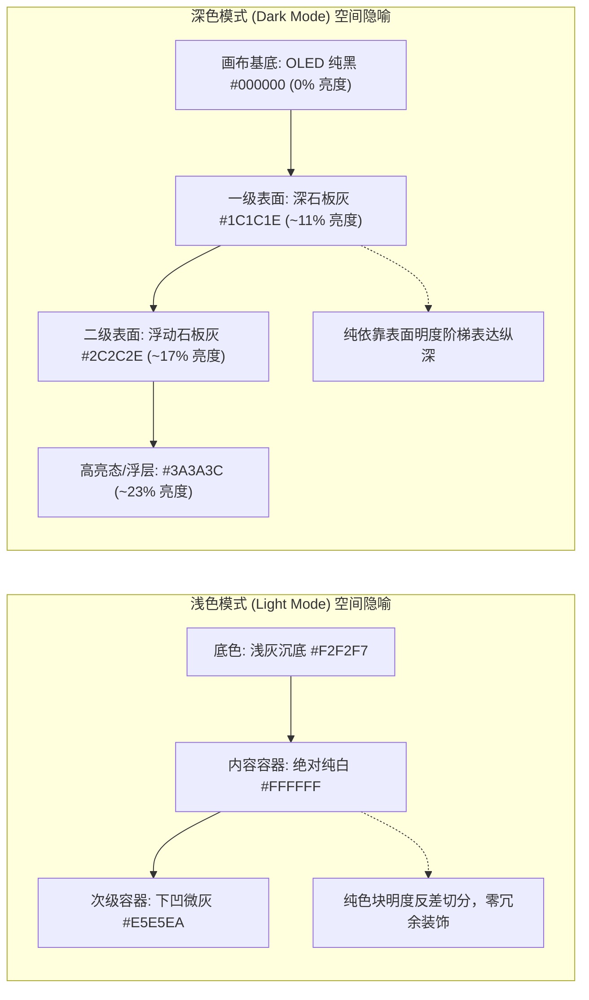
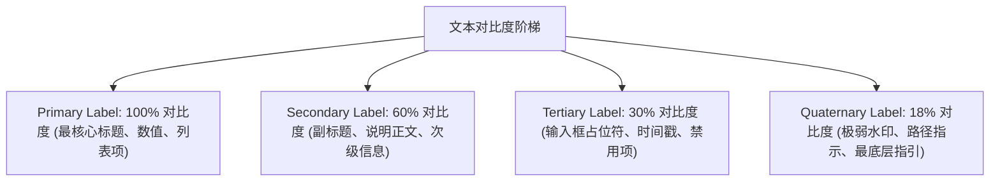

# 现代移动端动态色彩与深浅模式设计规范 (Dynamic Color & Elevation System)

本文档剥离字体字阶、排版布局与特定品牌规范，**纯粹聚焦于高级移动端设计系统在深浅模式（Light / Dark Mode）下的色彩架构、层级递进逻辑与视觉感知哲学**。

本规范提炼自主流旗舰设备（配备高分 OLED 视网膜屏幕）顶尖界面实测采样，旨在为现代移动端应用（包括 Android 原生开发与跨平台工程）提供一套极简、通透、工业级质感的色彩决策基准。

---

## 1. 核心设计哲学：从"静态色值"到"动态语义层级"

高级界面色彩系统绝非简单的"做一套白底界面，再反色做一套黑底界面"，其底层遵循两大空间隐喻公理：



### 1.1 动态语义色（Semantic Colors）的核心原则
- **拒绝硬编码 Hex**：禁止在业务代码中直接写入裸十六进制色值（如直接写死 `#FFFFFF`），必须统一通过语义 Token（如 `bg_canvas`、`surface_card`、`text_primary`、`separator`）调用。同一个语义 Token 在深浅模式下由主题引擎动态解析。
- **环境光适应（Luminance Adaptation）**：浅色模式追求"纸张与实体物理环境的纯净感"；深色模式追求"发光自控感与 OLED 沉浸感"。

---

## 2. 表面层级体系 (Elevation & Surface Hierarchy)

在浅色模式下，界面完全依赖**纯色块明度反差**（浅灰底托底 + 纯白卡片）表达容器边界；在深色模式下，则建立了一套严谨的**表面亮度阶梯（Luminance Stepping）**。

### 2.1 4 级背景表面阶梯映射表

| 语义层级 (Semantic Level) | 浅色模式 (Light) | 深色模式 (Dark) | 典型应用场景与视觉角色 |
|---|---|---|---|
| **Level 0: Canvas Base**<br>`bg_canvas` | `#F2F2F7`<br>$\text{RGB}(242, 242, 247)$ | `#000000`<br>$\text{RGB}(0, 0, 0)$ | **画布基底**。浅色为微暖浅灰，深色为 OLED 纯黑（像素完全熄灭，省电且提供绝对对比度基准）。 |
| **Level 1: Primary Surface**<br>`surface_card` | `#FFFFFF`<br>$\text{RGB}(255, 255, 255)$ | `#1C1C1E`<br>$\text{RGB}(28, 28, 30)$ | **一级卡片容器**。设置列表卡片、看板主卡片、业务条幅卡片。浅色实测为 100% 绝对纯白；深色模式下亮度跃迁约 $11\%$。 |
| **Level 2: Secondary Surface**<br>`surface_subcard` | `#E5E5EA`<br>$\text{RGB}(229, 229, 234)$ | `#2C2C2E`<br>$\text{RGB}(44, 44, 46)$ | **二级嵌套容器/次级操作区**。如卡片内的次要操作胶囊按钮、内置面板。深色亮度提升至约 $17\%$。 |
| **Level 3: Tertiary Surface / Elevated**<br>`surface_elevated` | `#D1D1D6`<br>$\text{RGB}(209, 209, 214)$ | `#3A3A3C`<br>$\text{RGB}(58, 58, 60)$ | **微型部件/激活态底色**。分段选择器滑块轨道、搜索栏输入框底块、高亮按压态。 |

> [!IMPORTANT]
> **深色模式纯色阶递进原理**：
> 在纯黑 `#000000` 画布基底上，层级表达完全依赖**阶梯式提亮色阶（`#000000` → `#1C1C1E` → `#2C2C2E` → `#3A3A3C`）**。
> 视觉上越靠近用户操作视线的容器，表面颜色越亮，形成纯粹依靠明度分层的极简工程骨架。

---

## 3. 文本与前景四级层级体系 (Text & Label Contrast)

系统绝不使用单一的灰色来做副文本，而是定义了 **4 级语义标签体系（Label Hierarchy）**，其底层通过**黑色/白色的不透明度衰减**来实现自适应环境融合。



### 3.1 文本色值与不透明度契约

| 语义角色 | 浅色模式理论值 (Alpha Blend) | 浅色白底实测 Hex | 深色模式理论值 (Alpha Blend) | 深色卡片实测 Hex | 界面视觉职责 |
|---|---|---|---|---|---|
| **`text_primary`** | `#000000` @ 100% | `#000000` | `#FFFFFF` @ 100% | `#FFFFFF` | 页面标题、列表主名称、核心金额与数字 |
| **`text_secondary`** | `#3C3C43` @ 60% | `#3C3C43` / `#8A8A8E` | `#EBEBF5` @ 60% | `#8E8E93` / `#98989D` | 属性说明、次级分类、已选状态文字、副标题 |
| **`text_tertiary`** | `#3C3C43` @ 30% | `#8E8E93` / `#C7C7CC` | `#EBEBF5` @ 30% | `#636366` | 输入框占位提示、未完成辅助说明 |
| **`text_quaternary`** | `#3C3C43` @ 18% | `#D1D1D6` / `#E5E5EA` | `#EBEBF5` @ 18% | `#48484A` | 禁用按钮字、极弱图标占位 |

---

## 4. 动态强调色微调公理 (Dynamic Accent Tints)

很多开发者误以为"品牌的主题色在浅色和深色下应该保持同一色值"，这在视觉感知学中是**严重违背人眼工效学**的做法。

### 4.1 光学明度补偿公理（Optical Luminance Compensation）
- **浅色背景下**：底色高亮（`#FFFFFF`），强调色如果太浅，对比度不足导致文本/图标看不清（无法满足 WCAG 4.5:1 对比度标准），因此浅色强调色必须**降低明度、加深饱和度**；
- **深色背景下**：底色黑暗（`#000000` / `#1C1C1E`），如果继续使用浅色模式的深色，会导致颜色被黑色"吞噬"，视线难以捕获且造成眼部疲劳。因此深色强调色必须**提高明度、提升发光感（Glow）**。

### 4.2 常用系统动态色彩深浅对照表

| 色彩语义名称 | 浅色模式 (Light) | 深色模式 (Dark) | 调色倾向与设计意图 |
|---|---|---|---|
| **`accent_blue`** (核心交互色) | `#007AFF`<br>$\text{RGB}(0, 122, 255)$ | `#0A84FF`<br>$\text{RGB}(10, 132, 255)$ | 深色提亮，R 通道微加，G 通道增加 $10$，形成自发光霓虹蓝 |
| **`accent_green`** (成功/开启态) | `#34C759`<br>$\text{RGB}(52, 199, 89)$ | `#30D158`<br>$\text{RGB}(48, 209, 88)$ | 浅色沉着稳定，深色提高荧光纯度，开关 Toggle 专属 |
| **`accent_red`** (警告/删除态) | `#FF3B30`<br>$\text{RGB}(255, 59, 48)$ | `#FF453A`<br>$\text{RGB}(255, 69, 58)$ | 深色微调 G 与 B，降低刺眼血红色感，提升可读性 |
| **`accent_orange`** (提示/重点) | `#FF9500`<br>$\text{RGB}(255, 149, 0)$| `#FF9F0A`<br>$\text{RGB}(255, 159, 10)$| 深色加入微量绿光成分，呈现更温润的琥珀橙 |
| **`neutral_gray`** (中性基准) | `#8E8E93`<br>$\text{RGB}(142, 142, 147)$ | `#8E8E93`<br>$\text{RGB}(142, 142, 147)$ | 中性绝对锚定点，深浅模式保持同一 Hex |

---

## 5. 分割线、边界与材质发丝线 (Separators & Hairlines)

在高级原生界面中，线框（Border）和分割线（Separator）的处理极其克制，永远是**次级辅助元素**，严禁喧宾夺主。

### 5.1 列表行间分割线（Separator）
- **浅色模式**：
  - 实测色值：`#C6C6C8`（等效于 `#3C3C43` 搭配约 $36\%$ 透明度）；
  - 物理逻辑：它是在纯白卡片表面轻微下沉的灰色凹槽；
  - 缩进逻辑：如果左侧有彩色图标，分割线**绝对不会贯穿全宽**，而是向左缩进 `60dp` 左右（避开图标与间距，仅划在正文文字下方）；在无图标的纯文本列表中，缩进为 `16dp`（对齐卡片内边距）。
- **深色模式**：
  - 实测色值：`#38383A`（等效于 `#545458` 搭配约 $65\%$ 透明度）；
  - 物理逻辑：在 `#1C1C1E` 的灰色卡片上，分割线比背景稍亮，起到隐微的隔断作用，杜绝生硬的纯白实线。

### 5.2 微光发丝轮廓线（Hairline Border）
- 宽度统一为 **1 物理像素**（高密度屏幕上为 `0.33dp` 或 `0.5dp`）；
- 在纯色卡片上，通常直接依靠表面色块交界区分边界；
- 在悬浮弹窗、浮动 Dock 或特殊微光卡片上，深色模式会施加一层极弱的白色发丝线（如 `#FFFFFF` 不透明度 $10\%$），模拟物体在暗光环境中边缘漫反射的光晕。

---

## 6. 典型业务界面的色彩编排实证

这一套色彩逻辑在不同功能界面中展现出高度统一的数学规律：

### 模式 1：模块化分组列表 (Inset Grouped List)
- **浅色编排**：
  - 整体被 `#F2F2F6` 灰底托底；
  - 卡片提亮为 `#FFFFFF` 纯白，与底色形成轻量级反差；
  - 文本使用纯黑 `#000000`；
  - 内部利用色彩饱和度极高的功能图标（红、紫、蓝、橙、绿）作为全页面的**唯一视觉彩色锚点**；
  - 分割线 `#C6C6C8` 精准避开图标，缩进约 `60dp`。
- **深色编排**：
  - 底色降至 OLED 纯黑 `#000000`；
  - 卡片浮起至 `#1C1C1E`；
  - 文本反转为 `#FFFFFF`；
  - 原本高亮的彩色图标在暗色背景下显得格外纯粹，且不改变图标内部色相；
  - 分割线转为微光灰 `#38383A`。

### 模式 2：业务引导看板 (Hero Onboarding Card)
- **浅色编排**：
  - 顶部渐变彩色图标与核心特性强调色（统一蓝色图标）；
  - 按钮层级：主按钮使用饱和蓝 `#007AFF` 填充白字；次级按钮使用 Level 2 表面色 `#E5E5EA` 配蓝字。
- **深色编排**：
  - 主卡片呈现 `#1C1C1E`；
  - 核心特性图标转为深色专用发光蓝 `#0A84FF`；
  - 按钮层级：主按钮使用 `#0A84FF`；次级按钮底色自适应为 Level 2 表面色 `#2C2C2E`，文字继续保持 `#0A84FF`，层级分明且无炫光。

### 模式 3：复合操作详情页 (Detail Editor)
- **多模块复合色彩编排**：
  - 快捷操作按钮：浅色下以独立纯白小卡片 `#FFFFFF` 悬浮于 `#F2F2F7`，图标为 `#007AFF`；深色下以 `#1C1C1E` 灰卡浮于 `#000000`，图标为 `#0A84FF`；
  - 业务开闭状态：Switch 开关开启态在浅色下呈现 `#34C759`，深色下呈现明度更高的 `#30D158`；
  - 底部操作行：直接使用主交互色蓝字，在白卡与深灰卡片上分别取得一致的高可读性。

### 模式 4：纯文本键值信息流 (Key-Value List)
- **纯文本键值信息流色彩控制**：
  - 左侧 Key 名统一采用一级主文本（浅色 `#000000` / 深色 `#FFFFFF`）；
  - 右侧 Value 值与展开指示箭头统一衰减为二级文本（浅色 `#3C3C43` / 深色 `#8E8E93`）；
  - 形成了极度克制、高效的双列信息扫描轨道。

---

## 7. 工业级工程落地：设计系统 Token 映射与代码定义

本套规范支持在现代前端与 Android 原生开发中无缝落地：

### 7.1 Web / CSS 变量规范定义

```css
:root {
  /* 表面层级 */
  --app-bg-canvas: #F2F2F7;
  --app-surface-primary: #FFFFFF;
  --app-surface-secondary: #E5E5EA;
  --app-surface-tertiary: #D1D1D6;

  /* 前景与文字 */
  --app-text-primary: #000000;
  --app-text-secondary: #8A8A8E;
  --app-text-tertiary: #C7C7CC;

  /* 边界与分割线 */
  --app-separator: #C6C6C8;

  /* 动态强调色 */
  --app-accent-blue: #007AFF;
  --app-accent-green: #34C759;
}

@media (prefers-color-scheme: dark) {
  :root {
    /* 表面层级 (亮度阶梯) */
    --app-bg-canvas: #000000;
    --app-surface-primary: #1C1C1E;
    --app-surface-secondary: #2C2C2E;
    --app-surface-tertiary: #3A3A3C;

    /* 前景与文字 */
    --app-text-primary: #FFFFFF;
    --app-text-secondary: #8E8E93;
    --app-text-tertiary: #636366;

    /* 边界与分割线 */
    --app-separator: #38383A;

    /* 动态强调色 (明度提升) */
    --app-accent-blue: #0A84FF;
    --app-accent-green: #30D158;
  }
}
```

### 7.2 Android Jetpack Compose 语义色盘定义 (Kotlin)

```kotlin
package com.example.designsystem.theme

import androidx.compose.runtime.Composable
import androidx.compose.runtime.staticCompositionLocalOf
import androidx.compose.ui.graphics.Color

data class AppColors(
    val bgCanvas: Color,
    val surfacePrimary: Color,
    val surfaceSecondary: Color,
    val textPrimary: Color,
    val textSecondary: Color,
    val separator: Color,
    val accentBlue: Color,
    val accentGreen: Color
)

val LightColors = AppColors(
    bgCanvas = Color(0xFFF2F2F7),
    surfacePrimary = Color(0xFFFFFFFF),
    surfaceSecondary = Color(0xFFE5E5EA),
    textPrimary = Color(0xFF000000),
    textSecondary = Color(0xFF8A8A8E),
    separator = Color(0xFFC6C6C8),
    accentBlue = Color(0xFF007AFF),
    accentGreen = Color(0xFF34C759)
)

val DarkColors = AppColors(
    bgCanvas = Color(0xFF000000),
    surfacePrimary = Color(0xFF1C1C1E),
    surfaceSecondary = Color(0xFF2C2C2E),
    textPrimary = Color(0xFFFFFFFF),
    textSecondary = Color(0xFF8E8E93),
    separator = Color(0xFF38383A),
    accentBlue = Color(0xFF0A84FF),
    accentGreen = Color(0xFF30D158)
)

val LocalAppColors = staticCompositionLocalOf { LightColors }
```

---

## 8. 总结与设计决策速查卡

| 设计维度 | 浅色模式做题思路 | 深色模式做题思路 | 避坑铁律 |
|---|---|---|---|
| **画布底色** | 必须用浅灰（`#F2F2F7`），绝不能直接用白底 | 必须用纯黑（`#000000`），保证 OLED 优势 | 严禁在浅色下直接用纯白做底色铺满 |
| **容器卡片** | 采用绝对纯白（`#FFFFFF`）上浮 | 采用石板灰（`#1C1C1E`）逐级提亮 | 严禁在深色下直接用 `#FFFFFF` 反色或大面积深灰铺底 |
| **深度层级表达** | 浅灰与纯白明度纯色块反差 | 纯依靠表面亮度色阶逐级跃迁 | 严禁添加非必要的渐变或冗余修饰 |
| **文字层级** | 纯黑 `100%` → 灰 `60%` → 淡灰 `30%` | 纯白 `100%` → 灰 `60%` → 暗灰 `30%` | 严禁全文使用单一种灰度 |
| **彩色与按钮** | 使用标准饱和度蓝（`#007AFF`） | 必须提高发光度使用自发光蓝（`#0A84FF`） | 严禁深浅模式硬编码完全相同的 Accent Hex |
