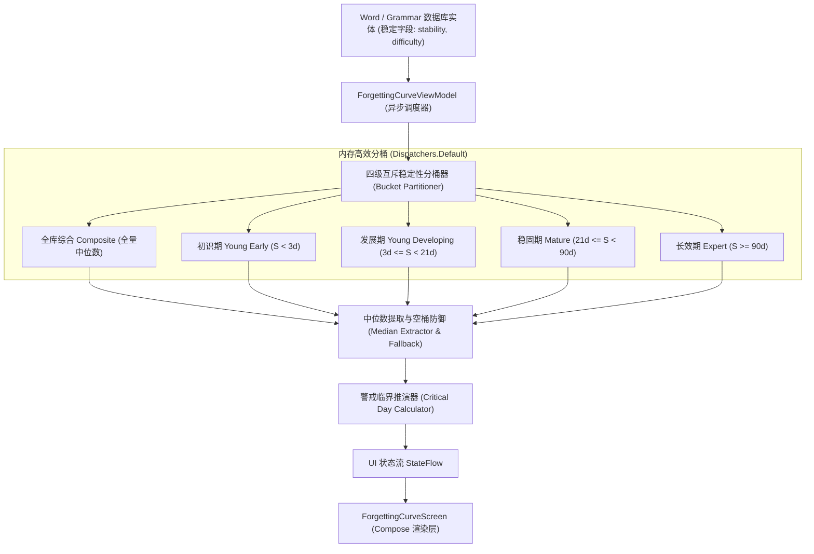

# Nemo 遗忘曲线多维分层与记忆警戒推演技术方案 (v1.0)

> **目标定位**：将统计模块中的静态遗忘曲线升级为具备**科学多维分层**与**动态警戒推演**的交互式“记忆全景沙盘”。  
> **核心原则**：严谨数学闭环、绝对老用户兼容、零数据库破坏、60FPS 高性能离线渲染。

---

## 1. 现状痛点与重构动因

### 1.1 现状分析与“幸存者偏差”
当前 Nemo 遗忘曲线采用单一全库中位数稳定性 $S_{\text{median}}$ 绘制橙色个人曲线：
- **痛点**：对于认真复习的老用户，词库中存在大量复习过数轮的熟词（$S \ge 60$ 天），导致中位数被稳固锚定在 60~70 天高位；
- **感知偏差**：全库曲线在 365 天后依然显示 75% 留存率，用户会产生认知反差（“我昨天刚背的生词，怎么可能一年后还有 75% 留存？”）；
- **静态缺乏指导性**：单纯展示百分比，未能解答用户核心疑问——*“哪批词快忘了？我什么时候必须去复习才不会亏？”*

---

## 2. 总体架构与数据流模型

本方案保持现有数据库表结构零修改，所有分层与推演逻辑均在领域层与表现层通过响应式数据流高效完成：



---

## 3. 详细设计规范

### 3.1 四级分层口径（与记忆全景热力图严格对齐）

为了保持 Nemo 整体统计模块认知模型的统一，分层口径与 `ActivityHeatmapViewModel` 保持 100% 同源：

| 记忆分层阶段 | 判定条件 (天) | 认知生理特征 | 典型曲线形态 (30天留存) | 品牌主题色 |
| :--- | :--- | :--- | :--- | :--- |
| **全库综合** *(默认)* | 全量已学词条 | 用户整体记忆资本的综合中位数 | 约 90% ~ 94% (平缓稳定) | 琥珀橙 `#FF9800` |
| **初识新词** *(Young Early)* | $S < 3.0$ | 刚学 1~2 次，海马体临时印记，极易流失 | **陡峭断崖** (跌至 30%~40%) | 珊瑚红 `#EF4444` |
| **发展巩固** *(Developing)* | $3.0 \le S < 21.0$ | 建立初步神经突触，需定期维持 | 约 70% ~ 80% (中度下倾) | 天际蓝 `#3B82F6` |
| **深度稳固** *(Mature)* | $21.0 \le S < 90.0$ | 进入长时记忆区，抗遗忘力强 | 约 88% ~ 92% (平滑抗阻) | 翡翠绿 `#22C55E` |
| **永久长效** *(Expert)* | $S \ge 90.0$ | 深度固化（如基础假名/核心母词） | 95%+ (近乎平直) | 紫罗兰 `#8B5CF6` |

---

### 3.2 90% 黄金记忆警戒线与反解临界推演

#### 3.2.1 警戒线的数学极简性
在 FSRS 算法体系中，稳定性 $S$ 的原始定义为：
> **“记忆回忆概率 $R$ 衰减至目标留存率 90% 所需经过的时间跨度”**。

即公式必然满足恒等式：
$$R(t = S, S) \equiv 0.90$$

**推论**：
对于任意选定阶段的代表性稳定性 $S_{\text{stage}}$：
- **跌破 90% 警戒线的临界天数，严格等于该阶段的稳定性数值本身**：
  $$T_{\text{critical}} = \text{round}(S_{\text{stage}})$$
- 无需执行复杂的数值反解或二分搜索，计算复杂度为 $O(1)$，绝对稳定无数值溢出风险。

#### 3.2.2 警戒推演卡片文案生成逻辑

```kotlin
fun generateAlertInsight(stage: CurveStage, stability: Float): AlertInsight {
    val days = stability.roundToInt()
    return when {
        days <= 3 -> AlertInsight(
            level = AlertLevel.CRITICAL,
            title = "极速遗忘预警",
            message = "初识词群将在 ${days} 天内跌破 90% 安全线，极易发生记忆滑坡，建议今日完成复习。",
            color = Color(0xFFEF4444)
        )
        days in 4..14 -> AlertInsight(
            level = AlertLevel.WARNING,
            title = "中期稳固窗口",
            message = "发展期词群约在 ${days} 天后进入遗忘加速期，推荐按正常调度推进。",
            color = Color(0xFF3B82F6)
        )
        else -> AlertInsight(
            level = AlertLevel.SAFE,
            title = "记忆壁垒稳固",
            message = "该群组知识已形成长期稳定突触，未来 ${days} 天内仍可保持 90% 以上高回忆率。",
            color = Color(0xFF22C55E)
        )
    }
}
```

---

## 4. 老用户兼容性与稳定性保障

### 4.1 零迁移成本（Zero Schema Changes）
- **数据源**：直接读取现存 `WordEntity` 与 `GrammarEntity` 中的 `stability` 字段；
- **只读计算**：分层与临界推演完全为**纯内存只读变换**，不向数据库回写任何脏数据，彻底隔绝数据损坏风险。

### 4.2 极端边界与冷启动容错矩阵

| 边界场景 | 潜在风险 | 保护与兜底策略 |
| :--- | :--- | :--- |
| **全新注册用户** (词库为空) | 空集合计算中位数报 `NoSuchElementException` | 自动 fallback 至展示艾宾浩斯标准基准线，分层胶囊隐藏或置灰，文案提示“完成首次复习后解锁专属曲线”。 |
| **某分层数量为 0** (如老用户暂无初识新词，或新用户暂无长效词) | 选中该分层时无数据可绘制 | 该阶段胶囊旁展示计数徽标 `(0)` 且不可点击；若强行传入，自动平滑退化显示为“全库综合”。 |
| **单阶段样本过少** (仅 1~2 词) | 中位数偶然性大 | 正常显示实际中位数，并在卡片底部提示“该分群样本较少，随着学习推进将愈发精准”。 |
| **脏数据防御** ($S \le 0$ 或极端异常大值) | 绘制坐标超出画布或除零异常 | 严格经过 `S.coerceIn(0.01f, 36500f)` 钳位清洗。 |

### 4.3 性能防御（60 FPS 渲染）
- **避免重复查询**：`ForgettingCurveViewModel` 在加载时一次性完成 `allStabilities` 的提取，并同时划分出 4 个预计算子列表；
- **切换零开销**：当用户在 `[7天 | 30天 | 90天 | 365天]` 或 `[全库 | 初识 | 稳固]` 之间切换点击时，**耗时 < 1ms**（仅重新计算 7~365 个点的浮点数组），绝对无任何 UI 掉帧或等待转圈。

---

## 5. UI / UX 视觉规范设计

### 5.1 界面布局层次
在保留现有优雅顶栏与时间选择器的基础上，纵向流式编排：

```
+-------------------------------------------------------+
|  <  遗忘曲线                                          |
+-------------------------------------------------------+
|  [ 7天 ]       [ 30天 ]       [ 90天 ]      [ 365天 ] | (时间范围选择)
+-------------------------------------------------------+
|  [🌟全库]  [🔴初识(12)]  [🟡熟悉(45)]  [🟢稳固(180)]  | (阶段多维切换胶囊)
+-------------------------------------------------------+
|                                                       |
|  100% ------------------\                             |
|   90% - - - - - - - - - - - - - - - - - - - (警戒虚线)|
|        \                 \________                    |
|         \                         \_______            |
|   50%    \  (标准线)                     \  (个人线) |
|   0%                                                  |
|       0天          15天          30天                 |
+-------------------------------------------------------+
|  ⚠️ 记忆推演卡片：                                     |
|  “初识词群预计 2 天后跌破 90% 安全线，建议今日复习。”  |
+-------------------------------------------------------+
|  ● 你的学习遗忘曲线      --- 艾宾浩斯标准参考线       |
+-------------------------------------------------------+
```

### 5.2 警戒虚线视觉实现
- 在 Canvas 纵坐标 $Y = 90\%$ 对应高度处，绘制一条半透明金色/浅白虚线；
- 虚线右侧标注微小标签 `90% 警戒阈值`；
- 当个人曲线下穿该虚线时，在交叉点绘制微弱发光的光点锚记。

### 5.3 曲线与面积渐变遮罩色彩联动规范 (Dynamic Theme Tinting)
- **视觉联动机制**：
  图表中的**主折线笔触**、**折线下方的半透明面积渐变遮罩 (Vertical Area Gradient)**、**长按手势探针指示点**以及**底部图例**，完全跟随选中的分层胶囊按钮主题色进行**平滑色彩补间动画 (animateColorAsState)**：
  1. **全库综合 (默认)**：主色调 `#FF9800` (琥珀橙)，面积渐变从 `Color(0xFFFF9800).copy(alpha = 0.35f)` 渐变至透明；
  2. **初识新词 (Young Early)**：主色调 `#EF4444` (珊瑚红)，面积渐变从 `Color(0xFFEF4444).copy(alpha = 0.35f)` 渐变至透明，视觉上突出遗忘断崖的警示感；
  3. **发展巩固 (Developing)**：主色调 `#3B82F6` (天际蓝)，面积渐变从 `Color(0xFF3B82F6).copy(alpha = 0.35f)` 渐变至透明；
  4. **深度稳固 (Mature)**：主色调 `#22C55E` (翡翠绿)，面积渐变从 `Color(0xFF22C55E).copy(alpha = 0.35f)` 渐变至透明；
  5. **永久长效 (Expert)**：主色调 `#8B5CF6` (紫罗兰)，面积渐变从 `Color(0xFF8B5CF6).copy(alpha = 0.35f)` 渐变至透明，营造高阶知识资产的尊贵质感。
- **流畅动效保障**：
  渐变色彩切换采用 `tween(durationMillis = 350, easing = FastOutSlowInEasing)` 插值动画，确保用户点击不同胶囊时，整个图表的氛围色如光影流转般柔和渐变，绝无卡顿与硬切。

---

## 6. 实施演进步骤

- **Step 1（模型与领域逻辑）**：
  在 `ForgettingCurveData.kt` 中扩充 `CurveStage` 枚举及包含各阶段分桶中位数与词数的聚合模型。
- **Step 2（ViewModel 数据分流）**：
  在 `ForgettingCurveViewModel.kt` 中实现四分桶中位数计算与 `AlertInsight` 状态推导。
- **Step 3（UI 胶囊与虚线组件）**：
  在 `ForgettingCurveScreen.kt` 中添加阶段切换胶囊 `CurveStageSelector`、绘制 Canvas 90% 警戒虚线及动态 `CurveAlertCard`。
- **Step 4（自动化测试与回归）**：
  编写针对各种极端样本量（0词、纯新词、纯熟词）的单元测试，确保零崩溃。
