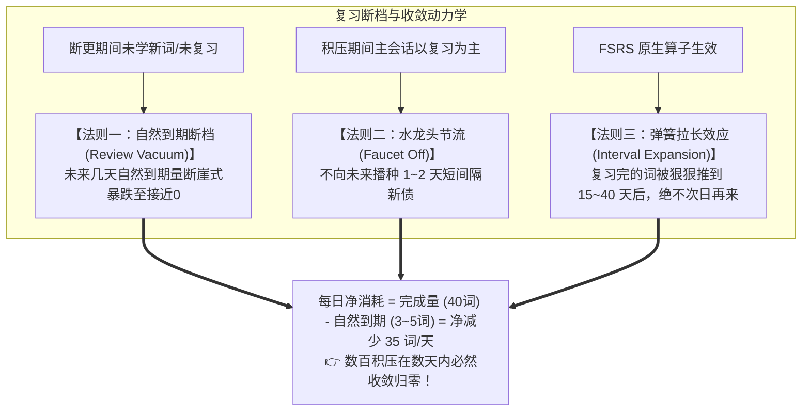
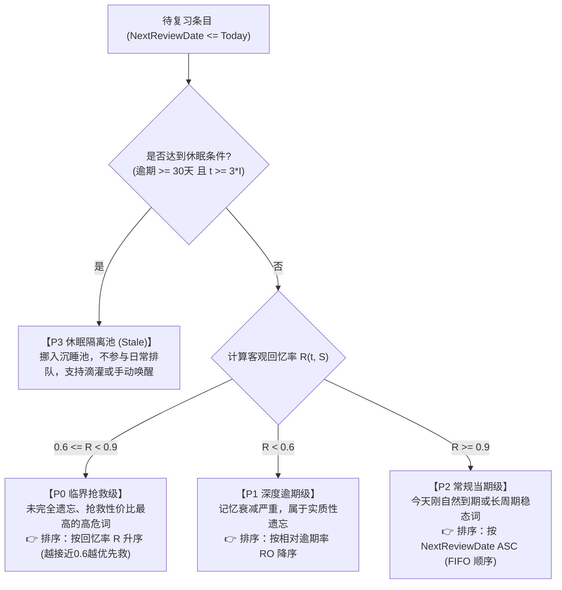
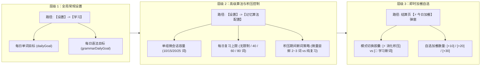

# Nemo 学习积压复习（Backlog Catch-up）深度解决方案 V2.4 (终极完备工业落地级)

> **版本**：2.4 (集大成终极工业落地规范)  
> **核心改进**：
> 1. **系统动力学与防累加数学证明**：从信息流与排期机制上彻底推导“复习断档期（Review Vacuum）”，用具体数字总账证明为何积压绝对不会滚雪球无限累加。
> 2. **三层级用户设置体系**：完整落地全局常规设置、高级记忆算法工作室（复习上限与单组容量）、结算页即时加餐弹窗的三层控制架构。
> 3. **数学与逻辑完全闭环**：彻底摒弃主观拼凑的人工加权，采用 FSRS 官方相对逾期率 $RO$ 与回忆率 $R$ 模型，构建四级互斥穷尽切片，消灭所有逻辑真空与权重归零死锁。
> 4. **零破坏架构落地**：明确 Stale 休眠态为 Domain 内存动态计算，严禁更改 Room 数据表与 Supabase 同步协议；双轨全面支持 `Word` 与 `Grammar` 泛型 `<T>`。

---

## 1. 核心系统动力学推演与防累加数学证明

很多用户面对数百个逾期积压时，最深层的焦虑是：  
**“我每天就算清偿一部分，那明天原本该到期的词不还在来吗？旧债没还完，新债天天加，整体难道不会无限滚雪球累加吗？”**

系统动力学推演明确给出结论：**绝对不会累加，它会在 3~6 天内迅速见底并彻底出清！**

### 1.1 防滚雪球的三大内在物理法则



1. **法则一：复习断档期（Review Vacuum，上游自然断流）**：
   - 明天到期的词，是昨天学习产生的；后天到期的词，是前天学习产生的；
   - 因为用户过去几天断更，既没有学新词，也没有复习老词，**导致用户根本没有向未来的这几天“播种”任何短周期（1天、2天、3天）的复习任务**；
   - 因此，接下来几天内，除了极少数一两个月前排过来的长周期老词外，**每天原本计划自然到期的词量极少（通常每天仅 3~8 个）**。
2. **法则二：水龙头节流（避免新债产生）**：
   - 积压期间，系统每日首组任务默认复习优先，新词不大量灌入，彻底切断了短间隔新债的源头。
3. **法则三：FSRS 弹簧拉长效应（推向遥远未来）**：
   - 逾期词一旦被用户回答“认识（Good/Easy）”，FSRS 根据超长经过时间 $t$ 会赋予其极高的稳定性增益，间隔直接拉长至大半个月甚至数月后，**绝不可能在明天或后天再次冒出来捣乱**。

### 1.2 真实场景数字出清总账推演（以 200 积压词为例）

假设用户断更累积了 **200 个** 逾期词，每天花 6~8 分钟刷 **2 组（共 40 词）**：

| 时间节点 | 早上总待办 | 今日原本自然到期的新词（空窗期） | 今日完成量（2组微会话） | 晚上剩余待办 | 运行状态 |
| :--- | :--- | :--- | :--- | :--- | :--- |
| **第 1 天** | **200 词** | + 8 词 | - 40 词 | **168 词** | 瞬间砍掉 32 词，首组保住连续打卡 |
| **第 2 天** | **168 词** | + 6 词 | - 40 词 | **134 词** | 稳步推进，心理压力骤降 |
| **第 3 天** | **134 词** | + 5 词 | - 40 词 | **99 词** | 积压跌破 100 词大关 |
| **第 4 天** | **99 词** | + 4 词 | - 40 词 | **63 词** | 仅剩最后零头 |
| **第 5 天** | **63 词** | + 3 词 | - 40 词 | **26 词** | 大部分词汇均已回归正常周期 |
| **第 6 天** | **26 词** | + 2 词 | - 28 词（扫尾） | **🎉 0 词** | **积压彻底清零，系统平稳回归稳态** |

---

## 2. 核心机制详细设计

### 机制一：纯客观 FSRS 相对逾期率与四级互斥切片

彻底废除带有主观色彩的人工加权公式（如 $\ln(S+1)$、乘以 $D/10$ 等），仅采用 FSRS 官方与统计学公认的两个核心指标：

1. **客观回忆率 $R(t, S)$**：
   $$R(t, S) = \left(1 + \text{factor} \cdot \frac{t}{S}\right)^{-\text{decay}} \quad (\text{来自 FsrsAlgorithm.kt})$$
2. **相对逾期率（Relative Overdue, $RO$）**：
   $$RO = \frac{t - I}{I} = \frac{\text{实际经过天数} - \text{原计划间隔}}{\text{原计划间隔}}$$
   - 无量纲物理比率：原间隔 1 天的词逾期 2 天，偏离度为 $200\%$（极端严重）；原间隔 90 天的词逾期 2 天，偏离度仅为 $2.2\%$（完全安全）。精准识别“谁是真急，谁是假急”。

#### 四级全域互斥穷尽切片（100% 覆盖，绝无逻辑空洞）：



- **P0 临界抢救级（$0.6 \le R < 0.9$）**：处于遗忘悬崖边上，投入最小认知成本即可拉回记忆，排在复习最前列；
- **P1 深度逾期级（$R < 0.6$）**：遗忘深度较深，按偏离倍数降序稳步推进；
- **P2 常规当期级（$R \ge 0.9$）**：解决刚到期词权重归零的问题，按到期先后自然排队；
- **P3 休眠隔离池**：断更数月的死词隔离，消除数字压迫感。

---

### 机制二：三层级用户设置体系与自定义配置架构

方案不是系统的一言堂硬性派发，而是建立**三层分级控制架构**，给用户全方位的掌控权：



1. **层级 1：全局常规设置（基准保底）**：
   - 位于现有的 `SettingsScreen.kt` 的【学习】板块；
   - 用户的 `dailyGoal`（如 20 词）默认作为每日首组微会话的基准大小。
2. **层级 2：高级记忆算法调校（专业控流与安全红线）**：
   - 位于 `AdvancedLearningSettingsScreen.kt`（记忆算法调校视界）；
   - **单组微会话容量（Session Batch Size）**：允许用户自定义（10 / 15 / 20 / 25 词，默认 20 词）；
   - **每日复习上限（Max Daily Reviews）**：支持【无限制】或设定数值（如 40 / 60 / 80 词），超出部分由系统自动平滑后推，不给用户超负荷压力；
   - **积压期主任务新词策略**：可选【微量尝鲜（17复习+3新词）】或【纯复习优先（20复习）】。
3. **层级 3：即时加餐自选（学完一组后的即时微调）**：
   - 位于每次学完一组后的 `BonusStudyBottomSheet.kt` 弹窗；
   - 快速点击 `+10` / `+20` / `+30`，随背随加，想背多少背多少。

---

### 机制三：微会话保底打卡 + 动态加餐流（还债主轴）

1. **首组微会话（3~4 分钟极低门槛）**：
   - 打开应用，系统只排 **1 组微会话（默认 15~20 词）**；
   - 优先填入 **P2 当期词** 并穿插 **P0 紧急抢救词**；
   - **做完该组，立即点亮今日打卡（Streak+1）！** 心理破窗被彻底修复。
2. **加餐模式双向自主选择（绝不绑架用户）**：
   - 结算页呼出加餐弹窗，提供模式切换：
     - `[⚡ 消化积压 (推荐)]`：继续调取积压词推进清零；
     - `[🌱 学习新词]`：**用户今天就想学新词？没问题！** 轻轻一点即可切至新词通道，加载 10~20 个新单词，杜绝“老词没背完不给学新词”的恶劣体验。

---

### 机制四：Stale（失活卡）纯内存动态计算与 FSRS 原生回流

严禁改动数据库架构，100% 走纯 Domain 层计算与原生步进：

1. **纯内存动态计算准入**：
   ```kotlin
   fun <T : SrsItem> isItemStale(item: T, today: Long): Boolean {
       val lastDate = item.lastReviewedDate ?: item.firstLearnedDate ?: return false
       val overdueDays = today - item.nextReviewDate
       val interval = item.interval
       return overdueDays >= 30 && overdueDays >= (3 * interval)
   }
   ```
   - 仅在内存中动态判定，**不在 Room 数据库与 Supabase 中增加 `is_stale` 物理列**，规避全部数据库 Migration 与多端同步冲突。
2. **透明化监控与平滑滴灌**：
   - 词库看板显示：`😴 休眠单词：40 词`，并提供【唤醒一组】手动入口；
   - 调度器每天向队列注入 3~5 词，或由用户主动一键唤醒。
3. **FSRS 6 原生调度保证**：
   - 用户回答认识（Good/Easy）$\implies$ 原生获得超大稳定性飞跃，大幅推后；
   - 用户回答忘记（Again）$\implies$ 原生进入遗忘重学步长，历史数据与轮次完好保留。

---

### 机制五：单组微会话 300 秒平滑熔断与作弊防护

- **300 秒平滑超时（保护做题沉浸感）**：
  - 当会话计时 $T \ge 300$ 秒时，系统**不强行弹窗打断**用户；
  - 待用户完成当前题目的评分操作后，平滑流转至结算页，温和提示：`本组学习已达 5 分钟，稍作休息或继续加餐`。
- **有效作答防作弊（Streak 保底准则）**：
  - 判定“完成本组微会话并达成今日打卡”必须同时满足：
    $$\text{本组有效去重作答词数 } N_{\text{unique}} \ge 5$$
  - 防止打开应用纯挂机 5 分钟刷连续打卡天数。
- **进度去重计数**：
  - 答错（Again）重现的卡片不重复计入进度条，进度条清晰展示物理词数：`已复习 14/20 词`。

---

## 3. 技术实施方案与代码映射（全域泛型支持）

### 1. `SettingsRepository.kt` & DataStore 契约扩展
```kotlin
// 单组微会话容量 (默认 20, 范围 10..30)
val sessionBatchSizeFlow: Flow<Int>
suspend fun setSessionBatchSize(size: Int)

// 每日复习上限 (0 表示不限制, 默认 0)
val maxDailyReviewsFlow: Flow<Int>
suspend fun setMaxDailyReviews(limit: Int)
```

### 2. `LearningSessionPolicy.kt` 泛型策略层
```kotlin
// 计算客观回忆率
fun <T : SrsItem> calculateRetrievability(item: T, today: Long): Float

// 计算相对逾期率
fun <T : SrsItem> calculateRelativeOverdue(item: T, today: Long): Float

// 四级互斥切片分流
fun <T : SrsItem> partitionOverdueItems(items: List<T>, today: Long): OverduePartition<T>
```

### 3. `SessionLoader.kt` 会话组装层
- 升级 `loadSession`，在加载复习条目时：
  1. 调用 `partitionOverdueItems` 获取 P0、P1、P2 和 P3；
  2. 首组主会话取前 `sessionBatchSize` 个词（按比例穿插 P2 当期词与 P0 抢救词）；
  3. 将 P3 暂时隔离至待唤醒队列。

### 4. `LearningViewModel.kt` 与 `BonusStudyBottomSheet.kt`
- 扩展加餐枚举与模式选择：
  ```kotlin
  enum class BonusMode {
      ReviewBacklog, // 消化积压
      NewItems       // 学习新内容
  }
  
  data class StartBonusLearning(
      val count: Int,
      val bonusMode: BonusMode = BonusMode.ReviewBacklog,
      val mode: LearningMode = LearningMode.Word
  ) : LearningEvent
  ```
- `BonusStudyBottomSheet` 升级：引入模式切换 Choice Chips，支持用户自由选择加餐内容。

---

## 4. 实施阶段与检验标准

1. **第一阶段：策略算法单测验证**：
   - 编写 `LearningSessionPolicyTest`，针对不同 $R$、$S$、$I$ 的样本进行四级切片测试，验证 100% 互斥穷尽与排序正确性。
2. **第二阶段：设置项与数据持久化**：
   - 扩展 DataStore 与 SettingsViewModel，在 `AdvancedLearningSettingsScreen` 中渲染“每日复习上限”与“单组容量”配置卡片。
3. **第三阶段：加餐 UI 与微会话闭环联调**：
   - 验证加餐双模式切换、300 秒平滑超时与有效防作弊打卡联动。
